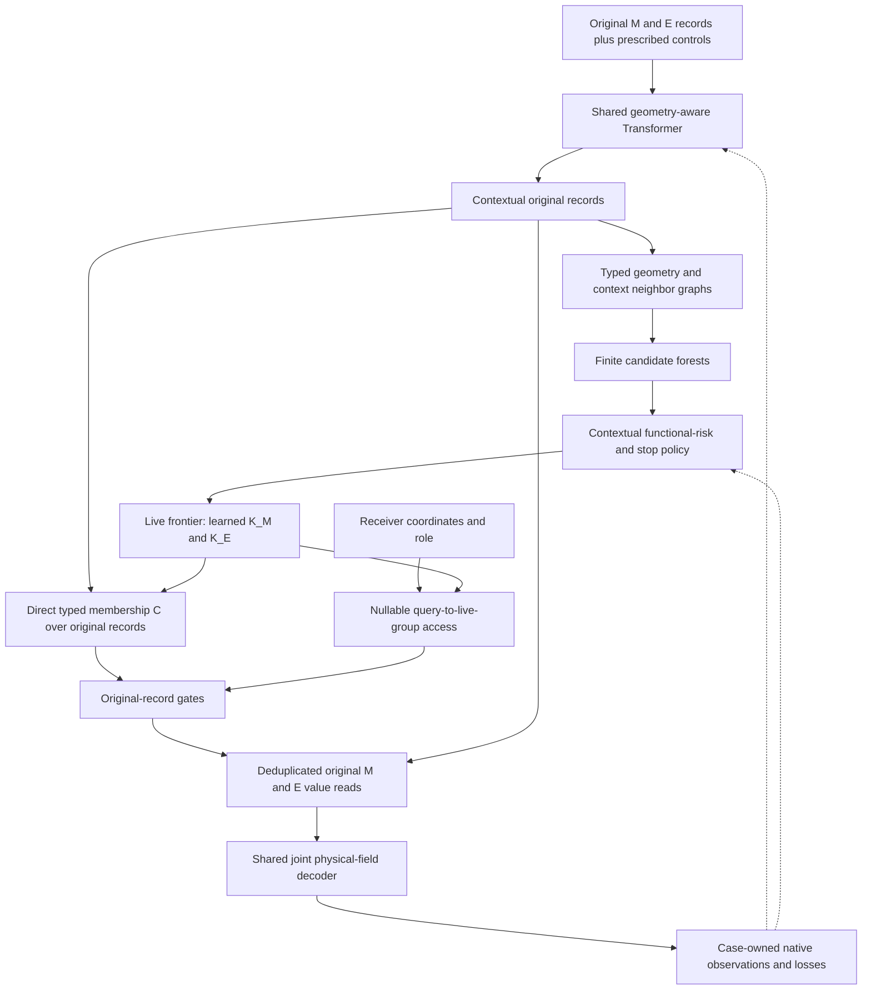
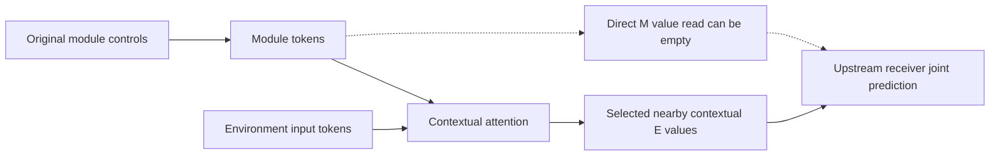

# Round 12-2 — Transformer-context adaptive hypergraph organization for a joint physical neural field

**Prepared:** 24 October 2026. **Status:** original design, authorized implementation/qualification in Section19, and completed matched first100 scientific screen in Section20. The measured decision is zero full-data candidates: real smaller frontiers collapse to roots without selective local access. **Original design checkout:** `agent/honf-core-next`, `b871877`, with unrelated workspace changes preserved. **Scope:** one general HONF organization capability, initially qualified and screened on existing ThermalChannel data. Existing U-H, scratch v1, soft-only v2, controls and historical failures remain immutable scientific lineages.

The proposed model lets a jointly learned physical field organize its Transformer-contextualized records into reusable retrieval groups. Candidate relationships depend on contextual function as well as geometry; a reversible learned frontier determines the actual number of groups; each receiver reads a structured subset of original values. An upstream receiver may use only nearby E values in its final read when those contextual values suffice. Original physical records, controls and identities remain available throughout.

The general core will not impose the current Thermal-specific separation between heat-independent flow and an exactly affine temperature operator. Prescribed physical controls, including each module's heating, may enter its own record before shared attention. One shared decoder representation predicts the physical channels jointly. E values may consequently carry module/control information acquired through attention. Explicit source-resolved E response factors are not required by this architecture. Original-source responses remain measurable through full-model Jacobians and finite changes, but exact heat superposition and heat-independent routing cease to be universal architectural promises.

This is a deliberate new model and input capability, not an output-only continuation or a compatible resume of U-H/v2. The former affine implementation remains protected and loadable. Thermal-specific laws may be useful case losses or reference tests under their stated assumptions; they must not silently become requirements of every HONF problem.

## 1. Objective, interpretation and non-goals

The scientific question is whether contextual records can generate a scene-dependent, reusable organization that preserves useful physical fields and responses while allowing receivers to avoid indiscriminate final access. Group count, receiver support, actual executed values, memory, complete runtime and design decisions are separate outcomes. A useful routing hypergraph need not replace individual record values with pooled latent field values. A smaller count alone is insufficient, and preserving fine values is not itself an architectural failure.

The intended design chain is physical records and operating inputs → shared Transformer exchanges → contextual candidate forest → learned group frontier → typed receiver-to-group access → selected original values → joint physical field → case-owned native observables. Only prescribed inputs may generate organization. Targets, reference errors, validation outcomes and optimizer diagnostics never become inference features.

“E-only retrieval” means zero direct M information/value rows for that receiver outside any declared local protection, with positive E access. It does not mean independence from modules: E states and organization controls can already depend on M through the encoder. Nor does it mean the full encoder read only local information. Show the final read graph, contextual dependency graph and control-plane work separately.

The original design-only task wrote this plan without changing active runs or launching experiments. The subsequent explicit execution authorization and completed paired quarter-data screen are recorded in Sections19–20. Historical source laws, running output settings and protected checkpoints remain intact. No full-data candidate, new inverse generator, Wind/HET-MF experiment, new physical solve or new dataset was launched by this screen.

### 1.1 Execution-first development and proportionate safeguards

Default-deny applies to new defensive infrastructure: do not add cryptographic hashes, contract-freeze workflows, baseline snapshots or blocking gates by default. Reuse Git history, ordinary versioned run configs, existing dataset manifests and record IDs, typed interfaces, atomic checkpoint writes and focused standard tests. Existing historical hashes in Section2 and the existing manifest identity in Section12 remain references, not instructions to build another fingerprint or snapshot system. J-D is an executed scientific control, not a software-baseline snapshot.

A proposed new defensive mechanism must first name a concrete failure scenario and demonstrate why applicable standard primitives are structurally insufficient. Generic concerns about reproducibility, possible future misuse or confidence do not meet that burden. This plan establishes no such insufficiency and therefore proposes no new mechanism. Preserve existing security, checkpoint-loading, TEST/data-access, storage, job-ownership and repository artifact protections; simplification does not authorize deleting, bypassing or diluting them.

Place new blocking gates only at irreversible state changes, cross-system mutations, critical security perimeters or formal production releases. Local design reviews, heuristic risk estimates, graph diagnostics and research reporting bands are advisory evidence, not approval gates. Invalid computations still use normal exceptions and maintained recovery; existing resource ceilings remain operating limits, without a new admission framework. Continue independent executable work when a nonessential diagnostic is unavailable and report the limitation.

Use actual prepare/decode execution, backward passes, save/reload and existing physical-reference measurements. Pre-flight assertions, schema inspections, projected timings and fixtures cannot substitute for empirical results. Reuse existing tests and add only changed-behavior coverage; avoid a separate validator framework or duplicated test matrices. The stage table is a work order, not a sequence of administrative approvals. This revision starts no training or solver work.

## 2. Evidence and current progress at the review boundary

### 2.1 Historical results that motivate the design

| Lineage | Verified useful result | Boundary retained in Round12-2 |
| --- | --- | --- |
| Run1404 | Six latent groups control fine query–module reads; direct hyperedge-value context is disabled. | Fixed six is an architectural capacity choice; useful routing does not establish six necessary mechanisms. Fine values may legitimately remain record-resolved. |
| Dense1804 and 180X | Strong dense baseline; regional/support experiments demonstrate exploitable structure. Regional1806 reduces environmental reads from192 to48 with competitive mature reconstruction. | Dense1804 is a baseline, not the proposed HONF organizer. Sparse per-query access and a small reusable group dictionary are different properties. |
| A2-D | Geometry-carrying Transformer context and direct original-source reads; formal Thermal field gains coexist with v/p and tail misses. | D has no compact content bank. Its affine heat contract is a case-specific restriction, not a general HONF definition. |
| U-H e1000 | Applied contextual incidence and composed group retrieval; native VAL89 fluid-T mean RMSE0.394110 versus U-D0.510812. | This is a completed checkpoint-specific comparison, not current-worker progress, causal attribution or completed5000 evidence. |
| Original Round12 R1 local100 | Candidate/policy/cut implementation executed, but accepted no pairs. | K=N; its selected-best80 is a singleton predictor reference. |
| Amended compact local100 | E192→96; actual K<N; the same terminal checkpoint passes four global temperature/peak preservation bands and useful heat-response checks. | All E siblings accepted and all M siblings rejected; geometry/mixed-response and candidate-ranking limitations remain. Dense final values still execute at100%. |
| Scratch tie-stop v1 | Fresh initialization; clean stop at467 with full recoverable history. | Its epoch40 cut accepted neither bank. Do not transfer amended inherited-run E contraction to this scratch run. |
| Soft-only scratch v2 | Joint predictor/policy optimization without a hard cut, bankwise calibration and existing-reference geometry supervision. | Still uses the old affine Thermal physics factorization; joint optimization does not mean a joint physical-field architecture. K=N by design. Saved progress and routine validation are not compact-model or terminal-response qualification. |

The compact100 predictor/response/cost and negative decision findings are consolidated in [R12]. In particular, objective Spearman correlation is−0.257143 and feasible regret0.524815 on the saved candidate pool; this is not reliable inverse design. No result from that checkpoint establishes a v2 result or a joint-field Round12-2 result.

The newer24 October organizer supplement in [R12] additionally fixes U-H `epoch_2500_model.pt`, SHA256 `854b8fddf2b67705f8f4a75235d99db35b6a87ab07a251552a8f379271ed9bff`, beside1404 e2500 and a separately labelled1404 e5000 reference. On four input-selected exposed layouts with512 geometry-fixed probes each, U-H retains195–202 native groups and7.38–12.11% positive membership. In0692/M10 its displayed M:3 group includes all10 M/192 E records, whereas E:53 includes2 M/9 E records. Applied EE incidence has34441/36864 positive relations in cycle1 and1978/36864 in cycle2. These are ordered stages of one forward, not a training sparsification curve. This strengthens the evidence for real broad/local contextual organization and the group-union issue; it adds no new native-field,source-response,compactness,decision or runtime qualification. The e1000 adaptation parent and e2500 organizer evidence remain distinct.

### 2.2 One current saved-state inspection, not monitoring

At **2026-10-24 16:55:51 UTC**, the maintained trusted checkpoint loader opened each v2 alias once on CPU. Latest and selected-best both identified epoch990 and990 history rows. Latest SHA256 was `1ebf90b676f85f645a97714b092d3bb2460fbbefd0c42095467e5b4a1fdc5ae5`; best-container SHA256 was `ab051db8963a358d07989bbbaa219c21500c603111cc703ea8eca7307018e68e`. Different container hashes are not evidence of different weights. No inference, CUDA initialization, optimizer action, job/log polling or new evaluation campaign was performed for this inspection.

| Saved v2 epoch990 observation | Value / meaning |
| --- | --- |
| Phase | `soft_only`; cut=false; policy_frozen=false; K=N by contract |
| Primary work |594000 case visits;12870 optimizer updates |
| Additional response work |3217 microbatches;6434 scene visits;3255344 supervised receiver rows |
| Completed calibrations / organizer reviews |1/100/200;100/300/600 |
| Routine exposed VAL89 field score |0.0027332804; sampled native receivers |
| Routine fluid/surface/material T mean RMSE |0.393876 /0.333035 /0.345940, native dataset units |
| Routine q-proxy mean RMSE |1.106160 |

The evaluation inventory at that boundary contained organizer100/300/600 and milestone validation100–900, without a terminal native/response result. The [local inspection receipt](../diagnostics/round12_2_design_20261024/v2_progress_snapshot.json) fixes this dated observation. Training may subsequently advance; do not update its status by assumption. A later executor should read already-produced terminal results once they exist, retain their explicit checkpoint identity, and avoid redundant campaigns.

The earlier fixed epoch800 CPU probe remains separate: SHA256 `82fc83bdb942870923e3ffc2b8aa433601f1feb42b838e1c459134d546f26a27`, four input-selected TRAIN cases0003/0048/0138/0228,10 M and384 E candidates. Mean probabilities were0.10072 M/0.999993 E; normalized C-row differences averaged4.18e−4/1.20e−7. One correctly isolated TRAIN0048 intervention gave zero measured E-sharing change in CPU FP32, while M-sharing prediction-change/native-RMSE ratios were1.235/0.910/0.637/0.765 for fluid/surface/material T/peak. This is one pair per bank in one scene, not full candidate coverage, physical causality, compression, or epoch990 organization evidence. Retained numerical evidence is in [V2-800].

### 2.3 Code-review findings and targeted implementation work

The v2 `_pair_logits` consumes raw child features, symmetric pair geometry and prescribed operating features, not final contextual states or actual functional signatures. Its same-type lexicographic adjacent candidates are single-level and cannot discover arbitrary contextual neighbors. The local-record transform removes E nearest-module distance/occupancy and operating module count/density; fixed-input E policy therefore cannot change grouping under module translations, although contextual descriptors, C and query access still change.

`UnifiedPreparationMixin` reuses actual last-cycle applied incidence for native U-H, with retrieval identity distinguished from contextual self-exclusion. Compact Level R instead constructs a new C from live controls; it does not literally reuse the encoder's membership matrix. Dense contextual scoring and value preparation remain. These are different applied representations, not interchangeable drawings of one adjacency.

The current scoped `full_shared` branch in `compact.py` starts from unblended singleton descriptors and substitutes the selected pair, so unselected pairs lose their ordinary learned blend. Existing tests of unchanged IDs/K/logits do not catch this. Correct the intervention when implementing or using sharing probes, with a focused regression test for unchanged unselected descriptors; joint-head and candidate implementation can proceed independently. Until corrected, do not use historical single-pair pass/fail or stability as acceptance evidence. The normal learned training branch is separate. Recompute membership and downstream query normalization after substituting only selected descriptors; assert unchanged unselected descriptors and rows, then exact restoration. Preserve original reports and identify corrected measurements in ordinary result history.

## 3. Requirements and generality boundary

| Required invariant | Selected treatment |
| --- | --- |
| Physical ownership | Keep original IDs, types, coordinates, measures, presence, values and prescribed controls. Groups own retrieval controls, not replacement physical objects. |
| Joint physical learning | Shared context, shared query representation and shared multi-channel decoder; no universal flow/temperature causal separation. |
| Valid information | Original local inputs and genuine attention exchanges; no target/error-dependent routes or undeclared pooled global value bypass. |
| Contextual policy | Final contextual states, contextual relation statistics and geometry may inform candidates, stopping and retrieval. |
| Adaptive organization | Scene-dependent membership and a learned discrete frontier; K is neither six nor permanently N. |
| Query consistency | Organization prepared independently of requested query order, subset or chunking; one scene organization reused across receiver roles. |
| Native physical outputs | Case adapter owns channels, units, masks, interface/material receivers, observable operators and losses. |
| Physical responses | Preserve input identity and measure complete response to original controls; do not assume an affine law in the new core. |
| Legacy behavior | Existing schemas/configs/loaders, old affine-factor application and active runs remain unchanged. |

The new input capability is provisionally `joint_physical_records_context_v1`. The core accepts generic typed record features and prescribed control features; Thermal places each module's own normalized heating in that module record. Normalization is fitted only on the selected TRAIN cohort. No total-heating/global-layout neural summary is broadcast as a substitute for attention. Retain the current exclusion of hand-engineered E occupancy/count shortcuts, while explicitly permitting E to learn module/control information through the actual M↔E exchanges. This changes the current input-only E *policy* contract and must be serialized as such.

Shared latent state permits learned multiphysics interaction; it is not a PDE solver or a guarantee of physical coupling fidelity. Likewise, separate final output columns are normal multi-output prediction, not independent physical encoders. Case-owned operators such as native curl and q-proxy may impose useful consistency without splitting the core into independent physics predictors.

Unknown physical fields are not supplied as inputs. The initial joint model learns their coupled mapping through common contextual/query states and gradients from all native outputs; it does not claim an explicit iterative PDE solve or force fictitious coupling into the simplified Thermal references. Retaining or losing the old exact-law guarantees is a measurable tradeoff, not a claim that architectural generality automatically improves this dataset's accuracy.

### 3.1 Design clarification: joint physics removes an affine-path restriction, not the information requirement

The user's objection is accepted as a core design correction: the origin of a supervised quantity does not justify a universal separation of temperature learning from flow learning. The old Thermal architecture solves a restricted case by construction: geometry/operating inputs prepare heat-independent flow and an original-source-resolved linear temperature operator, and heat is applied afterward. Under that contract, a final reader that discards M must obtain the missing heat coefficients through another explicit route. That requirement belongs to the old factorization; it is not a definition of an HONF environment record or a general condition for E-only prediction. Preserve the historical implementation as a useful structured reference rather than exporting its assumptions into the new core.

For general prescribed controls $b=(h,\ldots)$ and physical records $X$, the selected model is

$$
Z=\operatorname{Enc}_{\theta}(X,b),\qquad
\widehat{\mathbf F}(q)=\operatorname{Dec}_{\theta}\!\left(q,\operatorname{Read}_{\theta}(q,Z,\mathcal H_{\theta}(Z,X))\right),\qquad
\mathbf F=(u,v,p,T,\ldots).
$$

All unknown fields are outputs of a shared physical representation. Separate output coordinates, unit-dependent loss scales and case-owned observable operators remain appropriate; separate universal causal pathways or a prescribed heat-affine decoder do not. No ground-truth field is fed to the encoder, and a shared multi-output trunk is not evidence that the network has learned correct cross-field coupling. In a genuinely coupled case, that claim needs references in which relevant controls alter several fields; the simplified Thermal case cannot establish general buoyancy or other absent coupling.

The present implementation provides implicit coupling through shared contextual/query states and joint gradients. It does not explicitly iterate estimated velocity, temperature or other field-state tokens, and should not be described as doing so. Generality also does not require identical receiver support or an identical final projection for every physical channel: different fields may require different spatial information while reusing the same organization and contextual records. The initial shared reader/head is a controlled baseline. Introduce field-conditioned reading or iterative latent field exchange only if a later measured coupled-physics failure justifies that separately named change; no such extension is part of the current training recipe.

At a fixed legal topology, an E-only output may retain source sensitivity through ordinary context:

$$
\frac{\partial\widehat{\mathbf F}(q)}{\partial h_i}
=\frac{\partial\widehat{\mathbf F}}{\partial Z_E^{\rm read}}
\frac{\partial Z_E^{\rm read}}{\partial h_i}
+\left.\frac{\partial\widehat{\mathbf F}}{\partial h_i}\right|_{\rm organization/access},
\qquad Z_E=\operatorname{Enc}_{E,\theta}(X_M(h),X_E,b_{\setminus h}).
$$

The second term includes changes of contextual memberships, descriptors and query access; discrete graph/frontier changes require separate finite probes. Thus no explicit E-by-source coefficient table is necessary. Immutable original input columns still identify which module was changed and permit full-model AD/finite-difference validation; retaining these identities does not require allocating one response-factor column per source inside every E value. Changing controls invalidates prepared context and organization, so the old exactly reusable affine response cache is deliberately relinquished.

This requires changing the information path, not merely concatenating outputs or giving the old branches a common final head. If heat remains absent from the contextual inputs and reaches prediction only after retrieval through a separate affine application, removing the coefficient route would remove the source dependence rather than solve it. Conversely, prescribed heat entering the original records is a valid control input; supplying an unknown target temperature or reference flow as if it were available at inference would be leakage. Keep this distinction explicit in adapters and qualifications.

There remains a capacity question: the selected E states and routing controls must carry the response information needed in the proposed query region. At a fixed topology and with all relevant paths collected in $R_E$, the local derivative factorization $J_{F,h}=J_{F,R_E}J_{R_E,h}$ has rank at most $\dim R_E$. Reading a few finite-dimensional states therefore does not guarantee arbitrary independent-source responses everywhere. This is a conditional information bound, not a demand that latent channels reproduce the original source-column count: useful regional responses may have much lower effective rank, and different queries may select different states. Functional intervention, field errors and original-control response tests decide sufficiency; neither architectural sharing nor sparse access alone decides it.

Accordingly, the universal core owns joint contextual information exchange and structured original-record retrieval. The case adapter owns physical units, masks, boundary controls, conservation/constitutive tests and any justified problem-specific penalties. Preserve known Thermal heat-linearity and heat-independent-flow references as accuracy tests, while reporting any loss of those properties rather than baking them into all future HONF tasks. Joint training can suffer gradient competition or use spurious shortcuts and need not improve this simplified dataset. Likewise, E-only final retrieval still includes the earlier M-to-E encoder work and does not imply source independence, causality, compression or end-to-end acceleration.

| Question | U-H / soft-only v2 restricted Thermal path | Round12-2 joint physical path |
| --- | --- | --- |
| When prescribed heat is used | Applied to a prepared original-source response operator | Enters each original M record before contextual attention |
| What distinguishes M/E | Record roles, plus the restrictions inherited from the affine heat path | Physical record roles only; neither bank is assigned to a particular output field |
| What an E-only query needs | An explicit compatible route for the otherwise absent source response | Sufficient learned E context and routing; no mandatory coefficient-table representation |
| What original source identity guarantees | Correspondence of affine columns to physical modules | Correspondence of prescribed input axes and measured complete-model responses to physical modules |
| What heat changes invalidate | The old contract permits exact linear application from fixed preparation | Context, candidate forest/frontier and query access may change; complete preparation is required |
| What is exact by architecture | Case-specific heat superposition and heat-independent flow | Joint mapping and record identity; physical response laws require measurement |

Contextual policies may now react to moving modules even when raw E coordinates and boundary features remain fixed, because $Z_E$ changes through attention. That removes the old input-only E policy's layout-independence, but does not guarantee that the learned E groups will be selective or that M will coarsen. Similarly, geometry-response improvement requires correct spatial sensitivity, receiver correspondence and sufficiently informative supervision; replacing an affine head alone cannot supply those. Report candidate coverage, functional sharing changes and native/response failures to distinguish capacity, optimization and organization problems.

## 4. Selected architecture and alternatives

Select **contextual typed candidate forests with a reversible learned frontier, direct typed group membership, and nullable local retrieval**. Keep the maintained two Transformer contextual cycles and original value readers initially. Add one genuinely joint physical-field head and preserve the existing engine/native observation interface. Do not simultaneously replace the encoder with a group-factorized Level U operator.

| Alternative | Benefit | Reason not selected as the initial implementation |
| --- | --- | --- |
| Fixed small latent slots | Simple learned dictionary | Prescribes the capacity that motivated this round. |
| Keep one group per record and learn zeros | Strong U-H continuity | Does not learn the organizational axis length. |
| Unrestricted contextual clustering / general set partition | Very flexible grouping | Expensive combinatorics, difficult reproducibility and weak bounded implementation scope. |
| Contextual binary forest + learned frontier | Variable K, exact cover/lineage, reversible split/coarsen, finite candidates | Selected; restricted to one contextual hierarchy, with topology seams and no global optimality guarantee. |
| Require explicit E×source response factors | Retains the legacy affine heat law with E-only final reads | Unnecessary for the selected general joint-field architecture; would import a Thermal-specific restriction. |

Figure1. Proposed model, not an executed result. M and E refer to generic module/environment record roles. Group controls summarize context; actual values remain individually indexed. The shared field decoder receives whatever typed records the query selects, including an empty M set when permitted.

## 5. Shared Transformer and joint field

Let each record be $r_i=(\mathrm{id}_i,\tau_i,x_i,\mu_i,s_i,u_i)$, where $u_i$ contains prescribed controls and $s_i$ contains other physical inputs. Let $X$ denote the complete physical-input inventory, including controls; reserve $q$ for a receiver. Use the current dimension128, four heads and two ordered typed cycles as the initial engineering baseline:

$$
z_i^{(0)}=E_{\tau_i}(s_i,u_i,\gamma(x_i),c),\qquad
Z=\operatorname{Transformer}_{\theta}(\{z_i^{(0)}\},X).
$$

The contextual order remains MM→EM→EE→ME, destination named first. Attention uses the maintained physical measures, masks, geometric features and empty-row rules. Keep U-H's applied contextual incidence initially, so relationship learning still affects actual messages. Record the source-state version of every stage; a collection of sequential stages is not one simultaneous physical adjacency. Operating conditions remain legitimate inputs; undeclared learned global-summary broadcasts remain absent.

The generic query computation is

$$
\widehat F(q;X)=D_{\theta}\!\left(z_q,c_E(q;Z,G),c_M(q;Z,G),c_{\mathrm{local}}(q;Z)\right).
$$

Use one shared fusion trunk and a joint output vector. For the initial Thermal adapter, predict primitive $(u,v,p,T)$ from that trunk and retain the maintained native curl and temperature-derived observation operators. The generic core must not contain channel names, an independent frozen flow predictor, a mandatory affine heat head or a rule that temperature cannot influence the shared representation. Independent material/surface field readers are not added as a hidden all-source escape path.

The E→query→M ordering may be retained as a receiver-fusion implementation: $c_E$ conditions the query used for optional M reads. It is an information-routing order, not an assertion of a one-way physical causation between temperature and flow.

## 6. Contextual candidate generation

### 6.1 A query-independent bounded graph

Build separate M and E candidate graphs from present original records after Transformer preparation. The initial neighbor inventory is the symmetric union of four spatial neighbors and four cosine-context neighbors per record, clipped to the available count. Context distance uses normalized final128-wide states. Use geometry-normalized distance plus $(1-\cos(z_i,z_j))$ with equal fixed contributions as the initial candidate cost; record both components rather than fitting a similarity threshold to VAL errors. A deterministic spatial spanning tree connects disconnected components. All geometry and context distance work is counted; a cheap N² candidate-distance computation is not a retired native retrieval directory and is not free.

Neighbor selection and graph/tree indexing are discrete, detached operations. They regenerate from current inputs/weights at preparation; the surviving neural scores and node descriptors remain differentiable. Tie ordering uses immutable original IDs after physical distance/context ties, never padded row order. Record ties, graph changes and finite geometry/control seam crossings. No claim of global smoothness or unrestricted clustering is made.

### 6.2 A contextual hierarchy with finite capacity

Kruskal-style ascending graph-edge unions produce one binary hierarchy per nonempty type. Every original record is a leaf; an internal candidate is the union of two child ancestry sets. A bank of $N_B$ records has at most $2N_B-1$ candidates. This admits multi-level and context-nominated merges beyond the current one-pass adjacent pairs. It still restricts the possible partitions to that hierarchy. Do not describe the learned cut as globally optimal clustering.

Do not replace physical records with parent records. Store node ID, child IDs, original ancestry IDs, type, bounds and contextual moments. A node embedding uses masked pooling of member contextual states, position/extent statistics and typed measure statistics. Shared neural node/scoring functions operate at every depth. Group descriptors can have multiple spatial moments; a centroid alone is inadequate for multimodal candidates.

Candidates are not pre-accepted groups. The root may cover the entire bank, but native field/response losses, functional risk and actual record-work objectives must compete with that coarse choice. There is no desired E acceptance rate, M merge quota or fixed successful K.

## 7. Functional sharing and its training evidence

For internal node $v$ with children $l,r$, predict stop/coarsen score $b_v$ and role-resolved functional risk $\widehat{\mathcal R}_{v}$ from parent/child contextual embeddings, embedding scatter, relative geometry, typed contextual-relation statistics and member measures. Unlike v2, the policy can see information learned through the encoder. It sees neither target fields nor errors at inference. Actual C-row and receiver-use statistics supervise bounded training probes and audits; they need not be built for every inactive node during ordinary inference.

Define an intervention that selects $v$ versus the current legal descendant frontier below $v$, while preserving all other frontiers and the same encoder state. Rebuild only the affected live directory, then recompute typed query normalization, record gates, E conditioning, M reads and native predictions. Never reset unselected soft states. Both alternatives retain the identical original physical inventory and weights.

For receiver role/channel $a$, the model-change label is

$$
\mathcal R_{v,a}^{\mathrm{change}}
=\frac{\operatorname{RMS}_{q\in\mathcal Q_a}
 \left[\widehat F_a^{\mathrm{coarse}(v)}(q)-\widehat F_a^{\mathrm{split}(v)}(q)\right]}
 {\max\!\left(\operatorname{RMSE}_{\mathrm{TRAIN},a},\epsilon_a\right)}.
$$

Also retain signed physical-error changes against the same stored targets and source/control finite-difference changes. A small self-intervention can preserve an inaccurate model; a large change can occasionally improve physical accuracy. These labels must not be conflated. Use TRAIN-derived scales and fixed numerical floors. Predict log(1+risk) with an ordinary squared auxiliary error and detach the measured labels. A stop-outer-weight functional consistency term may send gradients through both tested predictions, but native physical losses remain the anchor against co-collapse.

Bound fitting probes to one node comparison every fourth primary update on an input-selected TRAIN panel, round-robin across type, depth and module-count strata rather than ranking by error. Each comparison uses fixed geometry-selected fluid/surface/material receivers. Its sampled material endpoint is not labelled a full module peak. Full native module peaks are recomputed only at declared organizer/terminal reviews. Report actual extra forwards, queries, target exposure and skipped empty M banks; the auxiliary may not acquire unrecorded optimizer steps.

For a measured promising shared node, retain the earlier research thresholds as descriptive diagnostics: policy probability≥0.8, nondegenerate normalized typed C-row difference≤0.1 for the compared child controls where defined, and full-sharing change RMS≤10% of native RMSE separately for the three temperature roles and recomputed peak. Parent-versus-descendant nodes require their own recorded comparison, not a fictitious two-row average. Report coverage and failures; these diagnostics do not block execution, force selection or establish physical validity.

## 8. Learning the number of groups

### 8.1 Soft frontier and its exact meaning

Let $s_v=\sigma(b_v/\tau)$ be an internal node's stop probability, with leaf $s_v=1$. Starting with root reach $a_{\mathrm{root}}=1$, define

$$
w_v=a_vs_v,\qquad a_l=a_r=a_v(1-s_v).
$$

For each original leaf $i$,

$$
\sum_{v:\,i\in\mathcal A_v} w_v=1,\qquad
\overline K_B=\sum_{v\in\mathcal T_B}w_v.
$$

Thus $\overline K_B$ is the expected size of a random valid tree frontier. It is not an allocated or executed K. A soft audit mode may evaluate this relaxation under a declared candidate-work budget; no compression claim follows from a small $\overline K_B$.

### 8.2 Reversible executed frontier

The deployed deterministic rule recursively selects an internal node if $b_v\ge0$ and otherwise descends, with leaves terminating recursion. Only reached stop nodes form $\mathcal F_B(X)$:

$$
K_B(X)=|\mathcal F_B(X)|,\qquad K=K_M+K_E.
$$

After warmup, training samples a legal frontier: at each reached internal node, draw a Bernoulli stop with probability $s_v$; a stop ends descent, while a split visits both children. Evaluation uses the deterministic rule above. Save the realized frontier in the prepared state. The sample key includes run seed, case identity, sampler epoch, primary update, bank and node identity, never query order/chunk or batch padding. Recompute/checkpoint/OOM replay must reuse the same keyed decisions. Record sampled training K and deterministic evaluation K separately; stochastic-to-deterministic quality transfer is not guaranteed.

Initialize the final stop-logit layer to constant−4 and retain shared trainable contextual features. For $t(e)=\min(1,\max(0,(e-1)/199))$, use $\tau(e)=0.5+0.75[1+\cos(\pi t(e))]$ and structural multiplier $\alpha(e)=0.1+0.45[1-\cos(\pi t(e))]$. Warmup disables executed stopping and the capacity reward rather than pretending its full-leaf forward sampled the policy. Risk/node supervision remains active. Record these initial settings in the ordinary run config; they require no separate contract-freeze process and are not evidence that this horizon is sufficient.

Do not claim a straight-through gradient through branches that were never computed. Use a conditional score-function estimator for physical task utility, plus the analytic expected-K derivative. If $d_v$ is a reached stop decision, then

$$
\log P_\phi(\mathcal F\mid Z)
=\sum_{v\text{ reached, internal}}
\left[d_v\log s_v+(1-d_v)\log(1-s_v)\right].
$$

For hard-frontier physical loss $L_h$ and an action-independent TRAIN moving baseline $\beta$ held from previous updates,

$$
g=\left.\nabla L_h(\mathcal F)\right|_{\mathcal F\ \mathrm{fixed}}
 +\operatorname{sg}(L_h-\beta)\nabla\log P_\phi(\mathcal F\mid Z)
 +\lambda_K\nabla\overline K+\nabla L_{\mathrm{aux}}.
$$

The score-function term permits policy learning without executing all inactive neural branches. Before later scaling/capping it is an expected-loss derivative for a fixed candidate tree under the stated baseline assumptions; topology nomination remains detached. Include the policy dependence through Z when accounting for gradients. The analytic expected-K term must not also be counted as sampled K in the policy reward. Role/native objective weights and any work terms included in $L_h$ must be listed explicitly. The estimator can have high variance; record advantage distributions and policy gradients, and use the bounded paired split/coarse comparisons for risk supervision and variance diagnosis. Do not silently add another estimator if it fails.

The planned gradient calibration/caps intentionally change this raw update and do not imply exact minimization or unbiasedness after capping. Qualify expected gradients by enumerating every frontier of tiny trees; ordinary AD/FD applies to fixed-frontier continuous predictions, not to deterministic threshold jumps. A soft reference is a numerical/control comparison, not a second scientific architecture portfolio.

The frontier is recomputed for every new prepared input/weight state. A parent selected earlier may split later; policy and predictor remain trainable. There is no one-time epoch40 cut or post-cut freeze. The fixed zero-logit decision is a versioned rule, not a VAL-tuned threshold. Record margin distributions and K variability; uncertain or poor nodes may remain split.

Minimize a bounded structural objective containing $\overline K_M/N_M$ and $\overline K_E/N_E$, with per-bank valid-scene normalization. Include original-record access/work separately. A root that lowers K but opens almost all values is a different operating point from one that also lowers value work. Never optimize only the drawn graph size.

### 8.3 Group mass and normalization

Each candidate owns additive dimensionless organizational mass $m_v=\sum_{i\in\mathcal A_v}\nu_i$. Use unit M seed mass; for E use the adapter's positive quadrature measure divided by its saved reference. This mass is distinct from decoder physical measure, heat and learned C amplitude. Present zero-measure E remains in the original inventory and is separately identified as information-ineligible; do not obtain apparent compression by silently deleting it. Report live/allocated K, eligible K and original present N separately.

If two child C rows and scores are identical, an additive mass-aware read can preserve their combined access after replacement by the parent. In general,

$$
\pi_lC_l+\pi_rC_r=\pi_vC_v
\quad\text{requires, for identical rows,}\quad
\pi_v=\pi_l+\pi_r.
$$

Neither deleting a duplicate slot nor recomputing the old entmax guarantees this identity. The new normalization below makes identical-score additive mass a testable special case, not universal exact merge equivalence. Different scores, geometry windows or memberships still change the function and require learning/validation.

## 9. Direct typed membership and nullable structured query access

### 9.1 Prevent cross-bank support expansion

Construct only live rows directly from live descriptors and original contextual records:

$$
C^B_{vi}=\mathbf1\{i\in\mathcal D_v\}\,
\psi\!\left(f_B(d_v,z_i,\gamma_{vi})\right),
\qquad \psi(t)=\frac{[t]_+^2}{1+[t]_+^2}.
$$

The donor cover $\mathcal D_v$ contains the node's same-type ancestry plus a bounded one-hop spatial halo from the declared neighbor graph. Overlapping halos permit overlapping hyperedges; ancestry coverage does not impose exclusive donor ownership. Context-nominated nonlocal descendants are allowed and their spatial extent is reported. A coarse node can still have a broad donor cover and must pay its actual work cost.

Use a typed block diagonal *retrieval* directory: M-group rows access M values, E-group rows access E values. Contextual attention remains cross-type. This intentionally prevents a tiny M-seed weight from reopening every E record through one mixed row. It changes U-H semantics and requires the new schema; it is not a sparse implementation of the old function. A linked M/E group pair can be displayed as a motif, but no untested cross-type ancestry merger is added.

Ordinary inference must not construct old N×N retrieval rows or old query-to-N seed logits and pool them. Direct C has K_M×M and K_E×E typed cells, masks and original column IDs. Dense encoder scores, candidate distances and legitimate selected-value arithmetic remain separately counted.

### 9.2 Local support with a null option

Use the existing C1 exact-zero gate rather than a mandatory winner. Let $W_v(q)$ be an input-defined C2 window over the group's spatial bounds enlarged by the fixed typed geometric halo, with exact zero outside. The initial transition shell is20% of the halo width. Radius/bounds are supplied from physical scale and the declared E catalogue, not VAL errors. A multimodal group's support is a union of member support regions rather than an invented single physical center. Do not impose upstream zero response as a universal law.

Use the quintic transition $\eta(t)=1-10t^3+15t^4-6t^5$ for $0<t<1$, with constant1/0 extensions at the inner/outer shell boundaries. A smooth union is $W_v=1-\prod_{i\in\mathcal A_v}(1-W_i)$; an input spatial index may cull exact-zero member windows before this arithmetic. Store the actual outer support and transition convention. Hard geometric ordering and frontier changes remain separate possible seams even though these individual windows are C2.

For each bank, independently,

$$
\omega_v^B(q)=m_vW_v(q)\psi\!\left(t_B(q,d_v)\right),\qquad
\pi_v^B(q)=\frac{\omega_v^B(q)}{1+\sum_{u\in\mathcal F_B}\omega_u^B(q)},
$$

$$
a_i^B(q)=\sum_{v\in\mathcal F_B}\pi_v^B(q)C^B_{vi},\qquad
\sum_v\pi_v^B\le1.
$$

The constant null mass1 makes an empty bank read well-defined, permits all M access to vanish, and avoids the single joint simplex forcing one type open. It is a zero value, not a learned all-source background vector. Do not renormalize a tiny surviving gate into a full-strength message. Empty typed contexts are exact zero; the joint head can still use the query and prescribed boundary/operating inputs.

Retain the declared smooth near-module envelope, supplied by the case adapter, $g_i^M=\ell_i+(1-\ell_i)a_i^M$; $g_e^E=a_e^E$. Thus E-only final retrieval is possible where every $\ell_i=0$ and M weights are zero. Do not require a nearest M or an E winner. If quality requires reopening an input region, the model must learn/use a declared route; an undeclared dense fallback is forbidden. If the bounded spatial cover is inadequate, report a negative result before proposing a separately named relaxation.

### 9.3 Execution boundaries

Prepare a geometry lookup from group support bounds/cover cells to live group IDs. At query time, traverse that index and score only admissible live groups; do not evaluate every group's neural score and then hide it with a local mask. The lookup is input-geometric metadata, not an error-selected route or a new global neural summary. Count visited bounds/cover tests and worst-case broad groups: metadata traversal can still be dense in an unfavorable scene.

Apply group selection and geometric support before expensive query-conditioned value construction. Union/deduplicate positive original record IDs per receiver; evaluate each selected M/E nonlinear value once. Do not inherit the old reader's all-eligible neural-score normalizer for the new capability: an unselected distant E key would remain a final control dependency through that denominator, undermining the local-read interpretation. Instead, for each type/head use only selected original keys and an explicit null denominator, for example

$$
\alpha_i^{B,h}(q)=
\frac{g_i^B(q)\,\widetilde\mu_i\exp t_i^h(q)}
 {1+\sum_{j\in\mathcal S_B(q)}g_j^B(q)\,\widetilde\mu_j\exp t_j^h(q)},
\qquad i\in\mathcal S_B(q)=\{i:g_i^B(q)>0\}.
$$

Here $\widetilde\mu$ is the case-owned dimensionless information measure, distinct from organizational mass and physical controls. Use a stable log-domain implementation including the null atom. An empty type requests no query/source scores or values and returns exact zero context. A tiny gate is not renormalized to mandatory unit mass. This is a changed reader function; retain old `guarded_weights` untouched for existing models and use the same new normalization for J-D/J-H. Count projected keys prepared once, selected query-key scores, selected nonlinear values, padding and local exceptions separately.

A dense same-selected-support executor is the arithmetic reference; it must not restore the old all-eligible denominator. Score/normalizer dependencies, cover tests, sorting, padding, native interpolation unions and local exceptions are counted even when values are skipped. Training initially retains checkpointed arithmetic where necessary; a packed deployment benefit must be measured at the same weights/gates.

During warmup keep gates initially open on eligible covers. A zero gate has zero local derivative under psi; auxiliary risk/probe supervision and shared contextual learning remain available, but automatic reopening is not guaranteed. Record dead-policy gradients and coverage, use a bounded soft-reference diagnostic if executed training exhibits collapse, and diagnose measured failure rather than stopping on heuristic warnings. Do not silently introduce stochastic routing, winner floors or another estimator into the declared trajectory.

## 10. E-only inference and original-control responses in the general model

With module controls $h$ included in prescribed module features, the final E states can be written $Z_E=\operatorname{Enc}_E(X_M(h),X_E,c)$. An E-only receiver computes

$$
\widehat F(q)=D_\theta\!\left(q,\{g_e(q)z_e(h)\}_{e\in\mathcal S_E(q)}\right).
$$

Its response to original module $i$ includes

$$
\frac{\partial\widehat F(q)}{\partial h_i}
=\sum_e\frac{\partial\widehat F}{\partial z_e}
          \frac{\partial z_e}{\partial h_i}
 +\text{terms through learned organization and access}.
$$

Consequently, a nonzero original-source response does not require a direct M value read or an explicit E×M affine factor bank. It does require that relevant information reaches the selected E records through learned context and that their capacity suffices. This is a hypothesis to validate, not something guaranteed merely by adding attention.

Original control columns are the input axes indexed by immutable module IDs. Measure full-model $J_{ai}(q)=\partial\widehat F_a(q)/\partial h_i$ and actual finite changes $\widehat F(q;h+\Delta h)-\widehat F(q;h)$. Retain source ordering, cross-field response, zero-control behavior and simultaneous-control effects. In the simplified Thermal case, test how well the learned model approximates saved linear/heat-independent behavior; in another case the physical references may legitimately be nonlinear or heat-coupled.

Do not claim $\Delta T=\mathcal K\Delta h$ as an exact law of this core, transfer the old cached affine operator, or reuse a heat-independent prepared state when h changes. Control changes invalidate context, candidates, frontier and relevant query caches and require preparation. Fixed complete physical inputs may still reuse organization across query roles/chunks. Compare full re-prepared responses with deliberately clamped-E/fixed-plan responses only as separate computational dependency probes.

Figure2. Proposed E-only final-read example. The solid M→attention→E path remains a real dependency; the empty direct M branch is an executed retrieval property. No physical claim that an upstream point is unaffected by remote modules follows from this diagram.

## 11. Learning objective and gradient calibration

Use a joint native objective plus bounded existing-reference response, functional sharing, risk prediction and structural terms:

$$
L=L_{\mathrm{native}}+\lambda_RL_{\mathrm{response}}
 +\sum_{B\in\{M,E\}}
  \left(\lambda_{f,B}L_{\mathrm{share},B}
       +\lambda_{r,B}L_{\mathrm{risk},B}
       +\lambda_{K,B}\overline K_B/N_B\right)
 +L_{\mathrm{work}}.
$$

The case owns physical-channel scales/weights and masks; a common joint trunk does not require equal numerical weights across different units. Retain native Thermal targets and existing response references. Do not add a universal exact heat-null/linear architectural restriction. Any Thermal zero-flow heat-response loss is justified by that case's references and labelled as such.

Normalize every structural auxiliary independently by bank, valid scene and compared node count; empty banks contribute neither fictitious examples nor gradient. Use the same complete bank organizer parameter set for every term's calibration, fill absent VJPs with zero, and log signs/dot products, zero gradients and coverage. This parameter set includes contextual node/control projection, membership/query scoring, stop and risk heads. Report its membership explicitly; it differs from v2's raw-input compatibility MLP. If the native norm or term norm is zero, the calibrated coefficient is zero, with no arbitrary positive floor.

At epochs1/21/100, run no-step selected-TRAIN calibration with exact restoration of model, named Adam, RNG, provider, sampler, counters, frontier randomness and caches. The reference native gradient is the conditional fixed-frontier physical/controller gradient. Each bank auxiliary and score-function contribution targets2% of its norm on that same organizer parameter set; record the zero/inactive score-function term during forced-leaf warmup rather than inventing a native stop-head norm. Sum all weighted organizer/policy gradients, including their encoder slice, and limit them downward to10% of the reference native full-model norm. Freeze calibrated coefficients after100; keep all policies trainable. For response supervision use10% of the native shared-predictor gradient norm, with a downward-only per-update shared-slice cap; report the complete response-gradient norm as well. These are norm targets at calibration, not constant influence, matched Adam motion or optimizer guarantees.

L_work must distinguish group scores from original-value work. Keep maintained macro/controller ownership and rollback contracts; add group-size cost as a separately named quantity. Evaluate actual positive/executed counts rather than equating gate amplitude with skipped work. Fixed weights/targets for existing M/E/context controls remain explicit; do not silently reuse the old fixed3000→4000 target arithmetic under a new counter definition. Qualification must bind the new counter inventory and calibrate any new group term on TRAIN only.

## 12. Prescribed development recipe and practical budget

The next authorized implementation should prepare one candidate `J-H` and one same-architecture uncompressed frontier control `J-D`. Both use the new joint physical inputs/head, contextual encoder, typed nullable query access and source identities. J-D forces leaf frontiers; J-H learns stopping. Current U-H/v2 are historical references, not matched controls for the new heat-dependent context or joint head. Register common named tensors identically; keep inactive stop heads in the control for ownership/initialization comparison.

| Contract | Initial bounded implementation |
| --- | --- |
| Data | Existing fixed25 manifest: TRAIN150/exposed DEV22, all available M strata; fresh selected-TRAIN normalization |
| Existing manifest identity (reference only) | `933b0138ba2f8447a1ecadfe31fd0bb2cb4a05607d3ac3d9f0dc79419f196044`; reuse the maintained manifest and IDs without another hash-generation or verification layer |
| Model/query seed |0; maintain case/primary-query schedule across J-D/J-H |
| Encoder |128 width,4 heads,2 existing typed cycles; shared joint field trunk |
| Optimizer |AdamW3e−4, WD1e−5 on the declared maintained parameter groups, clip1; fixed absolute1000-epoch development horizon, no schedule reset |
| Primary batch/query |Effective48, micro24, Q1024; full selected-case passes |
| Initial screen |100 epochs per arm:15000 primary visits,400 updates,15360000 primary queries each |
| Group warmup |Epochs1–20 force leaf frontiers while fitting node/risk probes, with capacity and score-function updates disabled;21+ sampled legal frontiers and score-function policy learning, deterministic evaluation, never a permanent cut |
| Stop temperature / structural ramp |Temperature2→0.5 and structural multiplier0.1→1 over absolute epochs1–200, then fixed; retain the same master schedule if later extended |
| Response microbatch |Every4 primary updates before the same Adam step; alternate existing heat/single-geometry controls; no independent optimizer update |
| Functional microbatch |One node comparison every4 primary updates, with a declared maximum of100 comparisons per arm in the100 screen |
| Calibration |No-step epochs1/21/100, input-selected ≤96 selected-TRAIN cases covering all available M/candidate strata |
| Output |Normal validation/history/tqdm; loss figures every10; milestones100 and any later authorized100 multiples, best-field/latest, explicit clean-stop |
| Checkpoint selection |Compare the common field selector at saved100-epoch reviews; retain all routine validation in history |

The fixed25 manifest intersects the historical eight response anchors at **0348 only**. Use only that selected-TRAIN anchor in the initial response objective and scale fitting. Do not import0001/0318/0333 from v2 or reuse its full-TRAIN normalization/calibration panel. Heat and geometry response scales come only from that admitted family; for a near-null component use the prespecified TRAIN native scale floor, not its vanishing response denominator. Excluded family evaluations, if later authorized as expanded reference-only validation, must be explicitly outside the development fit and must never enter backpropagation or selection.

The paired initial screen has800 scientific updates,30000 primary case visits and30720000 primary queries in total. Each arm has100 response microbatches and at most100 functional comparisons, plus separately counted calibration exposures. Exact receiver/scene counts vary by physical masks/module count and must be measured. Reuse the same case IDs, seed and primary-query sampler schedule from the shared config, with ordinary equality tests where useful; do not add per-update query hashing; contextual trees and selected node identities can legitimately differ between arms, so log rather than falsely declare identical auxiliary nodes. Mirror the fixed auxiliary scene/probe schedule and maximum exposure in both arms.

Prospective hard ceilings are **2 qualification +6 paired-training +2 validation GPU hours**, **8GiB retained output +1GiB peak temporary**, and **at least200GiB DATA2 free headroom**. These are maximum budgets, not measured feasibility. Within the qualification allocation, execute a short real maintained-runner training/save/reload sample including the largest-M native query union; measure elapsed time, peak memory and checkpoint bytes, then estimate remaining work. Do not impose an additional arbitrary75% projection margin or readiness dossier. A heuristic projection is advisory; reduce planned work when measured usage cannot fit the hard budget and save cleanly at actual limits. Preserve atomic-save capacity and reserve600 seconds before a time limit for clean saving. Do not add capacity or extend automatically.

GPU0 is the prospective default only when a later execution request authorizes training. Inspect ownership/capacity first, preserve visible-device/RNG streams, disturb no unrelated job and obey the machine's30-continuous-minute blocked-GPU rule. The present plan does not start a waiter or monitoring automation. Review100 before any500 continuation;1000 requires its own explicit evidence/budget decision. Full TRAIN600 is a separately labelled formal choice after development, not an implicit extension of this plan.

## 13. Acceptance, failure and decision criteria

### 13.1 Software and structural evidence

Require exact original record/control correspondence, legal frontier cover, no selected ancestor/descendant pair, deterministic restoration, direct live C construction, direct query-to-K scoring, query-order/subset/chunk parity and correct empty banks. Report present N, eligible N, candidate count, soft expected K, hard live/allocated K, original donor support, value rows and all local exceptions. A useful adaptive result requires some actual K<N without native record deletion, plus scene dependence or tested functional justification for repeated equal K. Uniform K, universal E sharing or unchanged M groups are observations, not automatically success or failure.

### 13.2 Native prediction and physical responses

At terminal and independently identified selected-best checkpoints, evaluate all nine Thermal observables on full native DEV22 receivers: u,v,p,omega, fluid/surface/material T,q proxy and recomputed module peaks. Retain equal-case mean,p90,worst IDs,M strata,masks and native units. Apply the original descriptive priority bands against the same-age J-D separately: mean≤1.10 and p90≤1.15 for each T role and peak, while keeping all other regressions visible. A full VAL89 board is a later explicitly labelled formal validation; a quarter-data fit must not be called a full-data comparison.

Replay admitted existing physical-reference heat and single-geometry differences, with absolute error per component and relative error only above the fixed near-null floor. Mixed geometry is validation-only. Prespecify response preservation against J-D as median absolute error≤1.10 and p90≤1.15 per priority component on each supported response set, while separately reporting magnitude fidelity and zero/near-null behavior. A one-family fit has very limited generalization evidence; no new solver label is authorized. Full-model AD/FD includes encoder, gates and controls at a fixed legal topology, with separate finite probes across actual candidate/frontier/window changes. Do not equate self-consistency with physical gradient fidelity.

### 13.3 E-only regional validation

Select upstream/far-from-module and near/downstream receiver panels using input geometry before errors. Use the common physical mask and native units. For every proposed E-only query, instrument exactly zero direct M nonlinear rows and no nonzero protected local M row; show the selected E IDs, their distances and groups, contextual M ancestry, and all control/score work. Compare regional native errors against the same J-D inputs, and replay existing source-control changes through full re-preparation. Report E-only coverage, false-safe regions and failures rather than imposing a desired coverage fraction.

E-only final access must preserve the descriptive priority mean/p90 bands on the fixed regional panel when sample size supports them; list individual failures otherwise. Correctly predicting a near-null upstream heat response does not prove global absence of source influence. A clamped-context intervention isolates model paths only. Do not call a local E read physical independence from distant M.

### 13.4 Decision usefulness and cost

An existing six-candidate replay, if part of later bounded evaluation, keeps IDs/objective/heat total/pressure limit and all saved physical references. Reprepare for every control/design change. Report objective MAE,rank correlation,feasibility confusion,selected candidate,reference feasibility and feasible regret. Do not fit a generator or claim a new verified design. No candidate decision campaign is part of this document-writing task or an automatic part of the initial development screen.

Measure preparation, tree/policy/live-directory work, native extraction/decode, relevant backward boundaries, peak allocated/reserved memory and complete-call time at the same trained function and hardware conditions. Count dense attention, candidate distances, score normalizers, local reads, padded packed values and native receiver unions. A source-control cache now requires full input identity; compare repeated fixed-input queries separately from changed-control evaluation. No speed claim follows from K or logical support alone.

## 14. Implementation ownership and small public interface

Keep the existing TrainingEngine, runner, checkpoint loader and case plugin architecture. Introduce a new `honf_forward_core/contextual_organization/` capability with narrowly owned candidate/frontier/directory/read components rather than changing the default behavior of `CompactUnifiedJointCore`. The public contract remains `prepare(scene) -> prepared` and `decode(prepared, QueryBatch) -> CoreOutput`; callers do not coordinate a separate policy engine, clustering service or cache daemon.

| Owned component | Responsibility / invariants |
| --- | --- |
| Generic record adapter contract |Typed IDs,geometry,measures,prescribed features/controls,validity; no case channel names in core |
| Contextual candidate builder |Detached finite geometry/context graph,canonical tree,ancestry and seam receipts |
| Frontier policy |Contextual stop/risk scores,soft weights,sampled/deterministic hard covers,keyed randomness and gradient-estimator metadata |
| Direct live directory |Build typed C only for selected nodes; original donor columns and declared covers |
| Nullable retrieval |Local query-to-live-group scoring,null contexts,typed gates and local protection |
| Joint field decoder |Shared latent fusion and generic multi-channel output; selected original values |
| Prepared state |Reuse existing owner/version and cache-invalidation behavior; store contextual tensors, original IDs, selected frontier and reader options needed by decode. No new cryptographic identities, registry service or parallel ownership checks |
| Thermal adapter/runtime |Primitive channel mapping,native stencils/masks,q/curl/peaks,physical losses,references and exposure accounting |

Reuse the maintained attention implementation and physical observation code where their contracts fit. Do not retrofit the generic joint model into the old affine `apply_record_increment` or label it an exact resume. Old configs continue to reconstruct their original classes and input laws through the existing loader. Use its normal version/argument handling for the new class; do not add a parallel schema, signature or admission framework. A new future run name can be `thermal_contextual_frontier_joint_dev100_v1`; no directory with that name is created by this task.

In particular, override the preparation boundary that currently invokes `applied_native_directory`/`_build_unified_retrieval`: the new class must not build the old N×N final directory before constructing C. Applied encoder incidence can still drive messages and bounded relation statistics, with stage/version ownership retained. Do not instantiate and silently use the base A2-D affine thermal-output branch or a heat-free input adapter underneath the new joint head. A focused executed-forward test can instrument the old retrieval/thermal entry points to confirm they are not called; reuse existing legacy tests instead of adding a static call-graph gate.

## 15. Execution order and bounded review points

| Stage | Concrete deliverable | Executed evidence / next action |
| --- | --- | --- |
| P0: reconcile |Use available v2 evidence without waiting for completion; record input/head/control choices in the ordinary run config; correct sharing probes when used |Identify unmeasured claims in the report; proceed with independent implementation without contract-freeze or readiness receipts |
| P1: joint leaf control |Implement new joint input/head with original records and all-leaf frontier; run CPU/native/response identity fixtures |E can carry prescribed control information; no mandatory heat-independent or affine core behavior; old tests remain valid |
| P2: candidates/frontier |Contextual graph/tree,exact cover,soft/hard/restore tests,direct typed C |K is an actual selected frontier; no retired retrieval prerequisite |
| P3: nullable retrieval |Zero-M and local-E scenarios,packed/dense same-function reference,role/native extraction |True empty M read works without removing source inputs; no hidden dense value bypass |
| P4: short execution |Execute maintained-runner backward/calibration, response/functional callbacks and save/reload on representative and largest-M cases within the qualification budget |Size remaining work from measured correctness, memory, checkpoint bytes and elapsed time; no separate readiness gate |
| P5: initial paired100 |One J-D/J-H pair using the recorded common master schedule and ordinary outputs |Report fields,physical responses,organization and actual work; retain negative results |
| P6: next decision |Choose stop,one narrowly justified repair,or separately budgeted continuation |No automatic architecture expansion,500/1000 extension or formal launch |

For an actual execution failure, retain useful exceptions, run config and resumable state in ordinary logs/checkpoints; do not create an audit bundle for every stage. A reporting-band miss is a scientific result, not a reason to suppress remaining bounded measurements or stop independent implementation. If the joint leaf control itself loses useful physical fidelity, diagnose that transition before attributing losses to grouping. If leaf control works but J-H fails, inspect candidate coverage, functional labels, policy gradients, normalization and topology boundaries. A larger encoder, a changed neighborhood or a different field law is a separately named amendment, not an undocumented retry.

## 16. Focused tests and executed scientific validation

| Test family | Required positive and negative cases |
| --- | --- |
| Original identity |Permutation with preserved IDs; zero-heat present modules; zero-measure E metadata; absence/padding; different M; reject mismatched controls/IDs |
| Joint physics inputs |A module-control perturbation can reach E and every declared output through shared context; old affine/heat-null contracts remain confined to old classes |
| Candidate/frontier |Context changes can alter nominations; deterministic ties; exact leaf cover; no ancestor+descendant selection; singleton/empty type; reversible split; enumerate tiny-tree expected gradients and restore keyed samples |
| Direct construction |Hook/assert that retired N×N retrieval and old query-seed scorers are never called; live/allocated shapes and original column order |
| Query support |Independent bank nulls; zero M outside protection; no mandatory nearest donor; C1 gate/C2 window boundaries; no one-type reopening through another type |
| Local dependency |Perturbing an unselected final key/value with encoder/frontier held fixed cannot affect the selected-support reader denominator or output; perturbing original inputs may still propagate through context |
| Sharing audit |Replace only one selected subtree; unselected descriptors/C/IDs unchanged; recompute normalization; exact context/parameter/state restoration |
| Gradients/calibration |Same bank parameter inventory; absent VJPs zero; sign competition; zero native norm; combined cap; response shared-slice cap; no calibration optimizer step |
| Physical responses |Original-source full Jacobian and finite controls; nonlinear cross-control example accepted by generic core; changed heat invalidates prepared state; no false exact affine cache |
| Native geometry/masks |Common Eulerian fluid mask; original module identity and moving local receivers; q/curl use complete unions; peak differences are endpoint maxima differences |
| Query consistency |Permutation,subset,public/internal chunks and tiled backward; organization independent of requested query set |
| Executor work |Packed/dense parity at identical gates; hooks count actual M/E nonlinear rows; deduplicate overlaps; count padding,score/control and local exception work |
| Restore |Strict model,named Adam,Python/NumPy/CPU/all-visible-CUDA RNG,sampler,provider,counters,tree policy/temperature/phase,normalizer and input capability |

These rows are coverage topics, not thirteen new suites or a mandatory Cartesian product of cases. Reuse existing tests listed in Section18 and add the smallest focused regression coverage for changed behavior through the maintained runner/native interface. First execute joint leaf prepare/decode/backward/save/reload, then a tiny learned frontier and an actual E-only read; test code as it is implemented rather than building all validation infrastructure first. Run affected correctness tests before committing; keep expensive physical/work measurements in the bounded scientific run. Static checks and synthetic fixtures do not establish field or response quality. Do not weaken existing FP32 tolerances after a failure or call finite differences of a sampled/deterministic frontier a continuous policy derivative. Reuse the current OOM rollback/repacking and checkpoint recovery paths; no reservation or monitoring daemon is added.

## 17. Evidence, visualization, storage and repository delivery

Future figures must be rendered with Python from retained arrays, inspected, and labelled by partition,checkpoint,controls,native units and masks. Keep a short index and selected PDF masters with only necessary Markdown rasters. Required views are joint physical fields/signed residuals; contextual candidate graph and actual frontier/C; query-region access including E-only cases; quality versus actual organizational/value work; cut/reopening and gradient trajectories; physical source/geometry responses; and saved decisions only if evaluated. A sparse picture or low loss never substitutes for these measurements.

Before output, verify mounted DATA2 and the existing Trained_Results/diagnostics/Wind catalogue symlink bindings. Store generated runs,evidence,figures and one-time helpers under ignored DATA2 paths, reuse exact shared caches, retain numerical identities and record budgets/headroom. Cleanup only round-owned disposable payloads under an exact verified allowlist, retain failure/provenance/metrics/checkpoints, and report removed bytes,retained evidence and actual free capacity. No dataset copy or source checkpoint deletion is authorized.

The original design-only round recorded a4MiB retained/2MiB temporary audit ceiling and200GiB DATA2 headroom, with3216413573120 bytes DATA2 and96183177216 bytes home free at that dated inspection. These are historical measurements, not current capacity or a requirement to generate another receipt. Documentation-only revisions use ordinary diff/format/link checks and create no scientific payload. Future output-producing execution follows the measured budget and existing cleanup policy above; do not create extra audit snapshots for this plan.

Commit durable implementation/tests/config/docs on the current non-default branch only when their round is ready. Configure `core.hooksPath=.githooks`, inspect/fetch the remote, audit the entire outgoing commit range including add-then-delete paths, run/review the pre-push artifact gate, push and verify tips. Generated figures,data,checkpoints and one-time diagnostics must not occur anywhere in outgoing history. Preserve all unrelated workspace changes and active jobs.

## 18. Historical, code, case and evidence references

The top-level [Round12 consolidated report][R12] is the maintained reading entry. The original workspace plan `HONF_Round12_Compact_Hypergraph_Thermal_Work_Plan.md` was already untracked when this task began; it was inspected but is not silently added or rewritten by this documentation round. Its phase reports are preserved in the dated archive below. A historical plan's original authorization/status text does not authorize execution in the present document-writing task.

| Reference | Role in the next implementation |
| --- | --- |
| [1404 routing-only design](ThemalChannel/20260916_20260918_Dynamic_Routing_and_Exact_Execution/20260916_130712Z_HONF_Run1404_Routing_Only_Pairwise_Plan.md) |Routing control over fine values; six-slot limitation |
| [Dense/regional mature comparison](../docs/reports/_bk/20260905_20260914_Interface_Fields_and_Response_Compression/20260912_041053Z_HONF_Five_Model_Epoch5000_Comparison_Report.md) |Strong baseline and partial environmental compression; exact versus selected ages |
| [NStage2 study](../docs/reports/_bk/20260905_20260914_Interface_Fields_and_Response_Compression/20260912_172548Z_HONF_NStage2_Comparison_Report.md) |Spatial response resolution,source identity,conditional influence and cost limits |
| [A2 attention/formal report](../docs/reports/_bk/20261014_20261015_Round02_Attention_Geometry/20261014_193935Z_HONF_Attention_Round2_Report.md) |Geometry-valued attention; direct versus content-bank evidence and formal field board |
| [U-H epoch1000 comparison][UH] |Native grouped retrieval,group-union expansion,all-nine field comparison |
| [U-H compact proposal](20261022_HONF_UH_Soft_Merged_Hyperedge_Upgrade_Design.md) |Record/group/value separation and normalization limits; original proposal scope |
| [Round12 consolidated report][R12] |Completed original/amended/local100 scientific evidence and negative ranking |
| [Original Round12 report](../docs/reports/_bk/20261023_Round12_Compact_Hypergraph_Thermal/20261023_161941Z_HONF_Round12_Compact_Hypergraph_Thermal_Report.md) |Zero-merge baseline/history |
| [Sibling diagnosis](../docs/reports/_bk/20261023_Round12_Compact_Hypergraph_Thermal/20261023_171813Z_HONF_Round12_Sibling_Policy_Diagnosis.md) |Tie shortcut and calibration coverage |
| [Tie-stop feasibility](../docs/reports/_bk/20261023_Round12_Compact_Hypergraph_Thermal/20261023_181429Z_HONF_Round12_Tie_Stop_Feasibility_Report.md) |Actual E cut at41 with incomplete recovery |
| [Recovery and validation](../docs/reports/_bk/20261023_Round12_Compact_Hypergraph_Thermal/20261023_195951Z_HONF_Round12_Compact_Recovery_and_Validation_Report.md) |Explicit compact100 fields,responses,cost and decisions |
| [v2 recipe][V2] / [frozen JSON](../configs/research/thermal_compact_softonly_full1000_scratch_v2.json) |Soft-only,bank calibration,geometry supervision,strict retention/budget |
| [Quarter-data protocol][DEV] |Exact memberships,TRAIN-only normalization,one admitted response anchor,review100 |
| [Hierarchical inverse core](../src/honf_inverse_core/README.md) |Future plan→design interface; not a generator launch instruction |

| Maintained code/test | Contract to preserve or explicitly version |
| --- | --- |
| [staged_attention_v2.py](../src/honf_forward_core/content_hypergraph/staged_attention_v2.py) |Ordered typed Transformer and measure/mask rules |
| [continuous_joint/unified.py](../src/honf_forward_core/continuous_joint/unified.py) |Applied contextual organization,removed summaries,compact mode/version boundaries |
| [incidence.py](../src/honf_forward_core/continuous_joint/incidence.py), [routing.py](../src/honf_forward_core/continuous_joint/routing.py), [primitives.py](../src/honf_forward_core/continuous_joint/primitives.py) |Native group composition,C1 zero gates,guarded normalization |
| [compact.py](../src/honf_forward_core/continuous_joint/compact.py) |Raw-input compatibility,deterministic candidates,direct C and intervention bug boundary |
| [model.py](../src/honf_forward_core/continuous_joint/model.py), [reader.py](../src/honf_forward_core/continuous_joint/reader.py), [contracts.py](../src/honf_forward_core/continuous_joint/contracts.py) |E-first reads,executor/counters,owner/identity checks |
| [local_records.py](../Case_ThermalChannel/src/channelthermal/local_records.py) |Current E input exclusions; new contextual-policy capability must be explicit |
| [Thermal content adapter](../Case_ThermalChannel/src/channelthermal/content_hypergraph.py) |Native scene/observation ownership; old affine law must remain compatible |
| [research_training.py](../src/honf_runtime/research_training.py) |Maintained runner,strict checkpoint identity,clean stop,OOM recovery |
| [thermal_soft_organization.py](../src/honf_runtime/thermal_soft_organization.py) |No-step bank calibration,gradient competition and exposure accounting |
| [thermal_geometry_supervision.py](../src/honf_runtime/thermal_geometry_supervision.py) |Existing references,source IDs,common masks/local receivers |
| [thermal_soft_reviews.py](../src/honf_runtime/thermal_soft_reviews.py) |Bounded organizer/native/response reviews; repair isolated intervention first |
| [test_continuous_unified_preparation.py](../tests/test_continuous_unified_preparation.py) / [test_continuous_joint_native_contracts.py](../tests/test_continuous_joint_native_contracts.py) |Applied preparation and original/native contracts |
| [test_continuous_compact_groups.py](../tests/test_continuous_compact_groups.py) / [test_compact_softonly.py](../tests/test_compact_softonly.py) |Candidate/C/phase/restore boundaries |
| [test_thermal_soft_organization.py](../tests/test_thermal_soft_organization.py) / [test_thermal_geometry_supervision.py](../tests/test_thermal_geometry_supervision.py) |Calibration gradients,geometry identity/masks |
| [test_thermal_soft_reviews.py](../tests/test_thermal_soft_reviews.py) / [test_continuous_joint_empty_support.py](../tests/test_continuous_joint_empty_support.py) |Review isolation and empty retrieval |

Fixed illustrative cases retain their original meanings: TRAIN0003/0048/0138/0228 cover M1/2/6/12 for the v2 organizer snapshot; TRAIN0006/0254 are historical M1/M12 compact probes; exposed VAL0274/0658/0293/0692 cover M3/5/7/10 for the U comparison;0291/0687 are earlier native-field/response examples. These are references, not automatic additions to the new fixed25 fit. Join module IDs and native receiver identities before every response comparison. The four v2 response-fit families0001/0318/0333/0348 and its four response-development families0304/0320/0335/0350 belong to full-TRAIN v2; only0348 intersects this plan's selected-TRAIN cohort.

[R12]: ../docs/reports/HONF_Round12_Consolidated_Scientific_Report.md
[UH]: ../docs/reports/_bk/20261021_20261023_Round11_Thermal/20261022_135002Z_HONF_Round11_Thermal_Development_Report.md
[V2]: ../docs/guides/Thermal_Compact_SoftOnly_Scratch1000_Recipe.md
[DEV]: ../docs/guides/Thermal_Model_Development_Protocol.md
[V2-800]: ../diagnostics/round12_soft_v2_analysis_20261024T143931Z/bounded_intervention_probe.json

## 19. Authorized execution revision and measured qualification (2026-10-24)

This section records the subsequent execution request; it supersedes the earlier proposal-only launch restrictions and the initial ten-GPU-hour projection without changing historical results. The user authorized a matched J-D/J-H development comparison through at most2000 absolute epochs per arm, followed only when supported by measured organizer progress by up to two separately initialized TRAIN600/canonical exposed VAL89 scratch100 screens. The2000 limit is a ceiling, not a target. Review100 first, then choose a justified bounded continuation or a negative-result closeout. Keep GPU0 primary, GPU1 optional only when ownership/capacity permit, and exclude GPU2 from this campaign.

The implemented joint Thermal primitive vector is $(u,v,p,T)$ from one trunk. Prescribed original-column heat enters each M record before the shared Transformer; raw E features are normalized coordinates and four boundary distances, and operating features omit handcrafted module count/density. Native observation code derives $\omega$, surface/material temperatures, q proxy and module endpoint maxima using the established grid union, curl and interpolation. Temperature inverse normalization includes the selected-TRAIN mean. E-only final access therefore needs no universal E-by-source affine coefficient bank; it retains a possible M-to-context-to-E dependency and requires complete re-preparation after heat changes. No exact heat-linear or heat-independent-flow constraint is part of this class.

The executed encoder reuses the maintained geometry-aware `StagedContextCycleV2` exchanges in MM→EM→EE→ME order with dense allowed-record attention. It does not implement the earlier Section5 proposal to apply U-H's learned contextual incidence inside those exchanges. Both J-D and J-H share this same encoder, so their matched comparison concerns the new frontier rather than attribution of the joint-encoder change to U-H. Dense encoder work remains in every preparation and must be included in cost reporting; a learned decoder frontier is not encoder sparsification.

The development recipes are [J-D](../configs/research/thermal_contextual_frontier_jd_dev_v1.json) and [J-H](../configs/research/thermal_contextual_frontier_jh_dev_v1.json). They use the maintained fixed25 TRAIN150/exposed DEV22 membership and selected-TRAIN normalization, seed0, Q1024, effective48/micro24, constant AdamW3e-4/WD1e-5, an absolute2000-epoch master horizon, initial stop100, and the existing TrainingEngine/clean-stop/checkpoint mechanisms. Independent typed policies use contextual descriptors. Joint normal training remains fully trainable; no permanent cut or policy freeze is introduced.

The initial implementation's per-query Python reader did not finish a largest-M native forward after approximately four minutes and was interrupted before any optimizer update; its failure log is retained. A mathematically equivalent tiled sparse-pair reader then completed actual TRAIN0231 (M12/E192,4355 native union rows) with forward2.206s, backward0.193s and peak allocated381752320 bytes. A subsequent high-module24-case microbatch measured prepare6.1597s, decode10.5225s, backward4.1233s and peak8640084480 bytes. These are qualification measurements, not trained field accuracy, learned compaction, steady-state throughput or speedup against another model.

The finite execution ceiling is now **62 GPU hours**: qualification2, paired development24 (12 per arm including calibration/response/functional work), conditional full-data scratch100 screens32 (at most16 per selected arm), and scientific validation4. The larger ceiling is based on the measured20.8055s high-module24-case forward/backward boundary; the former6-hour paired allocation did not cover a conservative screen and meaningful post-ramp recovery. Initial development endpoints remain100; any longer segment must record its evidence and remaining allocation before launch. Conditional full-data allocation is reserved until the development decision and is not an instruction to fill slots. Retained generated output remains8GiB total, peak temporary1GiB, with DATA2 free headroom at least200GiB. Initial DATA2 free space was3219533967360 bytes; new payloads use the existing ignored DATA2 bindings and exact datasets/reference stores, without dataset copies. Actual expenditure and remaining capacity belong in the results report.

One controlled objective change is explicit: **the retired U-H work penalty is disabled for this matched joint screen**. Its old epoch3000-based targets and M/E counter definitions do not describe this new reader; restoring those numbers would introduce an unqualified objective. The existing macro update, named Adam, clipping, OOM recovery, sampler and checkpoint ownership remain the execution source. The separately calibrated expected-K capacity term is a structural proxy; preparation, query/group scores, original-record edges, value projections, dense contextual attention and complete runtime are measured independently. This is a limitation of the current work objective, not evidence of executor savings. A later work-controller amendment requires its own TRAIN calibration and measured reason rather than silently relabelling the old targets.

Bounded functional probes alternate banks, rotate legal tree depths and use only input-selected TRAIN scenes with internal candidates. They compare a single parent stop with its descendant frontier while reusing encoded states/forest, rebuilding affected C/access normalization and retaining all original records. The shared discrepancy receives a stopped outer stop-probability; a risk head learns a detached normalized discrepancy target and the stop probability also receives its measured risk penalty. These auxiliaries use the same complete per-bank parameter inventory as capacity/native policy calibration, absent VJPs are zero, and their combined encoder-inclusive gradient is limited to10% of the native full-model gradient after the0.1-to1 structural ramp. Calibration epochs1/21/100 take no Adam step and restore ordinary state/RNG; coefficients then remain fixed. Initial ordinary functional exposure is capped at100 comparisons per arm, separately from declared calibration probes.

Existing-reference supervision alternates heat and single-geometry finite changes every fourth primary update before that same Adam step. Development fitting and physical scale estimation use0348 only. Every primitive fluid component, interface component and material-temperature difference uses its common saved mask and original module/local-receiver identity. Near-null response scales use a prespecified floor of0.001 times the corresponding selected-TRAIN native scale, with absolute response errors retained for scientific evaluation. Geometry, heat and mixed-geometry validation remain distinct. The response coefficient targets10% of native shared-predictor gradient norm with a downward-only shared-slice cap; no auxiliary optimizer or new solver is introduced.

The ninth native observable is explicitly **per-case RMSE across the errors of original-module endpoint maxima**, computed as $[M^{-1}\sum_i(\max_q\widehat T_i(q)-\max_qT_i(q))^2]^{1/2}$. Keep every module's signed endpoint error and worst case in addition to equal-case means/p90 and dynamically enumerated module-count strata. The priority preservation and response bands in Section13 remain descriptive, checkpoint-matched reporting rules and have not been relaxed after inspecting any trained candidate result.

The two new scratch development runs expose physicalGPU0 by its UUID only and still select `cuda:0` through the maintained runner. Their new checkpoints therefore have one visible CUDA RNG stream and must resume with the same visibility. This is a new scratch namespace; the separate qualification checkpoint retained/restored its original three-stream visibility and is not a weight source. No compute or new CUDA context is required on protected GPU1/GPU2 for the new runs.

## 20. Completed first100 screen and promotion decision (2026-10-24)

The matched scratch J-D/J-H development segments both completed100 epochs normally, with15000 primary case visits,400 Adam updates and15.36 million primary fluid-query rows per arm. The [measured development report](../docs/reports/HONF_Round12-2_Contextual_Organization_Development_Report.md) supersedes the earlier pending-learning statements for these exact checkpoints. All233 model tensors match each arm's epoch100/latest/best aliases; best has only the single declared100 monitoring point. These are fixed25 TRAIN150/exposed DEV22 results, not full-data or TEST validation. Original U-H/compact100/v2 evidence remains separate.

The joint predictor retains all four global priority native temperature/peak preservation bands relative to same-age J-D. The organizer executes real direct K<N, but every one of the four detailed input-selected scenes has deterministic K_M=K_E=1, learned M-group access is empty, and every positive E query reads all192 original E values. E-root/split fluid-temperature changes are0.323–0.772 times native RMSE, above the declared0.1 scale. The late sampled K trajectory is stable near roots from about50 through100. Richer contextual policy inputs and separate gradient calibration have therefore not established selective functional sharing or local structured access.

Both checkpoints completed full native DEV22, existing heat/single/mixed physical-response replay, bounded regional E-only checks, original-control/cache and live geometry AD/FD probes, and isolated native cost measurements. The response screen uses absolute per-reference physical RMSE as primary: pool raw records within each fixed cohort/response set, compute each arm's median/p90, then compare J-H/J-D with1.10/1.15 bands. Heat±, four single-geometry directions and mixed central/raw contrasts remain separate sets; MAE and equal-family summaries are secondary. Useful heat responses coexist with poor geometry/mixed responses. Both joint models also fail the simplified Thermal zero-heat and heat-independent-flow laws, separating that issue from compression alone. FP32 fine-step differentiation is precision-sensitive; FP64 qualification and coarser topology seams are reported separately, without claiming physical-gradient fidelity.

**Promote zero full TRAIN600 scratch100 candidates; close this bounded screen at100 without launching an unchanged continuation.** The2000-epoch ceiling and reserved full-data allocation are not required expenditure. Predictor loss continues to improve, and the structural ramp is not complete, so100 is not a mature-predictor impossibility result. The negative organizer evidence is nevertheless stable and executable: expected-K minimization has a root solution that expands final source access, with no calibrated actual-source-work objective in this screen. Additional training solely for predictor recovery would not by itself validate selective organization. No unique optimization/representation cause is asserted without a controlled ablation.

A future independently named amendment should explicitly balance dictionary K against deduplicated query/source coverage, verify that the learned M route participates when useful, and retain case-owned source-law/geometry checks. It must not force K, select thresholds from validation errors, or assume that a smaller group count saves value execution. The report gives a bounded expected-potential-edge recurrence as an unimplemented design direction; it is an upper-bound structural proxy with learned routes assumed open, not measured executed work. Replacing capacity by that proxy alone could favor leaves and is not yet justified as a remedy. New full-data training awaits a later measured organizer candidate rather than filling the reserved slots.

The scientific runs, histories, declared checkpoints, original references and qualification failures remain resumable/preserved under DATA2. The report records OOM retry accounting corrections, affected tests, actual exposure, figures, resource limits, cleanup and repository delivery. No source dataset, historical run, protected GPU1/GPU2 job or unrelated user modification is part of this revision.
