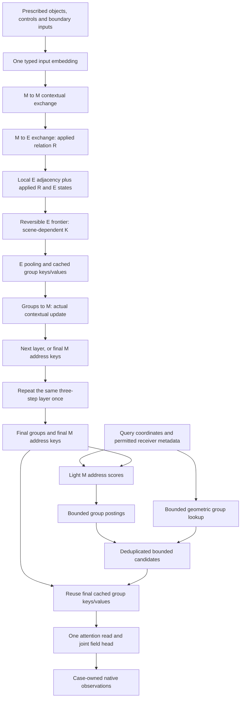
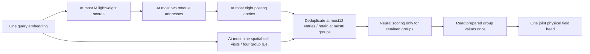

# Round12-3 — Interaction groups that form information and serve queries

**Prepared:** 24 October 2026. **Status:** design and execution guidance; no Round12-3 model implementation, training, or new scientific evaluation is performed by this document-writing task. **Starting checkout:** `agent/honf-core-next`, `f3ce139`. **Recommended primary model:** two interaction-group layers, no E→E, original M identities, learned E frontier, and one group-value query reader. Existing U-H, soft_only v2, Round12 compact results, and Round12-2 checkpoints remain distinct, protected lineages.

The central change is to make a group an information-bearing object before a receiver uses it. Environmental records acquire module context; their actually applied interaction relations constrain a reusable grouping; that grouping pools environmental information and supplies the E→group→M exchange. Queries subsequently use the same prepared group keys and values. Module proposals select addresses, rather than supplying another mandatory prediction-value stream. Learning organization size must account for the work of preparing groups, finding them, and reading them.

This is a replacement of the Round12-2 main path, not another retrieval layer above it. The new primary model removes E→E, independently learned retrieval C, M compaction, E-conditioned M reading, protected direct-M decoder access, and ordinary expansion of a selected group into all its E members. Raw physical records remain inputs and provenance; their identity does not require retaining every historical prediction branch. Optional bounded refinement is a separately qualified replacement of a coarse contribution, not a second unrestricted contribution.

## 1. Scientific question and decisions

Can a small collection of scene-dependent environmental groups simultaneously support useful module contextualization and reusable query inference, with lower measured work and useful native fields/original-control responses? A group must do work in the encoder and survive a direct query reuse test. A small K, attractive graph, high stop probability, or low auxiliary discrepancy is insufficient.

| Decision | Recommended Round12-3 choice | Reason and qualification |
| --- | --- | --- |
| Physical outputs | One joint physical-field representation; case-owned observation/extraction | Keep the generality correction from Round12-2; do not restore a universal heat-affine or heat-independent-flow architecture |
| Token inventory | Initially retain the established M records and E192 catalogue for a controlled comparison | This fixes a first experiment, not the definition of HONF or a permanent token count |
| Encoder | Two layers of M→M, M→E, E→group→M | Remove E→E and place groups inside an executed exchange |
| Organization | E only; connected spatial candidates scored using applied M→E relations and E state differences | Preserve original M identity; permit multiple groups per M and one group serving several M |
| Group values | Measure-aware pooled E state, one group transformation, cached keys/values | No independent query-specific C or fine-record reconstruction is required for ordinary prediction |
| Query | Small M address scores → bounded group postings plus bounded geometric supplement → one group read | M proposals are control; M values are absent from the primary decoder |
| Group count | Reversible learned legal frontier, optimized by physical utility and counted work | Neither K=M nor a forced merge quota; K=E remains legal |
| Additional losses | Native physical objective, existing-reference response objective, one work objective | Do not copy the separate tie/share/risk/capacity-head collection into this model |
| Fine expansion | Disabled in the first screen | First establish that groups carry useful information; one bounded replacement mode is specified in Section9 if justified later |
| First evidence | Matched fixed25 development; one narrowly staged E→E control | Old Round12-2 is historical evidence, not an isolating control for these simultaneous changes |

The proposal follows the user's main direction but adds three necessary qualifications: deleting E→E introduces a measurable communication bottleneck; the final E→group→M exchange must retain a real downstream prediction role; and a useful M proposal requires explicit gradient/coverage treatment rather than a trainable scoring network used only for an untrained hard index.

## 2. What Round12-2 established, and what this design changes

The [completed Round12-2 development report][R122] is the primary measured starting point. J-D and J-H each completed100 scratch epochs on fixed TRAIN150/exposed DEV22, with15000 primary visits and400 optimizer updates. Each arm's epoch100/latest/best aliases have equal model tensors; best has only one declared monitoring point. The results below concern those explicit checkpoints, not current U-H or v2 weights.

| Round12-2 evidence | Consequence for Round12-3 |
| --- | --- |
| Four detailed scenes selected K_M=K_E=1; positive E queries read all192 original E records | Remove ordinary full-member expansion; a root must predict through its finite group representation |
| Learned M-group access was empty; local M access remained active | Keep M identity and remove M compaction; remove the protected local-M decoder bypass in the new primary model |
| All four global priority native temperature/peak preservation bands passed, but M10 surface/peak and regional regressions remained | Preserve all-nine native boards, strata and local tests; global averages cannot validate organization |
| E root/split fluid-T changes were0.323–0.772 times ordinary RMSE, above0.1 | Measure coarse/fine task utility and functional interchangeability; root confidence is not redundancy |
| Clearing trained context changed18 M and862 E candidate edges on TRAIN0231, and reversed root stop logits | Context really influenced candidates/policy; lack of input information is no longer the only issue |
| The encoder remained dense; the subsequent C was independently constructed | Restore the U-H principle that relationships do computational work, then reuse the resulting group information itself |
| The forest evaluated full E-pair distances; expected K had no actual source-edge penalty | Use bounded spatial edges and count all preparation/search/decoder work; do not reintroduce E² in candidate construction |
| In one isolated full-native case, J-H E source edges were24.19× J-D and peak memory12.08×, despite lower decode latency | Report arithmetic, actual rows, memory and complete timings separately |
| Heat differences were more useful than geometry/mixed responses; both joint models failed case-specific zero-heat/heat-independent-flow probes | Keep joint outputs, strengthen bounded case-owned response checks, and distinguish representation loss from insufficient physical training |

U-H's relevant inheritance is applied relationship control followed by reuse: its incidence changes contextual value reduction and becomes retrieval structure. Round12-3 goes further by retaining an aggregate produced inside that interaction. Soft_only v2's K=N descriptor coupling and tie supervision do not provide this group-value execution. Round12-2's separately constructed retrieval frontier does not provide it either. These statements concern architectural paths, not a claim that any new design will outperform mature U-H.

## 3. Input ownership and a deletion budget

Let M input objects be $(x_i^M,a_i^M,h_i,\mu_i^M,\mathrm{id}_i)$ and E objects be $(x_e^E,a_e^E,\mu_e^E,\mathrm{id}_e)$. The symbols $a$ contain only prescribed geometry/material/boundary attributes; h denotes prescribed controls, not target fields. A case may have additional true operating inputs c. Fit normalization on selected TRAIN only. Keep original object/control identities and physical measures available for response joins, even when their values are not directly read by a query.

For the first Thermal experiment, preserve existing M features, original heat-column order, E192 positions, input exclusions and native receiver identities. Initialize $m_i^0=f_M(x_i^M,a_i^M,h_i,c)$ and $e_e^0=f_E(x_e^E,a_e^E,c)$. Supplying a true common condition to both input embeddings is not two independent decoder bypasses. Do not rebroadcast c, h, module statistics or raw layout through additional learned prediction branches. A future token-inventory change requires its own comparison; fixed E positions are an adapter discretization, not an axiom of HONF.

M/E denote input roles, not output responsibilities. Environmental states and groups may carry velocity, pressure, thermal and control information together. Original M controls stay separate input axes; they are not pooled heat amplitudes. No universal E-by-source coefficient bank or exact source superposition is imposed. Changing a control, geometry, material or boundary condition rebuilds the prepared model state.

| New-model path removed | Replacement / retained purpose |
| --- | --- |
| Per-layer E→E attention | Inter-layer E→group→M→E communication, with an explicit bottleneck test |
| Post-encoder dense E-pair candidate distances | Existing-catalogue adjacency and edge-local relation/state distances |
| Independently learned C[K,N] membership MLP and donor halos | Exclusive ancestry membership and measure-normalized pooling of the actual E states |
| M candidate forest / stop policy | Original module records remain distinct |
| E read → query conditioning → separate M value read | One query context from selected group values |
| Protected local-M value branch | No direct M values in the initial decoder; local fidelity must be carried by groups |
| Automatic group→all-members fine Q/K expansion | Disabled; bounded optional replacement only after a controlled qualification |
| Separate risk predictor, stopped tie loss and expected-K-only penalty | Native task utility plus a counted-work policy objective; counterfactual sharing is an audit first |
| Old affine heat application cache | Reuse only for identical complete physical inputs and weights |

Ordinary residual updates inside an interaction layer remain: they preserve each object's previous state rather than injecting another physical prediction route. Native interpolation, curl, physical units, conductivity-based q-proxy extraction and module identity joins remain case observation operators. They must not introduce a learned hidden field head or source-amplitude correction outside the joint core.

## 4. Complete architecture and state timing

Figure1. Proposed primary path. The two layers have the same computational form, with separate ordinary layer weights. Only the final layer's groups serve the query reader; earlier groups have already affected later information through the M relay. The diagram is a design, not a measured result.

At layer $l=1,\ldots,L$, start from $(M^{l-1},E^{l-1})$ and compute updated module states $\widetilde M^l$, updated environmental states $\widetilde E^l$, its frontier $\mathcal F^l$, pooled groups $G^l$, and final module states $M^l$ in that order. Set $E^l=\widetilde E^l$. The next layer starts from $(M^l,E^l)$. Its E states therefore depend on the preceding group→M update. Do not also broadcast G back to E inside the same layer or recompute the same E update after grouping.

At the final layer L=2, cache $G^L$ exactly where it was consumed by E→group→M. Use the resulting $M^L$ for query addressing. Do not silently refresh $G^L$ from the subsequently changed M state: that would create another interaction step and invalidate the claimed reuse. Layer1 and layer2 can have different groupings; record both $K^1$ and $K^2$, and charge both preparations. Only reporting final K would hide work.

The final M update is not allowed to become dead computation. Its address weights enter the differentiable group-read prior in Section8. With a singleton M, fixed-null normalization preserves a nonconstant address amplitude. Qualification must demonstrate a downstream effect of the final group→M update under unchanged query candidates, as well as the earlier relay's effect. If it is unused, simplify or reject that version; do not count it as useful interaction merely because it ran.

## 5. One interaction-group layer

### 5.1 M→M and M→E

Use conventional pre-normalized multihead attention, physical geometry bias and residual/FFN updates. M→M excludes self when appropriate; for M1 it returns an empty update and retains the module residual. It must not invent a second module or force a self-attention exchange to claim interaction.

For M→E head a, define dimensionless scores and applied coefficients

$$
s_{ei}^{l,a}=\frac{Q_E^a(e_e^{l-1})^\top K_M^a(\widetilde m_i^l)}{\sqrt{d_h}}+b^a(x_e^E,x_i^M),\qquad R_{ei}^{l,a}=\frac{\bar\mu_i^M\exp(s_{ei}^{l,a})}{1+\sum_j\bar\mu_j^M\exp(s_{ej}^{l,a})}.
$$

Here $\bar\mu$ is the adapter's positive dimensionless reference-scaled measure. Implement the null denominator stably by adding a fixed zero-valued, zero-logit option. It is not a learned global token or a hidden source-value broadcast. Then

$$
\widetilde e_e^l=\operatorname{FFN}_E^l\!\left(e_e^{l-1}+O_E^l\operatorname{concat}_a\sum_iR_{ei}^{l,a}V_M^a(\widetilde m_i^l)\right).
$$

Export the actual R used for this reduction, including its row mass and null mass. Do not reconstruct a different relation from later states for grouping. With M1, ordinary softmax over only that module would give R=1 everywhere; retaining the null makes relation strength informative without pretending there are multiple modules. This is a useful distinction but not a guarantee that M1 can transmit all environmental detail.

Unknown u/v/p/T are outputs, never input features. Existing physical source laws belong to case-owned losses/reference checks. Reuse attention arithmetic and geometry conventions where appropriate, but do not modify the historical four-route class to reinterpret old checkpoints.

### 5.2 Pool before the E→M read

For an active E group v with original-record ancestry $\mathcal A_v^l$, prepare

$$
Z_v=\sum_{e\in\mathcal A_v}\bar\mu_e^E,\quad c_{ve}=\mathbf1_{e\in\mathcal A_v}\frac{\bar\mu_e^E}{Z_v},\quad u_v^l=\sum_ec_{ve}\phi_E^l(\widetilde e_e^l),\quad g_v^l=\operatorname{FFN}_G^l(u_v^l),\quad \bar R_{vi}^{l,a}=\sum_ec_{ve}R_{ei}^{l,a}.
$$

The pooled vectors and relation moments are explicit aggregates, not a second learned assignment matrix. Use the same common group transformation for all active nodes. Cache one group key and one multihead value projection from $g_v^l$, and use those exact keys/values for both M reading and final query reading. Their query projections may differ because the receivers differ. Count every leaf projection and every active group transformation; pooling does not make preparation free.

Set $\phi_E$ to identity in the primary recipe: the E states have already passed through their contextual FFN. Do not introduce another expensive per-original-E value MLP before pooling. The active-group transformation and shared key/value projections follow pooling. Existing E embedding/attention/FFN work still touches original E rows during preparation and must be counted. In optional fine mode, apply this same group transformation to only the selected singleton E states rather than retaining an always-computed original-E value bank.

Physical measure, group mass and physical control amplitude are different objects. Pool encoded information, not original heating values as a substitute for original modules. Preserve zero-measure/present versus information-eligible accounting; an all-zero-mass aggregate returns an inactive zero message and is not counted as learned compression by deleting its source identity.

Build $\bar R$ by segmented reduction of the already computed E×M×H relation. This costs O(EMH), not O(E²). Store the ordinary partition as E→group IDs plus sparse ancestry/segment offsets; no K×E dense directory is needed in production. C may be materialized only for a bounded audit. Do not add overlapping donor halos in this initial model.

### 5.3 M consumes group information

Define actual group-to-module attention using cached group keys/values:

$$
t_{iv}^{l,a}=\frac{Q_{M,G}^a(\widetilde m_i^l)^\top k_v^{l,a}}{\sqrt{d_h}}+b_G^a(x_i^M,\operatorname{geom}(v))+\bar R_{vi}^{l,a},\qquad B_{iv}^{l,a}=\frac{Z_v\exp(t_{iv}^{l,a})}{1+\sum_w Z_w\exp(t_{iw}^{l,a})},
$$

$$
m_i^l=\operatorname{FFN}_M^l\!\left(\widetilde m_i^l+O_M^l\operatorname{concat}_a\sum_{v\in\mathcal F^l}B_{iv}^{l,a}v_v^{l,a}\right).
$$

The fixed relation-prior coefficient is1 in this initial design, without VAL tuning; all logits use their declared normalization. B is the actual coefficient in M's contextual update and also supplies the module→group posting priorities. Thus the relation is neither a decorative attention export nor an independently generated decoder graph. It is not claimed to reproduce dense E→M attention exactly: factorizing through one common group value is an intentional representational restriction to be tested.

Group mass must enter consistently. If child keys/values, geometric scores and relation priors are identical, their summed mass admits the corresponding additive merge identity. Different locations, scores, nonlinear transformations or query windows break that special equivalence; low within-group variance alone is not a general merge theorem.

## 6. Candidate construction without a new E² operation

The first implementation uses the existing24×8 E catalogue's physical adjacency. Its undirected horizontal/vertical graph has352 edges. Construct this directly from catalogue coordinates/indices; do not call the old full-distance `build_forest` and mask afterward. A general irregular catalogue would require its own bounded spatial construction; this version must not claim such a method is already implemented.

For each adjacent pair (e,f), compare the applied relation fingerprint $r_e=\operatorname{concat}_a(R_{e1}^{a},\ldots,R_{eM}^{a},R_{e0}^{a})$, its E contextual projection, and physical separation:

$$
d_{ef}=\frac{\|r_e-r_f\|^2}{H(M+1)\sigma_R^2}+\frac{\|z_e-z_f\|^2}{d_o\sigma_z^2}+\frac{\|x_e-x_f\|^2}{\sigma_x^2},\qquad z_e=P_o\widetilde e_e,\quad d_o=16.
$$

Use fixed TRAIN-calibrated positive scales and equal component coefficients, not validation errors. Zero-variance components contribute zero rather than receiving arbitrary large inverse scales. Evaluate these distances only on352 edges per layer. Build a deterministic minimum-spanning binary merge tree by edge sorting/union-find, with ties resolved by original E IDs. Complexity is O(EMH+E d_o+|A|log|A|), plus the declared neural projections; no E×E distance tensor, dense context-kNN, or all-pairs connectivity repair is permitted.

This connected-tree restriction is deliberate. A module-associated region may split into many nodes; adjacent regions associated with different modules may merge; a group can have substantial B weights for several modules. No node is permanently named after one module, and K is not bounded by M. Distant disconnected regions cannot merge in the initial candidate family, even if their relation fingerprints match. That is a declared limitation, not a reason to add a global similarity search now.

Bottom-up node statistics are additive mass, pooled z, relation moments, position/extent and child differences. Compute them in O(E) nodes; apply the expensive group FFN/key/value transformation only to active frontier nodes. Do not precompute a neural value bank for all2E−1 nodes and report only live K. Report metadata nodes, policy-scored nodes, allocated group vectors and actual value rows separately.

Store tree children/parents and additive statistics in compact arrays. Do not expand every candidate node's full ancestry into a node×E membership matrix or copied ID list: a chain-shaped tree would recreate quadratic memory even without pair distances. Traverse the selected frontier once to produce one E→active-group label per original record; materialize full ancestry only for the bounded selected audit. Pooling the active partition and building the spatial lookup then take linear source storage.

## 7. Functional sharing and learning K

Keep a legal frontier covering all eligible E records. A shared small E stop policy sees the node's pooled interaction/state statistics, spatial extent, mass and child discrepancy; it does not see targets or validation errors. At reached internal node v, probability $p_v=\sigma(b_v/\tau)$ stops at v; otherwise descend to its children. Leaves always terminate. Training samples keyed decisions; inference uses fixed $b_v\ge0$. Decisions can reverse in later preparations. K is the number of reached stops, not an expected count, a padded capacity or the number of modules.

Report unchanged original module count $N_M=M$ and separate $K_E^l$ for each layer. A bookkeeping total $M+K_E^l$ is an inventory summary; it is not a learned joint M/E capacity or the number of value rows read by a query. The primary query reader has no M-value bank to compact.

Reuse the proven frontier traversal/keying ideas, not the old dense candidate builder or independent membership/risk heads. Initialize stop logits−4; force leaves for epochs1–20. On one absolute1000-epoch master schedule, use temperature2→0.5 over1–200 and work-price ramp0→1 over21–100, held afterward. Resume never resets these clocks. Warmup optimizes the actual singleton-group field predictor; inactive stop gradients are recorded as inactive, not calibrated from an invented native stop norm.

The simplest primary learning criterion is task utility plus counted work, Section10. It has no separate reward for making groups look alike. A bounded parent-versus-child intervention supplies the scientific functional-sharing test: replace one reached coarse node by its legal child frontier, repool from the same E states, rerun its E→group→M update and all dependent later layers, rebuild final addresses, and recompute native outputs. A final-layer read-only swap is a different diagnostic and must be labelled as such.

For v, record $\Delta L_v=L_{\mathrm{physical}}(\mathrm{parent})-L_{\mathrm{physical}}(\mathrm{children})$ and $\Delta W_v=W(\mathrm{parent})-W(\mathrm{children})$. The declared preference is $\Delta L_v+\lambda_W\Delta W_v<0$ under the fixed TRAIN-calibrated resource price. Also record normalized output changes per physical quantity. These counterfactuals judge whether a shared representation is useful; they do not label physical causes or imply an exact hierarchy of natural subsystems.

No stopped tie loss or learned risk head is required initially. In particular, do not carry the Round12-2 tiny-M-gradient coefficient13350 into this E-only design. If sampled-frontier learning is too noisy or saturates, inspect actual conditional task/work advantages and reached-node coverage before adding another estimator. Tiny-tree enumeration qualifies the existing estimator. A negative result is preferable to an undocumented straight-through path, forced root/leaf preference or a new auxiliary portfolio.

## 8. Query addressing before group neural work

### 8.1 Reusable postings and bounded geometric lookup

At final preparation, take the arithmetic mean over heads of the actual $B_{iv}^{L,a}$ to form scalar association $\bar B_{iv}$. Store the highest four group IDs per original module as postings $P_i$, with immutable-ID ties. This index is not a partition: several modules can point to the same group and one module can point to several groups. Full B is already needed for M's update; posting construction is scene work, not query work. Record index sorting and allocation costs.

Build a spatial E-cell→active-group lookup from the same ancestry partition, with O(E) stored entries. For the current regular grid, a query visits at most its cell and eight neighboring cells; deduplicate and retain at most four distinct group IDs by cell distance and then immutable ID. It must not first test every group bounding box, scan all E coordinates, or sort all K by query distance. Empty/overflow events are counted; they never trigger an all-E fallback. The initial model does not claim a general irregular-point index.

### 8.2 Lightweight M control with a trained effect

Encode query coordinates and permitted receiver metadata once into q. Cache16-dimensional proposal keys $k_i^P=P_Mm_i^L$ and form $s_{qi}^P=(P_qq)^\top k_i^P/4+b_P(q,x_i^M)$. All present M may be scored because M is small; count QM explicitly. Keep at most two M proposals. On the selected set $I_q$, use the nullable coefficients

$$
\alpha_{qi}=\frac{\exp(s_{qi}^P)}{1+\sum_{j\in I_q}\exp(s_{qj}^P)}.
$$

The selected coefficients must enter the eventual group prior, not only an integer top-k operation. Thus selected proposal logits, the last M states and their group→M update receive native gradients through the read weights. The null avoids the singleton-M coefficient becoming identically1. M controls search and weights; no M value vector is concatenated to the field head.

Top-k indices and posting membership remain discrete. Ordinary derivatives hold their legal support fixed and do not differentiate an unselected branch. To avoid permanently unvisited module proposals, reserve one of the two slots on exactly one in16 TRAIN query IDs for a deterministic cyclic alternative module when one exists; the case/query/absolute-epoch key is independent of chunking and checkpoint replay. Preserve the same slot budget and renormalize actual selected logits. Evaluation uses only deterministic learned top-k. Record exploration exposure and train/eval support differences. This is bounded support coverage, not an unbiased gradient through top-k; do not describe it as such.

### 8.3 One restricted group read

Retrieve $\bigcup_{i\in I_q}P_i$ (at most eight posting entries) and the four geometric entries. Deduplicate at most12 gathered entries. Reserve up to four candidate slots for the geometric entrance in cell-distance/immutable-ID order; fill the remaining slots up to eight from distinct module-posted groups ranked by $\sum_{i\in I_q}\alpha_{qi}\bar B_{ig}\mathbf1_{g\in P_i}$, with immutable-ID ties. This preserves the bounded geometric supplement even when module postings are confident. Do not perform new query/group neural scores before this cap. Record visited entries, deduplicated candidates and truncations separately.

For a retained candidate g, define an address prior using the actual association and geometric entrance:

$$
\rho_{qg}=\mathbf1_{g\in C_q^{\mathrm{geo}}}w_{qg}^{\mathrm{geo}}+\sum_{i\in I_q}\alpha_{qi}\bar B_{ig}\mathbf1_{g\in P_i},\qquad a_{qg}=\frac{Z_g\rho_{qg}\exp(q_G^\top k_g/\sqrt{d_h}+b(q,g))}{1+\sum_{u\in C_q}Z_u\rho_{qu}\exp(q_G^\top k_u/\sqrt{d_h}+b(q,u))}.
$$

The geometric weight is a fixed input-geometric entrance/window with a declared physical scale, not a learned dense layout summary or a validation-tuned fallback. Only retained candidates are scored. Reuse the exact cached group values from the final group→M exchange:

$$
c(q)=\operatorname{concat}_a\sum_{g\in C_q}a_{qg}^{a}v_g^{L,a},\qquad \widehat{\mathbf F}(q)=f_{\mathrm{joint}}([q,c(q)]).
$$

The primary version reads all retained positive-prior candidates, at most eight per query; it does not claim additional learned exact-zero sparsity inside that shortlist. An empty candidate set produces the declared null context, with no nearest-M value or global-E rescue. A zero learned module-value read is structural here; nullable M proposals and geometric candidates still allow an environmental-only address path. If an always-read eight-group shortlist is wasteful, measure it before adding another gate family.

This is one attention/value fusion and one joint head. There is no E-derived conditioning of a later M query, no independent per-field reader, and no dense query-to-original-E logit denominator. A logical E-only query can retain source dependence through its group values and addressing; it is not physically independent of M.

Figure2. Proposed bounded query work, not a measured speedup. The postings and spatial lookup share the prepared grouping. M scores and index work are explicitly charged; the cap is applied before group neural scoring and value mixing.

## 9. Optional fine records: a bounded replacement, not a rescue network

The first learning screen has refinement disabled and zero query/original-E reads. Retaining original E states for further layers, provenance or future intervention is not permission for the ordinary decoder to read them. Establish direct-group quality first. If it fails, first inspect lost group information, group granularity, source responses and candidate coverage. Do not automatically grow the decoder until the graph appears successful.

If a later single controlled revision is justified, use the same group/address system and the same attention-read implementation. Permit at most one selected group per query to be replaced by at most four original E records from that group's local spatial cells. Select source IDs with the existing bounded spatial lookup and ancestry labels before projecting any extra fine keys; never scan the group's entire ancestry at query time. A root containing192 records may still open at most four originals, or return an insufficient-cover event. There is no all-member fallback.

Use exclusive contributions:

$$
c(q)=\sum_{g\in C_q}a_{qg}\left[(1-r_{qg})v_g+r_{qg}\sum_{e\in S(q,g)}b_{qe}v_e\right],\qquad r_{qg}\in\{0,1\},\quad\sum_gr_{qg}\le1,\quad|S(q,g)|\le4.
$$

The fine contribution replaces the coarse value; it is not added as a residual prediction plus an independently read original-value stream. Share the ordinary value/attention family, with selected-source work counted before claims. Initial implementation need not construct this optional mode. Before enabling it, freeze one selection/training rule and its gradient treatment in a separately named recipe; a learned hard refine switch needs its own qualified estimator, not an implicit gradient through the integer decision. Do not add an uncertainty/risk model merely to choose refinement.

If nearly every query refines, if physical utility survives removal of group values, or if refinement carries most field/response quality, classify the result as a fine-reader result rather than successful group reuse. Report group-only and refined function, actual expanded rows and complete cost separately. Do not merge their best metrics into one claimed model.

## 10. Joint task/work learning and meaningful gradients

Let $\mathcal P$ denote the sampled legal layer frontiers. The initial objective is

$$
J(\theta,\varphi)=\mathbb E_{\mathcal P\sim p_\varphi}\left[L_{\mathrm{native}}(\mathcal P)+\lambda_RL_{\mathrm{response}}(\mathcal P)+\lambda_W(e)\widetilde W(\mathcal P)\right].
$$

Native losses retain existing case weights, TRAIN scales and physical masks. Response supervision uses the existing admitted TRAIN anchor0348 only, every fourth primary update before the same Adam step; it alternates heat and single geometry. No extra optimizer update, new solver or mixed-geometry backpropagation is introduced. Retain its separate10%-of-native-shared-gradient target/downward cap and report actual exposures. Do not add the other seven reference families to fixed25 fitting.

Including this response supervision from the initial100 screen is an explicit proposed departure from the development protocol's older response-free initial screen, following the Round12-2 joint-field recipe. Freeze it identically for all three new arms before execution. Do not silently enable it in only the adaptive arm or after inspecting its geometry failures. The executable objective must also state its absolute-epoch101 native-loss rule consistently across arms instead of inheriting an accidental historical runner default.

Work is not K alone. Maintain exact counters for each layer's pair scores, edge-local candidate evaluations, node statistics/policy rows, original E projections, active group transforms, M/group edges, index entries/visits, query/M scores, group candidates/scores/reads, optional fine rows, native extraction, backward and optimizer boundary. Define $\widetilde W=\sum_j a_jC_j/W_{\mathrm{singleton}}$ from these actually executed counts. Coefficients $a_j\ge0$ are frozen using small TRAIN-only stage timings at qualification; they approximate arithmetic/runtime price and are not actual wall time. Include a group-vector preparation/storage price so K is explicitly charged. No independent expected-K reward is added on top of the same cost.

Irreducible M→E work and E-state projection remain in total cost even when they are constant with respect to a frontier. A query-only count cannot justify a preparation or training saving. Do not differentiate a timer. For sampled frontiers, use the maintained score-function estimator with previous-update action-independent TRAIN baselines:

$$
\widehat\nabla J=\left.\nabla_\theta L_{\mathrm{physical}}\right|_{\mathcal P}+\operatorname{sg}\!\left(L_{\mathrm{physical}}+\lambda_W\widetilde W-b\right)\nabla\log p_\varphi(\mathcal P).
$$

Continuous group/address/value gradients flow through the fixed executed support. The structural cost of uncomputed branches cannot acquire a pathwise derivative; it receives the declared policy gradient. The formula is qualified for a fixed candidate family and the declared support conventions. Detached tree nomination, top-k postings/proposals, gradient caps and finite-sample baselines limit claims about global/unbiased architecture optimization.

Differentiate the log-probability through its actual contextual descriptors, including shared encoder parameters; $\varphi$ denotes the frontier mechanism rather than an artificial detached copy of the encoder. Keep the native conditional gradient and policy contribution separate in telemetry, and do not count a physical loss twice when assembling the same Adam update.

Keep one work price, not separate M/E tie/risk/capacity prices. Run a no-step TRAIN calibration at21 using at most96 input-selected cases covering all selected M/geometry/heat strata. Estimate the work-policy gradient on the same complete encoder/organization inventory as the native-policy estimate, filling missing entries with zero. Initially target2% of the corresponding nonzero native norm and limit the combined work-induced full-model gradient downward to10% of native full-model norm. Log per-slice norms/cosines, zero/missing gradients, reached-node coverage and coefficient uncertainty. If a norm is numerically null or unstable across calibration batches, leave the coefficient zero and declare work learning unqualified; do not divide a tiny noisy norm into a huge influence. Inspect calibration again at100 without silently changing the fixed price. Recalibration would be an explicit amended lineage.

This calibration/cap is an engineering tradeoff, not exact minimization of the raw scalar objective or a guarantee of a physical error bound. Maintain named AdamW ownership, macro accumulation, clipping, OOM rollback/repacking, RNG restoration and successful-retry accounting. Extend the existing work accounting for the new counters; do not reuse the retired epoch3000→4000 target numbers or silently disable all work pressure as in the first Round12-2 screen.

## 11. Original controls, response fidelity and the M1/M2 limitation

The source-response chain is now explicit:

$$
h_i\longrightarrow m_i^0\longrightarrow R,\widetilde E\longrightarrow(\mathcal P,G,B)\longrightarrow M_{\mathrm{address}},C_q,a_{qg}\longrightarrow\widehat F(q).
$$

Measure all original-column AD/JVP/VJP and saved finite controls using complete re-preparation. A source may affect a query's group values and its address weights without a direct M value read. Original source identity is preserved by the input axes and joins, not by allocating an exact affine coefficient per E/M pair. Native source-law properties must be checked rather than transferred from U-H.

The established atlas families are0001/0304(M3),0318/0320(M5),0333/0335(M7),0348/0350(M10). Their saved geometry/heat/mixed states are source TRAIN, with only0348 admitted for fixed25 response fitting. Evaluate the other families as explicitly labelled reference-only evidence, never optimization or VAL threshold tuning. Preserve the0001/0273 duplicate-family identity and canonical exclusion already in the protocol.

**There is no M1/M2 physical geometry-response atlas in these eight families, and DEV22 has no M1/M2 cases.** The available evidence can establish M1/M2 native TRAIN quality, actual communication, original-source model derivatives and applicable analytical case-law consistency. It cannot certify physical M1/M2 geometry-response fidelity. Do not create a new solver/dataset to hide this gap or substitute AD/FD self-consistency for a physical reference. An eventual independent M1/M2 response claim needs additional separately authorized physical evidence.

Freeze12 input-selected TRAIN examples (six M1 and six M2, covering available Re/heat bands) before errors for this risk panel. They stay in the same TRAIN150 fit and are labelled TRAIN evidence, not a newly independent validation split. Reuse the same cases across controls. Test boundary-dominated/far-from-M regions and compare the no-E→E versus E→E control at the same epoch, with all native quantities, not only temperature.

Under the simplified homogeneous-boundary Thermal assumptions, use bounded zero-heat, heat-partition/superposition and heat-independent-flow probes. These include controls not necessarily covered by native training, so label generalization versus interpolation. They are case laws, not universal restrictions of the HONF core. Initially retain the same response objective across arms without adding extra analytical losses; if both controls fail the same laws, diagnose shared training/coverage before attributing the failure to grouping. Any later case-owned analytical loss is a separately controlled change.

## 12. Communication and approximation limits

Removing E→E eliminates one large exchange but does not remove the need for environmental communication. With two layers, distant environmental information reaches another E state through $E^0\to G^1\to M^1\to E^2$. The M relay has finite width and few tokens. At a fixed topology, any dependency carried only through that M-state vector has Jacobian rank at most Md; this is a local bottleneck statement, not the rank of the full model, because E residuals and direct final group values retain other information.

M1/M2 are therefore essential stress cases. A single module can receive many distinct groups, but it still compresses the information it relays to other E positions into its finite state. Pooling may additionally lose within-group spatial modes needed for local peaks, flux or geometry changes. Keeping a position/extent summary does not recover arbitrarily detailed source identity. A broad group may be useful for smooth background information yet inadequate near a module or boundary transition.

There is no theorem that three exchanges or two layers suffice for every physical problem. This is the initial testable hypothesis. A singleton-E control isolates the E→E removal before any adaptive pooling is promoted. Do not add a direct global E summary, multiple specialized physical readers, or an uncounted E pair operator when the bottleneck fails.

Uniform K=1 is not forbidden. If a single group genuinely supports useful fields/responses with lower complete work, call it a successful global bottleneck representation. It still does not demonstrate scene-adaptive functional subdivision or local organization. Conversely, retained K=E with useful prediction is a valid negative compression result. Report these classifications instead of selecting a desired K after looking at validation.

## 13. Work and cost predictions to test

For the old four exchanges, attention-score pair count per layer/head is approximately $M^2+2ME+E^2$ before masks/self exclusion. Simply deleting E→E gives $M^2+2ME$. With E192/M12, these are41616 and4752; with M1 they are37249 and385. These arithmetic comparisons exclude projections, FFNs, softmax, pooling, indexing, backward and native extraction, and are not timing predictions.

In the proposed grouped exchange, learned attention-score pairs are approximately $M^2+ME+MK_l$ per layer. Applied-R aggregation still costs O(MEH), pooling costs O(Ed), the tree costs O(ElogE), and group transforms cost O(K_ld²). Query work adds O(QMd_p), bounded posting/spatial lookup, O(QB_Gd) scores/value mixing and the shared physical head. Optional fine mode adds at most O(Qb_Ed), but this must be measured, not treated as a free correction. No E² term is intentionally present; tests must catch accidental broadcasted E×E allocations.

The initial primary reader opens zero original E values per query, but all E states are embedded/contextualized/projected during preparation. This trades repeated fine access for amortized representation work. Benchmark Q=32,1024 and full native receiver unions separately; report first-query preparation and cached application, not only the most favorable large-Q amortization. Training retains both layers' autograd states even when inference can discard intermediate groups.

Report at least prepare embeddings/attention, candidate construction, pooling/group projections, M/group reduction, posting/spatial-index build, query/M proposal, candidate gathering, group scoring/value fusion, native extraction, frontier-work VJP, native backward and complete optimizer macro. Use isolated compatible hardware, warmups and at least three repeated measures. Also report live/allocated K per layer, total prepared group/value rows, every query cap/truncation, peak allocated memory and persistent prepared-state bytes. CUDA allocator/warmup effects and different trained functions limit causal speed interpretations.

## 14. Minimal staged comparisons, not an architecture portfolio

| Arm | Encoding / grouping | Reader | Purpose |
| --- | --- | --- | --- |
| G-EE | New three-step layer plus an explicit E→E exchange after M→E; singleton E groups | Same bounded M-proposed direct-group reader | Narrow control for deleting E→E |
| G-F | No E→E; singleton E groups | Same reader | Primary fine-granularity control |
| G-H | No E→E; learned E frontier | Same reader, refinement off | Test actual adaptive aggregation and reuse |

All three are new scratch models with joint physical inputs/head and no direct M value bypass. Match common named initial tensors, normalization, seed, case/query schedules, physical/response losses and cumulative exposure. G-EE alone owns the extra E→E weights; this difference cannot be made parameter-count-identical without changing the experiment. G-F/G-H can share the E-only policy inventory, with G-F forcing leaves and no sampled-policy reward. Do not compare a new100-epoch model to mature U-H as a matched accuracy control.

G-F/G-EE bypass candidate-tree construction and stop-policy execution because their singleton partition is known. Keeping inactive policy parameters for initialization compatibility does not authorize wasting computation in the control. G-H pays its full nomination/tree/stop cost. Comparisons must not manufacture a speed advantage by making the singleton baseline execute unused organization work.

Stage A implements and qualifies G-F and G-H forward/backward/save/reload at actual native sizes before long fitting. Stage B trains G-EE/G-F to100 as the single E→E deletion qualification. If G-F fails the available field/response bands or exhibits severe M1/M2 TRAIN failures, stop and diagnose the communication change; do not train G-H merely to reach a model count. Stage C trains G-H to the same100 endpoint only if the no-E→E route is useful. Compare it with the retained G-F100, reusing valid evaluations. These are one candidate and two scientifically necessary controls, not a broad encoder/decoder grid.

R12-2 J-D/J-H and U-H/v2 supply historical mechanisms and numerical context, not matched same-function or same-architecture controls. A refinement mode, extra physical-law loss, changed proposal budget or wider relay is not silently inserted into these arms. At most one measured failure may justify a separately named controlled amendment after the initial decision.

## 15. Planned training, budgets and review points

This section is a proposed finite allocation for a future execution request; it launches nothing. Use maintained fixed25 TRAIN150/exposed DEV22 and its existing manifest, selected-TRAIN normalization, seed0, FP32, width128/four heads/two layers, AdamW3e-4/WD1e-5, effective48/nominal micro24/Q1024. Preserve native objectives, query identities, clean stop, named optimizer/RNG/provider restoration and OOM rollback. Use a1000 absolute-epoch master schedule with initial endpoint100. Review before any continuation to300/500; neither1000 nor three completed arms is a requirement.

| Resource / operation | Proposed hard allocation / rule |
| --- | --- |
| Initial qualification |2 GPU-hours, including native forward/backward/reload and actual stage sizing |
| Initial staged training |At most6 GPU-hours per100-epoch arm,18 total if all three arms are justified |
| Scientific validation |4 GPU-hours for explicit terminal/best development checkpoints and bounded references/interventions |
| Initial ceiling |24 GPU-hours; reject/reduce a stage if measured throughput cannot fit its allocation |
| Conditional recovery reserve |At most12 additional GPU-hours total for one justified candidate/control continuation or one controlled amendment; establish projected visits/updates before use |
| Overall plan ceiling |36 GPU-hours, not an instruction to spend reserved time; no full-data run is included |
| Retained generated output |4GiB total across qualification, runs and evaluations |
| Peak temporary storage |512MiB; reuse exact shared data/reference stores, no dataset copies |
| DATA2 headroom |At least200GiB at every output-producing stage |
| Checkpoints / outputs |Every100, latest, best-field over declared monitoring points; curves every10; normal validation/tqdm/full history |
| Device / job ownership |GPU0 preferred when a future run is authorized; inspect live ownership/capacity first, preserve existing RNG visibility, respect30-minute blocked-GPU pause rule |

A100-epoch arm has15000 primary case visits,400 optimizer updates and15.36 million primary fluid queries. At every-fourth-update response cadence, it also has100 response microbatches/200 endpoint-scene visits, before the same Adam steps. Record no-step calibration and any bounded intervention exposures separately. History must count successful OOM-repacked microbatches correctly. Do not use convenient provider construction counters as successful physical exposure.

Initial learning has no ordinary auxiliary functional-probe training campaign. Evaluate at most24 input-selected TRAIN organizer scenes with detailed native interventions on at most four scenes per endpoint, plus the12-case M1/M2 TRAIN risk panel. Reuse frozen DEV representatives0277/0287/0294/0684 for detailed fields; evaluate all22 DEV cases statistically. Additional files are written only at declared reviews/final stops. Model/optimizer/checkpoint sizes and high-M microbatch peaks must be measured before freezing executable JSONs; if the projected4GiB/512MiB/compute ceiling fails, reduce optional exports or stop, never silently change physical sampling/precision/retention.

At100, record go/stop from measured group utility, field/response preservation and complete work. If organizer learning is progressing but undertrained, a matched continuation may be justified within the12-hour reserve using the original absolute schedule. Stable unused-group paths, all-fine bypasses, unqualified work gradients, persistent field/response failure or no measured executor improvement justify a negative closeout. A formal full TRAIN600/VAL89 experiment is a later explicitly selected run, not part of this document or its budget.

## 16. Prespecified validation and claim levels

Freeze these descriptive criteria in the executable recipes before inspecting new model results. They are research reporting bands, not physical validity thresholds or significance guarantees. Retain failures and absolute errors even where ratios pass.

| Question | Evidence required | Initial descriptive criterion / decision |
| --- | --- | --- |
| Can no-E→E predict? | G-F versus same-age G-EE, full native DEV22 and M1/M2 TRAIN panel | Each priority T/peak mean≤1.10 and p90≤1.15; all other quantities/stratum failures visible |
| Are physical responses retained? | Same-checkpoint existing references, separated fit/reference-only/response-validation-only and heat/single/mixed | Per priority component, ratio of pooled-record median absolute RMSE≤1.10 and p90≤1.15; magnitude/near-null errors separate |
| Does grouping preserve utility? | G-H versus same-age G-F, same boards | Same field/response bands; no checkpoint mixing; absolute physical usefulness must also be discussed |
| Are groups used in encoding? | Clamp group→M message and recompute downstream; final address-control clamp with fixed candidates | Nontrivial model dependence plus measured task utility; no automatic pass from nonzero changes alone |
| Is the representation reused? | Final encoder/query group IDs, tensor state versions, keys/values and normalization audit | Same prepared group values/keys; zero ordinary original-E query expansion; no hidden C or other learned value bypass |
| Is K learned? | Per-layer live/allocated K, probabilities, reached nodes and stability across input strata | Not hardwired to M; K=E and K=1 outcomes honestly classified; adaptive subdivision requires actual variation/usefulness |
| Is functional sharing credible? | Parent/child replay through dependent encoder and query, priority output changes and task errors | High-confidence stops p≥0.8 with priority output-change RMS≤0.1×ordinary native RMSE are promising audit candidates; report coverage/failures, not a forced acceptance rule |
| Does M constrain search? | Before-score candidate traces and cost versus same function with exhaustive group search on a bounded panel | Candidate cap applied before group neural scores; at least50% fewer scored groups where K>16, while preserved-field/response bands remain satisfied |
| Is actual work lower? | Counters and isolated complete passes at Q32/1024/native unions | At least20% fewer measured group/value pair operations and at least10% lower complete native inference time versus G-F are initial useful gains; report preparation/backward/training separately |
| Is the overall executor cheaper? | Complete forward/backward/optimizer macro and peak memory | Claim a training gain only if complete macro time decreases≥10% without peak-memory growth>10%; otherwise classify the specific inference/memory tradeoff |

Relative preservation against an immature control is insufficient for physical usefulness. Also compute the fixed selected-TRAIN-mean native predictor and the zero-response predictor on the same masks/references. A useful native claim requires each priority quantity's mean error to beat its TRAIN-mean predictor. A supported heat/single-geometry usefulness claim additionally requires median relative response error below1 for each priority component with a non-null physical response; report excluded near-null entries using absolute errors and retain tails/coverage. Mixed interactions remain separately qualified. If both controls are inaccurate, label the study an architecture/work qualification rather than a useful physical surrogate, even if their ratios pass. These baseline comparisons are arithmetic on existing evidence, not new trained control runs or physical validity guarantees.

The bounded exhaustive group-search comparison reads the same trained model and prepared groups with the candidate restriction removed, not all original E values. It is a diagnostic alternate address function, not a parity expectation: compare physical errors/outputs to expose coverage loss. A chunked versus unchunked implementation of the same restricted function, in contrast, must pass numerical parity. Training G-F/G-H under the same query caps is necessary; post-hoc restriction of an unrestricted predictor is a different experiment.

All-nine native reporting includes u,v,p,omega, fluid/surface/material T, q proxy and per-case RMSE of separately recomputed original-module maxima. Retain equal-case means,p90,worst IDs, module-count strata, physical masks and native units. Preserve source-independent flow/zero heat as case-specific analytical probes, source-column Jacobians, existing32 single geometry differences and eight mixed differences, absolute near-null errors, legal-order/topology seams and AD/FD precision diagnostics. Model AD/FD consistency is not physical-gradient fidelity.

No saved-pool ranking or inverse generator is required by this first design screen. Group utility and valid surrogate geometry gradients remain prerequisites, not evidence of an optimized physical design. An inverse claim would require separate saved-reference decisions/feasibility/regret; do not infer it from smooth model derivatives or more diverse group diagrams.

## 17. Implementation placement and interface discipline

Create one small-interface core module, provisionally `honf_forward_core/interaction_groups`, rather than adding many mode flags to the historical `ContextualOrganizationJointCore`. Its external interface is `prepare(scene) -> PreparedInteractionGroups` and `decode(prepared, query) -> joint fields + work counts`, with ordinary configuration/checkpoint methods. Keep frontier construction, pooling, posting/spatial indexing and read selection inside this module. No caller should manually coordinate five different group objects to make a normal prediction.

Internally, one `InteractionGroupLayer` owns its three exchanges and returns updated M/E, prepared active groups and counters. The final prepared state contains original-ID mapping, per-layer organization metadata, final cached group keys/values, final M proposal keys, actual B-derived postings, spatial lookup, input/model ownership versions and work counters. It does not contain a dense all-node neural value directory, a full E² graph, or precomputed query-to-E logits. Intermediate layer values may be released in inference; autograd/checkpoint retention remains explicitly counted during training.

| Existing source | Reuse / explicit change |
| --- | --- |
| [staged_attention_v2.py](../src/honf_forward_core/content_hypergraph/staged_attention_v2.py) | Reuse attention/geometry/FFN primitives; new three-step class rather than mutating four-route historical behavior |
| [incidence.py](../src/honf_forward_core/continuous_joint/incidence.py), [preparation.py](../src/honf_forward_core/continuous_joint/preparation.py) | Preserve understanding of actually applied coefficients and guarded reductions; do not import the old dense directory into the new reader |
| [Round12-2 model.py](../src/honf_forward_core/contextual_organization/model.py) | Reference owner/version/query chunk behavior; replace independent membership, source reader and environment conditioning |
| [forest.py](../src/honf_forward_core/contextual_organization/forest.py) | Extract/reuse legal keyed traversal and tiny-tree estimator tests; replace full-pair candidate construction, remove M/risk policy ownership |
| [contextual_joint.py](../Case_ThermalChannel/src/channelthermal/contextual_joint.py) | Reuse target-free physical input binding and joint native observations; add a distinct adapter/schema for new core loading, not a compatible old-run resume |
| [contextual_joint_task.py](../Case_ThermalChannel/src/channelthermal/training/contextual_joint_task.py) | Reuse selected memberships, losses and reference joins; factor the small common native/response path instead of inheriting the old organizer callbacks |
| [contextual_frontier_training.py](../src/honf_runtime/contextual_frontier_training.py) | Reuse maintained training/storage/clean-stop machinery with a new versioned recipe/task dispatch; no separate training engine |
| [research_training.py](../src/honf_runtime/research_training.py), [unified_training.py](../src/honf_runtime/unified_training.py) | Preserve optimizer, macro/OOM/provider/RNG and corrected successful-retry accounting; bind new counter names explicitly |
| [contextual_frontier_evaluation.py](../src/honf_runtime/contextual_frontier_evaluation.py), [responses.py](../src/honf_runtime/contextual_frontier_responses.py) | Reuse numerical reductions/atlas identity joins; new group execution traces and checkpoint dispatch, no old field/response results transferred |
| [organization.py](../src/honf_runtime/contextual_frontier_organization.py), [derivatives.py](../src/honf_runtime/contextual_frontier_derivatives.py) | Reuse conservative native masks/nonfinite accounting and derivative protocols; new encoder-sharing/query-address interventions |
| [honf_research.py](../tools/honf_research.py) | Add maintained dispatch for the new schema once implemented; any command in a future recipe must actually exist before launch |

The new core must still satisfy the native output shape consumed by the case adapter. If joint observation reuse requires extracting a small common helper, do that once with legacy regression coverage; do not instantiate an unused old affine model or silently route the new checkpoint through the old factory. New config loading must reject wrong schema/data/schedule identities and unsupported invisible CUDA RNG streams using existing mechanisms, without new hash/snapshot/gate infrastructure.

## 18. Required focused tests and execution qualification

1. Test original source IDs/control placement, padded versus present objects, physical measure handling, input-only E restrictions and native target masks. Keep each physical field's unit/normalization and module-local receiver mapping intact.
2. Check M1/M2 and empty-M/empty-donor behavior, including fixed-null M→E/address/group attention. M1 MM must be a true empty update. A fixed-null option must not project into a nonzero learned donor message.
3. Verify only catalogue-local E edges are evaluated; double E on a synthetic grid and count near-linear candidate work. Assert that no E×E tensor/call appears in ordinary candidate construction or no-E→E encoding.
4. Verify legal complete E ancestry, deterministic ID ties, K independent of M, cross-module sharing and same-module subdivision. Test reversible frontier decisions, chunk/RNG replay, and tiny-tree expected task/work policy gradients by enumeration.
5. Check actual R changes E updates and candidate statistics, G changes M updates, and the resulting groups/values are the ones read by queries. Test both early-layer relay and final-layer address dependence, with no direct M-value or dense E fallback.
6. Test measure-weighted pooling and the identical-key/value additive-mass special case; avoid asserting generic parent/child invariance. Confirm live/allocated groups and all projected rows are correctly counted.
7. Verify posting caps, spatial-cell visit caps, deduplication, boundary/empty/overflow behavior, proposal gradients through actual address priors, one-in16 TRAIN coverage, deterministic evaluation and state/RNG restoration. Include M1, where ordinary one-element softmax would otherwise hide a dead path.
8. Compare query chunkings and a small reference implementation of the same restricted function. Assert candidate selection occurs before group/fine key/value work, and that ordinary original-E query reads are exactly zero.
9. Run strict save/reload/next-update parity with optimizer/provider/RNG/counters, force a macro OOM/repack, and confirm the successful microbatch/query identities and no duplicate optimizer steps. Preserve the saved visible-device namespace.
10. Execute actual native prepare/decode/backward at E192/M12, one high-M microbatch and a maintained epoch→save→resume boundary. Measure stage time, peak memory, checkpoint size and projected100-epoch/storage budget before fitting the screen. Passing tests/startup does not satisfy the scientific criteria.

Tests should exercise the small module interface and meaningful behavior rather than mirror private helper arithmetic. Prefer a few physical/native negative cases, including missing geometry coverage and nonfinite predictions retaining the reference denominator. Do not build a new generic validator/registry/snapshot system around this experiment.

## 19. Milestones and stop decisions

| Milestone | Deliverable | Stop / proceed rule |
| --- | --- | --- |
| P0: exact implementation recipe | New schemas; input/objective/work definitions; removed-path list; fixed IDs/query budgets; finite output/compute allocation | No launch with unimplemented counters or hidden fine fallback |
| P1: actual module/native qualification | Focused tests, native prepare/decode/backward, save/reload/OOM and cost sizing | Correctness/budget failures are implementation failures, not scientific negatives |
| P2: G-EE/G-F100 | Matched no-E→E test, all-nine DEV22, M1/M2 TRAIN panel and existing responses | Stop if the available communication/physical utility is inadequate |
| P3: G-H100 | Real E grouping inside exchange, exact group reuse, task/work learning and bounded query access | Promote only with useful fields/responses and actually reduced work; otherwise negative diagnosis |
| P4: one justified recovery/amendment | Matched continuation or one controlled change within remaining budget | No broad architecture search, forced K or decoder rescue portfolio |
| P5: scientific closeout | English report, selected Python figures/numerics, cleanup and durable code/tests/config/docs delivery | State positive, partial or negative result; no automatic full-data launch |

The next report should begin with the removed and newly executed paths. Separate predictor, organizer, response/decision and executor results. Use selected Python figures from retained numerical evidence: native fields/signed residuals, applied R→group→M and identical query reuse, per-layer K/group-only/refinement trajectories, search before/after caps, physical responses and full fidelity/work/memory comparisons. Keep a short figure index, PDF masters and necessary Markdown raster companions. Every paragraph/caption stays on one source line.

## 20. Preservation, delivery and this document's footprint

Existing runs are historical evidence, not launch targets. This task does not stop/resume/inspect live training, touch GPU state, overwrite checkpoints, create datasets or make solver calls. The source documents and saved numerical metadata were read without loading model weights. The full-data v2/U-H jobs and unrelated user working-tree changes remain outside scope.

For future execution, preserve the DATA2 bindings of `HONF_Proj/Trained_Results`, `HONF_Proj/diagnostics` and the shared Wind catalogue. Reuse exact datasets/reference caches, checkpoint cadence and existing storage/headroom policy. Before materialization, measure actual free space and checkpoint/output estimates. Clean only exact round-owned disposable outputs after retained results are verified; retain numerical/provenance evidence and report actual removed bytes, retained files and capacity. Never remove protected migration backups or historical scientific failures.

For this document-only revision, new scientific-output and temporary-disk budgets are both0; durable Markdown additions are limited to1MiB. At the read-only preparation check, DATA2 was mounted at `/data2` on ext4, both HONF output symlinks resolved to their declared DATA2 targets, DATA2 free space was3218753503232B and the source filesystem had84884688896B free. These are dated capacity observations, not current GPU availability or future execution authorization. No generated scientific payload is required, and no cleanup deletion is warranted merely for writing this plan.

Commit/push durable changes on the current non-default branch under repository rules. Inspect the remote and audit every outgoing commit, including paths added and later deleted; run the existing `.githooks` artifact gate and verify local/remote tips after delivery. Keep future generated figures/data and one-time helpers ignored on DATA2. Do not add cryptographic contract freezes, new approval gates or new monitoring daemons by default. A later authorized experiment uses one startup check and meaningful internal/review milestones, not continual GPU/log/checkpoint polling.

## 21. Historical and implementation reading map

| Reference | Why it matters |
| --- | --- |
| [Round12 consolidated scientific report][R12] | Original zero-merge, tie-stop contraction/recovery and response/decision/cost boundaries |
| [Round12-2 plan][P122], especially Sections3.1/19/20 | Joint fields, source identities, executed departures and the negative first100 promotion decision |
| [Round12-2 measured development report][R122] | Actual root collapse, original-source expansion, gradient competition, source laws and scientific timing evidence |
| [U-H soft-merge design](20261022_HONF_UH_Soft_Merged_Hyperedge_Upgrade_Design.md) | Original record/control/value distinction and why pooling requires functional validation |
| [Soft-only v2 recipe](../docs/guides/Thermal_Compact_SoftOnly_Scratch1000_Recipe.md) | Bank calibration and bounded geometry supervision, without claiming actual compaction |
| [Thermal development protocol][DEV] | Exact fixed25 membership, TRAIN normalization, exposed validation and absent M1/M2 DEV coverage |
| [J-D recipe](../configs/research/thermal_contextual_frontier_jd_dev_v1.json), [J-H recipe](../configs/research/thermal_contextual_frontier_jh_dev_v1.json) | Previous actual seed/sampler/budget/optimizer/source-law identities; reference only, not new recipes |
| [Round12-2 numerical evidence][E122] | Existing native, response, organizer, regional, derivative and cost arrays, including saved family module counts |
| [Joint core tests](../tests/test_contextual_joint_core.py), [forest tests](../tests/test_contextual_frontier_forest.py), [native adapter tests](../tests/test_thermal_contextual_joint.py) | Reuse meaningful contracts while replacing the old path |
| [Runner tests](../tests/test_research_training_runner.py), [training tests](../tests/test_unified_training.py), [organization tests](../tests/test_contextual_frontier_organization.py) | Correct retry/exposure accounting, native masking and empty/nonfinite behavior |

The implementation target is deliberately narrow: groups must first prove useful in forming information, queries then reuse those same values, and physical utility and complete work jointly decide the useful organization scale. A failed bottleneck, failed search coverage or failed physical response should remain visible instead of being compensated by another unrestricted decoder route.

[R12]: ../docs/reports/HONF_Round12_Consolidated_Scientific_Report.md
[P122]: HONF_Round12-2_Contextual_Adaptive_Hypergraph_Organization_Work_Plan.md
[R122]: ../docs/reports/HONF_Round12-2_Contextual_Organization_Development_Report.md
[DEV]: ../docs/guides/Thermal_Model_Development_Protocol.md
[E122]: ../diagnostics/round12_2_execution_20261024/review100
