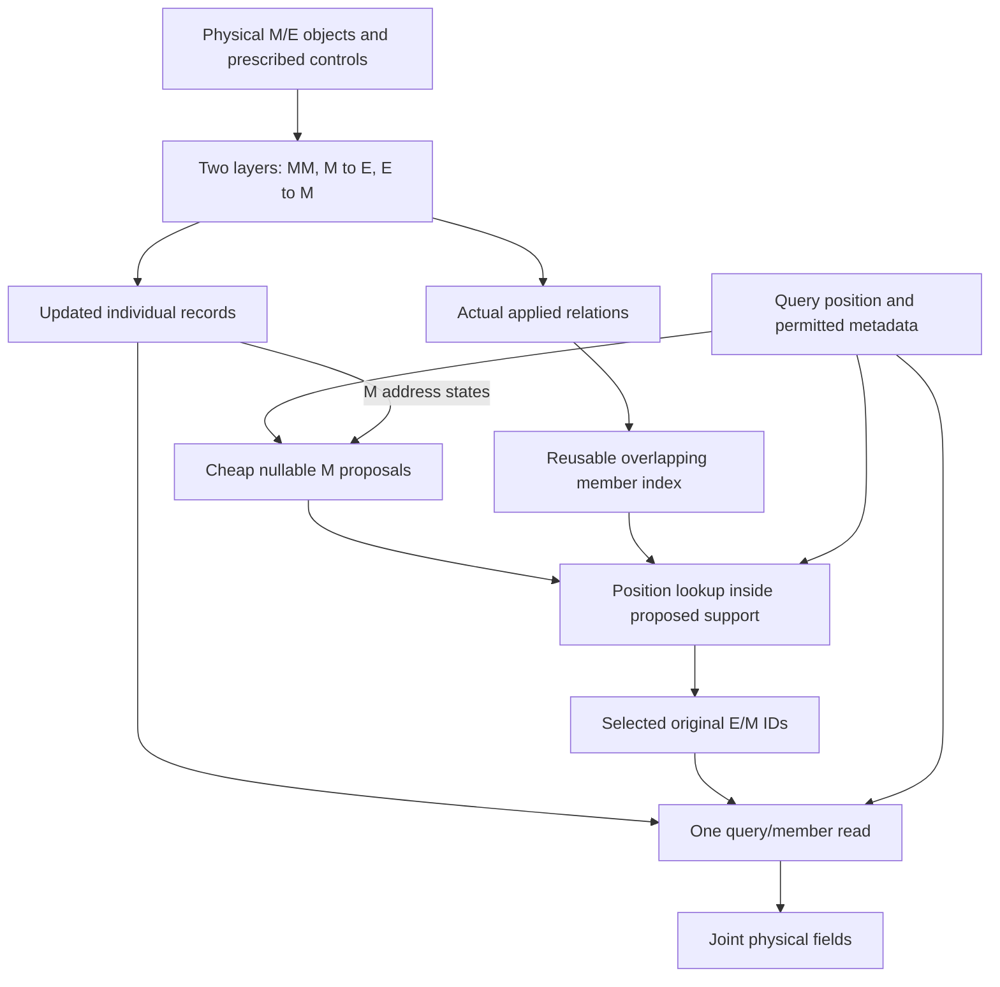

# Round13-3 — Interaction-reused organization and query-directed member access

**Prepared:** 25 October 2026. **Status:** design and execution specification only; this planning round launches no training, changes no active run and revises no historical result. **Scope:** one general HONF organizer/decoder capability, initially exercised on ThermalChannel through its existing native adapter. **Primary comparison:** one common joint-field model with full member access versus the same model with interaction-reused, M-first member routing. Existing A2-D, U-H, R12 and F13 lineages remain protected and separately identified.

## 1. Restore the scientific question

HONF should learn relations that govern how information forms and how it is accessed and distributed, then study the organization scale and real work needed to solve the task. A group identifies members, their relations and supported operations. It may offer shared summaries or local calculations, but individual contextual records remain legal query targets through the organization. A query that follows the organization to selected E/M members is executing routing, not bypassing it.

The intended path is prescribed physical inputs → actual contextual exchanges with applied relations → reusable organization/index → query-dependent, restricted E/M member support → one joint member read → joint physical-field prediction. Preserve original identity, coordinates, physical measures and control ownership throughout. Select support before expensive query/member neural scoring and value work. No additional record-value branch may ignore the organization.

This round deliberately does not define organization as a pre-query pooled feature, a finite spatial reconstruction basis, a tree cut, one mandatory value vector per group, or a prescribed number of groups. Aggregation after a query has selected and evaluated members is ordinary reading. Optional precomputed aggregates are operations the organization may support; they are not the compulsory substitute for every member.

The diagram specifies the proposed dataflow, not a measured result. Individual record values enter the read only through selected IDs. The organization is an access structure, with no required pooled prediction-value node.

The standing [repository instructions](../../AGENTS.md) supersede older default development/promotion rules for new work. All training lengths and handoffs use epochs exclusively. Segmented qualification is capped at500 epochs for the entire round and should stop much sooner once execution is established. The first full-data segment is at most100 epochs per selected model. Further training requires the user's explicit instruction. Neither short segmented fits nor the first full-data100 endpoint establish mature architectural success or failure.

## 2. What A2-D and U-H actually established

The [Round2 report](../docs/reports/_bk/20261014_20261015_Round02_Attention_Geometry/20261014_193935Z_HONF_Attention_Round2_Report.md) records a strong contextual-preparation milestone. At matched exposed development epoch2500, Thermal fluid-temperature mean RMSE changes from A-D2.47444 to A2-D0.949959; Wind near/downstream vector errors change from0.64306/0.455483 to0.273712/0.185800m/s. The change bundles geometry-bearing token values, attention geometry, Q/K normalization, ordered exchanges and other preparation changes. It supports this attention/contextualization direction, not an isolated necessity proof for four routes, two cycles, scene-summary reinjection or dataset-specific prediction laws. A2-H6 remains worse than the direct A2-D control; compressing information into contents was not the demonstrated milestone. The formal comparisons in that report remain mixed against classical baselines.

The [Round11 report](../docs/reports/_bk/20261021_20261023_Round11_Thermal/20261022_135002Z_HONF_Round11_Thermal_Development_Report.md) and [R12 consolidated report](../docs/reports/HONF_Round12_Consolidated_Scientific_Report.md) establish U-H's distinct milestone: relationship gates actually affect contextual exchange and their applied values are reused for member access. In source, `staged_attention_v2.py` calls the live contextual reduction and exports `applied_incidence`; `continuous_joint/unified.py::applied_native_directory` assembles those actual final-cycle gates. Gates, normalized attention coefficients and retrieval self-membership are separate objects. Ordered stage relations do not form one simultaneous physical adjacency.

On exposed0692/M10 at U-H epoch2500,202 entries coexist with about23.40 positive and12.426 effective entries per outside-module query; B is12.11% positive. Other displayed cases have7.38–11.97% positive B. Exact M6/M7→E53 gates0.9512439966/0.9341055751 recur in retrieval, and an E53 query coefficient0.2168742716 contributes0.2063003489/0.2025834662 to access of the original M6/M7 records. This is a concrete working relation-to-member path, not a pooled-value explanation.

These observations establish room to study localized/selective access, not a proven minimum dictionary size. Across467 outside-module queries in0692,193 of202 entries are used at least once. A small per-query effective count cannot justify globally deleting most addresses. At U-H epoch1000, positive M/E support on canonical VAL89 is72.65%/39.79%, yet its configured dense value executor performs100% of eligible rows. In the historical packed lineage, support savings can become executed-row savings, but the checkpoint/backend identities must remain separate.

The broad-row failure is equally concrete: every inspected M-addressed E row at epoch1000 includes all192 E; even M proposal mass0.000366 can open the entire E bank. Sparse EE relations do not prevent this union. U-H therefore supplies the relation-reuse foundation and a measured routing problem, not an already scalable organizer. Its heat-affine/flow-temperature split is a historical Thermal specialization that must not enter the new core.

## 3. Lessons from the detour

| Stage | Useful inheritance | Failure or objective shift to avoid |
| --- | --- | --- |
| R12 compact retrieval | Separates address count from original record/value count | Constructs a new C after encoding; fewer addresses do not ensure fewer member reads |
| R12-2 | Joint prescribed-control inputs/output, typed selected-member executor, original identities | Expected-K incentive rewards roots while actual member access stays broad; independent C weakens interaction reuse; local M protection can hide a dormant M route |
| R12-3 | Actual interaction-derived relations, M-address ideas, measured preparation/read costs | Converts broad root access into a ban on ordinary member access; requires aggregates to replace members and treats detail-dependent fidelity as organizational failure |
| R12-3 reader recovery | Reveals candidate coverage, prior scaling and weak final-M utility | Top-four postings omit most nonnull B mass in seven of eight inspected cases; an independent geometric entrance dominates attention before repair; fixing scale does not restore omitted relations |
| R13 | Useful spatial modes, actual early-relay dependence, bounded implementation | Adds representational capacity to pre-query aggregates and replaces candidate routing by all-group reads; this addresses representation/refinement, not query/member routing |
| R13-1 | More adequate training, full-data evidence and measured nontrivial partitions | Better F13-1 physical prediction does not create a missing member-access path or prove scalable routing |

The decisive design error appears in the original R12-3 plan, already present in commit `2cb6063`: from “a root opens all original E” it infers “remove ordinary member expansion.” The proper inference is to make access conditional and charge its actual work. Its further rule that a detail-dependent reader cannot count as successful group reuse is withdrawn for R13-3. A routed member reader may be the successful organization mechanism.

The retained [R13-1 report](../docs/reports/HONF_Round13-1_Mature_Spatial_Group_Functions_Report.md) records real full-data500 gains: F13-1 fluid/surface temperature mean RMSE0.697816/0.636262 versus F13-0 1.002763/0.958891. Those measured predictor gains remain valid. Every receiver still reads all selected groups, so they do not resolve the member-routing question. Preserve that branch as spatial group-function research rather than erase its results or use it as proof of the corrected architecture. This document does not inspect or alter its run status.

Other lessons remain independent: singleton R12-3 quality losses cannot all be blamed on pooling; removing EE was confounded with other changes; roots are not intrinsically wrong; an address and its members need not have the same identity/type; exact-zero support, field quality, contextual dependence, complete speed and physical causality are different claims. Research ratio bands are descriptive, not launch gates. Long training cannot supply an interface the implementation lacks, while a short fit cannot prove intrinsic capacity failure.

## 4. Token preparation and a generic physical predictor

Prepare original objects as `(id, type, coordinates, extent, attributes, prescribed_controls, measure, presence)`. M/E are initial input roles. Geometry, material, boundaries and control values enter the objects that own them before interaction; a global prescribed condition may use the existing adapter input capability without creating another learned prediction branch. Unknown fields never enter preparation or organization.

Use one shared latent prediction trunk and an adapter-declared output-channel projection. All physical channels derive from that joint representation. Per-channel output columns and native physical extraction are ordinary prediction/observation operations, not separate flow and temperature architectures. Do not import `T = source_coefficients × heat`, an exact zero-heat output factorization, heat-independent flow/routing, separate temperature prediction, a Wind analytical-wake residual architecture, or post-hoc analytical correction as a universal HONF law.

Case adapters retain valid units, training-only normalization, masks, boundary/control inputs, native interpolation, curl and flux/peak extraction. Existing case-owned reference measurements may be reported under their assumptions; they must not silently introduce a universal architectural constraint, extra loss campaign or new solver work. Keep historical specializations loadable without changing their equations. Existing E192 coordinates fix the initial comparison's discretization, not the generic token inventory.

## 5. One interaction layer, repeated twice

The proposed default layer is M←M, E←M, M←E, with ordinary object residuals and FFNs. Stack two such layers with separately named ordinary weights. Write source-to-destination names in reports to avoid the old destination-first `em`/`me` naming ambiguity. With one M, M←M has an empty nonself message; it must not fabricate a second object or an exchange. Absent/zero-information donors keep the maintained empty-read behavior.

Each real exchange applies its learned relation gates during the information reduction. Reuse the existing geometry-aware attention and applied-gate machinery in a narrow new model path; do not add a second post-encoder membership network. Keep both the applied gate I and the normalized attention coefficient A in bounded diagnostics. The initial reuse definition is B taken from the actual head-shared gate I, as in U-H; do not substitute A or attention pictures for I. Existing calibration already mixes heads before producing I, so there is no second head average of that tensor. Use a fixed zero-valued null in the new contextual normalization and account for it in score calibration: copying a physical-donors-only single-M softmax or row centering would erase the intended geometry-dependent M→E amplitude. Reuse its arithmetic pieces, not that entire old normalization law.

Removing E→E is a testable default to remove the E² exchange, not a theorem that the remaining communication is sufficient. Original E states remain available to the member reader, so information is not forced through M or a pooled group on the final value path. M-mediated communication may still lose environmental dependencies; that possibility belongs in the report. Do not claim isolated EE-removal benefit from a comparison in which both models omit EE. A retained-EE trained contrast is not automatically added to this round; a later user-directed comparison can isolate it.

Do not call the existing four-block `applied_native_directory` unchanged when EE is absent, invent an EE matrix, transpose M→E and claim E→M ran, or recompute relationship values from later states. Export the actual directed stage data at the time it controls an exchange. Final E→M uses the final contextual E donor states; those original E states also supply final query values. Final M states may address and contribute values through the ordinary organization-controlled reader.

## 6. Organizer: reusable, overlapping access relations

For the first corrected model, use original M objects as inexpensive address handles and the actually applied E→M relations as their E-member directory. This eliminates the mandatory E-seed address bank without replacing E values. Let I be the actual final-layer gate and define

\[
B^E_{me}=I^{E\to M,L}_{me},\qquad
B^M_{mj}=\mathbf1_{j=m}+I^{M\to M,L}_{mj}.
\]

The MM exchange excludes self, so the identity term does not double-count an exchange. It denotes access to the original address object's own record and is separately reported. B entries are information-access priors, not heat/source amplitudes. Relation gates are dimensionless; physical donor measure enters the declared contextual reduction and the later member reduction in their respective roles, never twice within the same reduction.

Store exact-positive member IDs and gate values with original IDs, typed offsets and compact row pointers. Several M handles can reach one E or M; the directory is overlapping and need not partition space. Do not construct N original seed rows, a dense N×N retrieval directory, a new E merge tree, an aggregate value bank or a learned reconstruction basis. Context preparation still pays its real M² and ME work, record projections and index construction.

M handles are physical addresses, not a claim that there are M physical mechanisms or that learned optimal K=M. This round tests a small, variable-with-scene physical-address family. It does not yet learn an independently minimal number of organizational addresses, and cannot represent every useful environment-only organization. Later address coalescence must share access rules while retaining member identities; it is not implemented by averaging prediction values. Do not retain one new packet per original E and call it learned compactness.

The native pilot contains physical modules. Empty M must remain a valid empty/null computation, without inventing a fake module or opening an unorganized E fallback; this family does not establish adequate representation of module-free environmental problems. Other real object/address types may be needed for such a case and must be declared through the input/organization interface. General joint-channel prediction is not a claim that this initial address family covers every possible physical problem.

Broad M rows remain legal and charged. A tiny positive query address weight must not silently turn into unlimited expensive E access. Do not repeat the old scene-wide top-four truncation: every exact-positive B entry remains in the prepared directory. Query-dependent restriction happens in an explicit index operation over that directory, not by pretending omitted relationships were never applied.

## 7. Decoder: M proposes; query accesses concrete members

### 7.1 Lightweight nullable M proposals

Prepare small proposal keys from final contextual M states. Encode query coordinates and permitted metadata once; score the small M bank with the existing relative-geometry conventions and a low-width projection. Apply the maintained exact-zero sparse normalization with a fixed zero-valued null option. Define π as the remaining nonnull coefficients. There is no mandatory top-two proposal count or forced winner.

Only positive M proposals have member postings visited. With M1, the null preserves query-dependent acceptance/amplitude; it does not magically create a choice between physical modules. An M address does not force its M value to be read. A query can use E values and ignore M values, use M values and ignore E values, or take the null context. Changing true physical input rebuilds contextual states and organization; no historical heat-affine cache shortcut survives.

### 7.2 Query-position restriction inside the proposed organization

Define the logical E support as the union of positive members of the positively proposed B rows. Apply one query-position filter to that union, then retain all positively proposed-row contributions for every surviving E ID. This is a single union filter, not different per-row views whose omitted contributions are later accidentally restored. The logical union need not be materialized: a geometry index can visit bounded local cells and test their IDs against the proposed support. The index is a standard access accelerator, not a pooled field, independent learned organizer or additional geometric prediction branch. It may not introduce unrelated nearby E, nearest-M protection or a full-E fallback. M candidate IDs come from proposed handles and their actual one-hop MM members; do not take an unrestricted graph closure.

The first implementation reuses Thermal's existing catalogue-cell lookup or another already maintained spatial lookup through a small adapter interface. Store common E geometry once and compact per-row membership metadata; do not duplicate point catalogues per module. The initial adapter recipe visits cell rings about the input-geometric query cell in a deterministic order, with at most64 distinct cell visits; within the visited cells order legal records by query distance and original-ID ties and retain at most32 E candidates. Resolve equal-distance cell visits by fixed catalogue geometry order, not learned scores or storage order. Fewer legal records produces a smaller view, including empty; no all-E scan follows. Distance ranking is over the visited view and is not claimed to be the exact global nearest-neighbor result. Name both limits and traversal rules in the config before fitting. These are provisional work limits, not desired active counts or universal physical scales. Confirm or replace the profile once from a small input-selected TRAIN qualification using actual lookup/prepare/read timing; do not sweep it against validation errors. Record truncations, unmatched/null queries and spatial/nonlocal coverage. The generic core must not know24×8 or Thermal channel geometry.

Do not claim sublinear lookup if the implementation scans/sorts every original E or every full posting for each query. An unsupported irregular catalogue is an explicit adapter limitation, not justification for silently allocating a dense query/source search. No generic clustering/index platform is required here. The position restriction is a model approximation to validate: distant contextual records can matter, and contextualization does not prove a local view sufficient. Its failure calls for an identified access-coverage remedy, not a higher-order pooled decoder.

This restriction is essential for interpreting M1 and broad rows. Query-dependent local views can differ even when only one physical address exists; that positional selection alone does not prove the learned relation is useful. Measure the B-dependent support/prior effect separately from the geometry index. If all rows are broad/equivalent and only geometry changes access, report geometry-assisted member reading, not learned selective hypergraph organization.

### 7.3 One joint individual-member read

For the selected view, compose the live access prior

\[
g_e(q)=\sum_{m:\pi_m(q)>0}\pi_m(q)B^E_{me},\qquad
g_j(q)=\sum_{m:\pi_m(q)>0}\pi_m(q)B^M_{mj}.
\]

Keep only the indexed legal IDs and positive priors, deduplicate an original member reached through multiple addresses, and sum its prior once. The equation above is evaluated only on the surviving union-filtered E view and legal M candidates; it has no hidden per-row positional filter. Gather each contextual state, own coordinates, type and information measure. Compute query/member neural scores only for these packed edges. For each head, apply the existing entmax1.5 primitive to member logits `neural_score + geometry_score + log(g) + log(relative_information_measure)` together with one fixed null logit0; mask absent/zero-information members before normalization. Retain the nonnull weights without rescaling them to sum to1. Use their original-record values to form one fused context and joint field head. Geometry contributes through this same score convention; do not add an independently normalized geometric value stream or combine incomparable geometric/B priors as in R12-3.

The reader evaluates query-relative geometry and the original contextual member, not a group centroid as a replacement coordinate. Values may use a simple shared per-record projection, reused across queries that select that record; an extra query-conditioned value network is not required initially. Avoid materializing full query×record neural logits. Normalize on the selected legal support plus null, not on all unselected records. Measure candidate-score rows separately from positive final member values: a zero weight discovered after scoring has not saved that score.

Do not renormalize a tiny proposal into a mandatory full-strength message or hide a null/scale problem with an extra predictor. State clearly which coefficients are gates, priors and normalized read weights; preserve their actual amplitude path and inspect gradients/native behavior. If a coefficient/measure is applied twice in one reduction, repair that computation before fitting. There is no E→conditioned-query→M ordering, protected local M read, raw-layout summary injection, source-linear temperature summation or parallel dense prediction branch.

For fixed latent width and layer count, the intended contextual pair inventory is O(M²+ME), with no EE exchange; original-record FFNs and projections still cost real work. Preparation stores original records and the applied relation/index data, not a value for every candidate subtree. Query addressing still scores all M cheaply and pays bounded cell/member-lookup work, while expensive member pair calculations are limited to the selected E view and legal M candidates. This improves dependence on environment resolution if M stays small; it is not a claim of sublinear search in arbitrary M or measured complete acceleration. Entmax sorting, metadata membership tests, head factors and actual tensor allocation belong in the counters/timing.

### 7.4 Learning support without another controller collection

Train physical inputs, contextual attention/gates, M proposal scores and member read jointly through actual native field losses. Selected π and B numerical values must participate in prediction and receive a real gradient. Integer member IDs alone do not train a proposal network. Exact-zero gates also do not guarantee reopening of closed entries; report active/dormant gradients and TRAIN exposure rather than asserting that sparsity will learn itself.

Use at most one bounded keyed support-coverage mechanism, borrowing existing support-exploration code where useful. Its initial specification is one input-keyed probe query per TRAIN case for an omitted M address and at most one omitted E donor per M row during the final E→M exchange, when omissions exist. Probe/exploration coefficients must be formed from live scores with a differentiable positive contribution; apply an exploratory contextual edge in the actual exchange and export that same applied relation to the directory. Never add a query-only unorganized donor or a dense epsilon background that reopens every record. Count these exposures and train/eval differences. Evaluation uses only the learned ordinary rule.

This is finite coverage, not an unbiased derivative through discrete support, a guarantee of adequate exploration, or a second reward model. Implement only the narrow mechanism needed for observed dormant-support behavior and keep its exact rule in the run config. No20-epoch leaf period, merge delay, forced K, target sparsity, frozen organization, separate risk/share/utility-head collection or stronger compression penalty is introduced. Native training and the measured execution cap define the first experiment; any later task/cost-learning amendment is separately identified.

## 8. Small module interface and code reuse

Keep the caller interface close to `prepare(scene)` and `decode(prepared, queries)`. Preparation returns contextual original records, the applied organization and its reusable index; decode returns joint fields and compact work counters, with detailed traces only on request. Existing case adapters continue native extraction. Keep indexing and packed member execution inside this module rather than exposing many stage controllers to callers. Do not build a second training engine or a general plugin framework.

| Existing source | Reuse | Do not inherit |
| --- | --- | --- |
| `src/honf_forward_core/content_hypergraph/staged_attention_v2.py` | Geometry-aware attention, masks/measures, applied relation capture | Mandatory four-route cycle, scene reinjection or an invented EE snapshot |
| `src/honf_forward_core/continuous_joint/preparation.py` and `incidence.py` | Applied-gate reduction and exact-zero primitive semantics | A four-route policy inventory or automatically copied saturated initialization |
| `src/honf_forward_core/continuous_joint/unified.py::applied_native_directory` | Principle of literal reuse and separate identity access | Its all-record four-block directory and old core's physical law |
| `src/honf_forward_core/contextual_organization/model.py::_aggregate_sparse_edges`, `_group_record_edges`, `_source_context_tiled` | Coalescing IDs, selected-pair scores, selected-record projections and null read | Hierarchical lifecycle,20-epoch leaf rule, independent C, E-first sequencing and local protection |
| `src/honf_forward_core/continuous_joint/primitives.py` | Existing sparse normalization/positive gate | All-eligible score denominator from the old reader |
| `src/honf_forward_core/interaction_groups/model.py` | Bounded-index implementation ideas and prior failure examples | Fixed scene top-four postings, independent geometric entrance, group-value-only decoder |
| Existing contextual/spatial joint task and maintained research runner | Prescribed-control adapter, native targets, joint fields, epoch stop/resume, loss curves | F13 coefficient bottleneck or legacy automatic long-run rules |

The old `continuous_joint/reader.py` computes all-record raw scores before gathering; borrowing its packed reducer alone does not deliver selection-before-scoring. The R12-2 selected-pair reader is the appropriate execution starting point. Extract only genuinely shared arithmetic with focused backward-compatibility coverage. Do not reinterpret old checkpoint equations in place.

Use a narrow new capability, provisionally `interaction_reused_member_routing_v1`, with ordinary versioned configs and one maintained runner dispatch. New generic M-control inputs and joint fields make this a new architecture, not an exact U-H/F13 resume. Default to matched fresh common initialization for the two arms; do not silently transfer segmented, affine U-H or F13 weights into full-data training. Preserve existing historical tensor mappings and loading paths.

## 9. Minimal comparison and execution order

| Arm | Common contextual model | Query read | Question |
| --- | --- | --- | --- |
| R13-3-Full | Two MM/M→E/E→M layers, prescribed-control joint field | All eligible original M/E members through the same selected-edge reader | Can this simpler generic interaction program preserve useful physics without the access restriction? |
| R13-3-Route | Same layer program, common initial tensors, data/objectives/schedule | M proposals → actual directory/index → original E/M members | What fidelity and complete-work change does organization-controlled access produce? |

Both arms retain and apply the contextual relation mechanism. Full changes query access to an explicit all-eligible control; it is not classic1804, A2-D or old U-D. Route-only proposal parameters/costs are reported rather than padded into an allegedly identical parameter count. Neither arm uses pooled field values. Their contrast isolates the query-access restriction within the declared three-exchange family; it does not independently identify the effect of removing EE or establish optimal group cardinality.

First implement and execute small native prepare/decode/backward, empty/M1 cases and save/resume through the maintained runner. Use the fixed segmented TRAIN150/DEV22 manifest for this engineering stage, normally only a few necessary epochs; count all segmented attempts against the whole-round500-epoch ceiling. A script starting successfully is not completed qualification. Save an actual loss curve and a complete short history, verify resumed behavior, exercise selected-member work counters and repair concrete failures. Do not fit a500-epoch segmented predictor simply because500 is available, generate a research verdict from it, or replace real native execution with fixtures.

Then create two separately named full-TRAIN600 runs with one common TRAIN600-fitted normalizer, seed0, identical case ordering/query draws, native objectives, effective batch48/micro24, FP32 and Q1024 primary fluid queries, retaining native surface/material/stencil observations. Use the existing constant AdamW LR3e-4, WD1e-5 and clip1 as a transparent initial recipe, with no new schedule sweep or hidden epoch101 loss change. Separate schedule definition from the actual requested stop. No training target or reference error may enter the organizer/index at inference.

The first full-data endpoint is100 epochs for each arm. At that stop, preserve latest/best and the100 milestone, curves, history, compact native evidence, actual cost and tested user-controlled continuation commands. Stop there and await the user's explicit extension instruction. No automatic500/1000 extension, repeated100-epoch relaunch, extra seed, fixed-K alternative, EE portfolio, inverse head or new dataset is authorized by executing this plan. Numerical/runtime bugs can be repaired within the declared budget; research ratio misses do not impose an earlier admission gate or authorize training until a band passes.

Use the existing native field/observation losses without a response-fitting callback in this first pair. Do not inherit epoch101 objective switches, gradient-balancing calibration, a new physical-law constraint, mixed-geometry fitting or a solver campaign. Existing saved physical-response families are evaluation only in R13-3; retain their historical source/supervision identities and state this round's different fitting exposure. A later response-supervision experiment needs its own user-directed amendment rather than an accidentally inherited parent callback.

## 10. Evidence that answers the routing question

Evaluate the full-data100 endpoints descriptively on canonical exposed VAL89, separately identifying the original DEV22 slice and low-M TRAIN diagnostics. Do not call these independent TEST results or a mature final comparison. Save full statistical per-field means/p90/worst IDs and module-count strata, but detailed fields and routing graphs only for four fixed representative validation cases plus a small M1/M2 TRAIN panel. Full data means every source training case, not reading protected targets from other datasets/partitions.

Show each selected query as a physical-coordinate diagram: M proposal coefficients, directory paths, original E/M candidates, final nonzero member weights and actual omitted members. Include one M1 example, a mixed M/E read, and any E-only/M-only/null outcomes that actually occur. Never fabricate a desired support pattern. Group support and member/query edges are learned surrogate computation, not physical causality.

On at most four fixed cases, perform same-checkpoint no-fit interventions: remove the query candidate restriction while keeping the declared weighting semantics; remove only numerical relation priors on fixed support; compare a count-matched geometry-only or eligible-ID-shuffled access control; and remove one actual contextual message with all downstream states rebuilt. Keep support changes distinct from weight changes and dependent recomputation distinct from read-only interventions. Do not repeat the R12-3 exhaustive diagnostic's duplicate-B error. These small probes do not authorize a new trained arm or all-node campaign.

Measure unique original E/M members, proposal support, B-row degree, composed support before/after positional lookup, candidate-score counts, final value rows, duplicate removal, index visits, nulls and truncations. Report E coverage across queries as well as per-query counts; low per-query use does not establish globally dispensable records. Compare learned relation routing with geometry assistance explicitly. If removing relation information leaves routing/outputs unchanged, report that limitation without adding a loss solely to force a prettier graph.

Measure actual prepare, cached decode, complete native inference and complete training-boundary time and memory, charging original record transforms, relation scores, preparation/index costs, lookup/sorting, query scores, selected values and native extraction. Use one warmup and three synchronized repetitions on a fixed M1 and M10 case, not a benchmark portfolio. Full/Route use the same receiver populations and tiling. No speedup follows from coefficient sparsity, the32-candidate ceiling or absence of EE alone.

Plot native loss/validation trajectories from saved history, physical fields/residuals, actual identity-preserving routes, fidelity versus measured work and existing physical responses where available. All figure labels are English; visually inspect retained PDF masters and only necessary small inline raster companions. Static field fidelity, physical-control/geometry response, useful organization and actual execution savings remain separate evidence axes. No ranking/inverse-design claim is authorized. No heat-to-flow independence check or architecture correction is added.

A100-epoch full-data report may establish which calculations executed, what a saved endpoint measured and what remains unresolved. It may not conclude that HONF or a representation cannot work because the loss still improves or support has not matured. Later user-authorized epochs provide the scientific trajectory. Static defects such as a missing member path, all-record pre-scoring or an unused proposal can be identified immediately and repaired without pretending they require long fitting.

## 11. Resource limits and quiet Luna monitoring

The initial implementation/execution allocation is at most12 process-associated GPU hours across qualification, both first full-data segments, necessary retries and bounded endpoint evidence: qualification2, paired full-data fitting8, endpoint evaluation/timing2. These are finite allowances, not consumption goals or measured device utilization. After the first real native qualification, estimate epoch duration once and state whether the remaining declared work fits. Trim optional exports/repeated timing first if necessary; do not silently change physics, precision, case/query membership or exceed the ceiling. A longer fitting horizon requires the user's explicit instruction regardless of unused allowance.

Retained new scientific payload is capped at4GiB across runs and diagnostics, with512MiB peak temporary payload, zero dataset copies, zero new persistent dataset-cache stores and at least200GiB DATA2 free headroom. Reuse the verified shared dataset/geometry/reference caches and existing DATA2 workspace symlinks. Keep native resolutions/precision and deterministic sampling. Historical checkpoints, active-run files and migration backups are protected. Apply the existing exact allowlist/dependency/open-handle cleanup procedure only to round-owned disposable outputs; report removed bytes, retained evidence and measured remaining capacity. Do not add a cleanup/hash service.

Every training launch, including segmented work, has one read-only monitor explicitly running the available Luna model, with minimal run-specific context rather than an inherited expensive model/full conversation. Give it only the exact run identities, epoch targets, relevant logs, existing completion/failure signals and the notification condition. It performs one startup/epoch-time/ETA check, then normally waits until roughly80–90% of the estimated remaining duration before checking again. Already declared necessary milestones and concrete failures may justify an earlier inspection; routine curiosity does not. No repeated tailing, GPU polling, parent/monitor duplicate checks or hourly status messages when nothing changes. The parent does independent necessary work or rests through available wait/completion mechanisms. Luna reports only completion, failure, material delay or required user action and never launches/resumes/extends a run. No new daemon, scheduler, reservation or admission framework is required.

Preserve existing permissions, job ownership, safe checkpoint handling, writer protection, source/TEST separation and artifact hooks. Default-deny new cryptographic hashes, contract freezes, baseline snapshots and blocking gates. Before proposing an exception, identify the concrete failure and prove why standard Git history, existing IDs/manifests, types, atomic writes and focused tests cannot prevent it. No such exception is established here. Place new blocking gates only at irreversible state changes, cross-system mutations, critical security perimeters or formal production releases. Empirical execution and ground-truth/native measurements take precedence over preflight assertions or heuristic screening.

## 12. Completion and the planning-round record

The execution deliverable is relevant maintained code/configs, focused behavior tests, real segmented qualification, both first full-data100 endpoints or an explicitly documented actual runtime/resource blocker, saved curves/numerical evidence, a readable English report and tested user-controlled continuation commands. Verify selection-before-scoring, stage-correct relation reuse, original-member identity, M1/null/type omission behavior, query-order/tiling invariance, selected-support arithmetic and save/resume. Keep tests proportional; do not add a framework, broad legacy matrix or repeated qualification for unchanged code.

Commit durable changes on the current non-default branch, inspect/fetch the remote, audit the entire outgoing history and use the existing artifact hook before push. No generated figures/data, one-time diagnostics or source snapshots enter Git. Verify remote/local tips match, retain unrelated user changes and report unresolved evidence without a promotion gate. Completing this plan does not authorize its execution or alter the scope of any already running campaign.

For this documentation-only planning round, measured initial free capacity was82,340,225,024 bytes on the home filesystem and3,214,821,478,400 bytes on mounted DATA2. The hard new durable-source allowance is256KiB, temporary allowance128KiB, minimum headroom2GiB on home and200GiB on DATA2, with zero scientific payload/cache/checkpoint/figure writes. Only this plan, standing project instructions and the Thermal protocol's policy clarification are revised. No scientific cleanup or GPU work is needed or authorized by this planning task.

Planning closeout: two independent read-only reviews checked the historical evidence and the routing design; their corrections clarified head-shared applied gates, the single union positional filter, deterministic lookup and the exact null member normalization. Local link, unwrapped-paragraph, epoch-terminology and whitespace checks passed. No scientific payloads or disposable cache files were created;0 files/0 bytes were removed, and existing runs/evidence were left untouched. Retained project changes are the three durable documents, under the256KiB source allowance. At the final storage inspection, home had82,329,870,336 bytes free and DATA2 had3,214,821,478,400 bytes free; unrelated writers may subsequently change those values.
