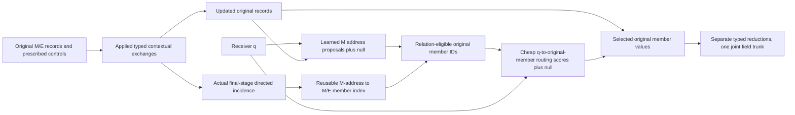

# HONF Round13-3 — Reviewed plan: interaction-reused, query-conditioned original-member routing

**Status:** reviewed execution specification, 25 October 2026; **not an authorization to execute**. **Repository:** `cosmos2w/ModularDT`, `agent/honf-core-next`; source reviewed at `9c8a1c9`. Preserve all later work and the original `HONF_Round13-3_Interaction_Reused_Member_Routing_Work_Plan.md`. **Scope:** ThermalChannel only, with a portable core; no Wind/HET-MF training, new solver calls, inverse optimizer, or long training portfolio. If the original and this reviewed version disagree on the scientific architecture or member selection, this version is the recommended amendment. Historical measurements remain as reported by their original authors.

## 0. Decision and changes relative to the original R13-3 plan

R13-3 has recovered the right research object: learned relations used for *information formation* and reused to control *query-to-original-member access*. A member value read reached through the group is not a bypass. Pooling, spatial moments, a merge tree and minimized K are neither required nor the success criterion. Retain the original record IDs, physical attributes and controls.

The review makes four scientific amendments before fitting: **(A)** retain the established E→E contextual exchange in both initial arms rather than deleting it at the same time as the routing redesign; its later removal is an isolated efficiency hypothesis, not an architectural requirement; **(B)** do not let the primary model's group-to-member selection be only a fixed 64-cell/32-E nearest-geometry cut; retain those rules as a separate *optional, explicitly changed candidate approximation*, and use a lightweight, learned query–member selector on relation-eligible original members in the first scientific model; **(C)** specify independent M and E null-normalized reads followed by one joint physical trunk, preventing competition between 192 E records and a much smaller M bank in one uncontrolled simplex; **(D)** clarify that the matched Full arm is an all-original-member *predictive capacity control*, not a work-matched proof that explicit groups beat trained direct sparse routing. Add cheap fixed-checkpoint attribution probes, not a third new training arm.

The M-first address bank is **one provisional, module-anchored hypergraph hypothesis**, not a universal definition of HONF or learned optimal K. The model can have E-only final *value reads* after a positive M address routes to E members, but it cannot have E access when all M addresses are null or when M is absent. Report this honestly; expose a typed address interface that can later admit environment-native handles without adding an unorganized E-value fallback now.

## 1. Nonnegotiable architecture

The computational path is:

A hyperedge/control row describes relationships and permissible member access, **not an aggregate replacing its members**. All expensive query–member value operations must be reached through the organization, except in the explicitly labelled all-original-member scientific control. Aggregation after selecting original member messages is normal attention/reduction. Optional cached source projections do not become a compulsory pre-query group-value bottleneck. Do not add an independently learned geometric-value, local-M, scene-summary or correction branch to rescue the routed model.

Let each original input record be `Record(id, type, coordinates, extent, physical_attributes, prescribed_controls, measure, presence)`. A `PreparedScene` owns original contextual states, the actual applied stage-labelled incidences, the lightweight address index, original-record projections and work counters. `decode(prepared, query)` returns joint field channels, with traces optional. All scene changes affecting control, geometry, materials, operating conditions, or model weights require re-preparation. Query order/tile size must not change numerical support except documented floating-point effects.

## 2. Preserve effective information formation before testing retrieval

**Initial scientific default:** two ordered stages using the existing MM → EM → EE → ME *destination-first* naming, i.e. source-to-destination M→M, M→E, E→E, E→M. This is the existing U-H contextual capacity, not a claim that E→E is always indispensable. Both Full and Route execute the same stages with their actual continuous relation gates applied to contextual value messages. Keep original-record residuals and the joint prescribed-control input semantics; do not reintroduce the historical heat-affine output head, heat-independent flow constraint or scene-summary corrections as generic laws.

**Reason for changing the original proposed three-route default:** the prior R12-3 G-F-versus-G-EE screen found material surface/detail differences even before adaptive pooling, while all subsequent pooling experiments introduced additional confounders. Dropping E→E while replacing the decoder risks attributing a context bottleneck to the hypergraph router. Leaving it in both arms is a conservative controlled starting point. Report the O(E²) contextual scoring and executed work; later remove it only as a separately named experiment after routing utility is demonstrated.

Use `staged_attention_v2.py` only as a source of geometry-aware projections, masks, measures and ordered stage semantics. For the live gates, use actual `contextual_value_update` / `ContinuousIncidencePolicy` semantics in `continuous_joint/preparation.py` and `incidence.py`. The captured **applied incidence** is the head-shared gate before the headwise normalized attention-weight reduction; it is not itself the normalized attention weight. Never regenerate it from later states or invert a stage to claim a reverse exchange ran. Preserve the exact stage/source-state provenance. The existing policy initializes route biases at +7 (near-all-open): **do not blindly copy that saturated initialization into the new model**. Choose one gradient-active finite initialization on TRAIN inputs, record the actual initial support/gradients and use it identically for both arms; do not tune it against DEV.

This round reuses a limited subset of actual final-stage relations in the decoder. Other exchange stages are legitimate upstream context and must be disclosed; the resulting graph is not a complete causal or input-dependency graph. Do not claim that every applied contextual relation has become a query edge merely because it participated in preparation.

## 3. Define the reusable M-address organization precisely

For present module address `m`, use the **actual applied final E→M exchange** to construct the E-member row and the actual applied final nonself M→M exchange to construct the M-member row:

\[
B^E_{me}=I^{\mathrm{ME},L}_{me},\qquad
B^M_{mj}=\begin{cases}
1, & j=m,\\
I^{\mathrm{MM},L}_{mj}, & j\ne m.
\end{cases}
\]

The superscript ME here uses the existing **destination-first** source-code stage name (`me` means M receives E). Never substitute the earlier `em` gate (M→E) or an attention matrix transpose. The identity term is retrieval access to the original module object and is not a fabricated nonself M→M exchange. Separate record presence from contextual information eligibility; a physically present original module and its prescribed control must not be silently discarded because a contextual donor-measure flag is zero. Check this edge case with the Thermal adapter and document the resulting legitimate information policy.

Store rows in a compact indexed form (original typed IDs, row offsets, source IDs and live differentiable coefficient references), avoiding the old (M+E)² retrieval directory. Multiple module addresses may name the same E/M donor. Preparing postings/index metadata may use nondifferentiable integer support, but retain the *live tensor coefficient* when gathering a selected relation so ordinary gradients reach applied gates; do not inadvertently turn B into a detached saved table. Avoid a permanent Python dictionary of detached scalar probabilities as the neural value path.

No merging of physical modules or environment records, no forced native seed inventory, no K optimizer, no pooling of prescribed heat, no extra bank of learned group-value vectors. K=M here describes **the chosen address family**, not an inferred number of physical interactions or a generally sufficient group capacity. Empty M yields no module-address route; this initial version cannot solve arbitrary environment-only scenarios and must not conceal that limitation with an unrelated E read.

## 4. Two-stage routing: group proposal AND query-dependent member selection

### 4.1 Module-address proposals

From `q` and the final contextual M address states, score present M handles with a lightweight projection and relative geometry. Give the proposal distribution one **fixed zero-value null** using the maintained exact-zero-capable `entmax1.5` primitive (test its explicit null-column implementation):

\[
(\pi_{q1},\ldots,\pi_{qM},\pi_{q\varnothing})
=\operatorname{entmax}_{1.5}(s^G_{q1},\ldots,s^G_{qM},0).
\]

No mandatory winner, fixed top-two, or learned ideal K. A positive proposal selects an organizational address; it does **not** automatically execute every positive member in that address. If every M proposal is zero, the route returns empty typed contexts, not a hidden all-E fallback. Log this case and its impact on prediction. The applied relation gates B must receive gradients through actual contextual messages and the decoder member priors; proposal coefficients π must receive gradients through decoder member priors. An address used only as an integer selector is insufficient.

### 4.2 Relation-eligible original-member union

For each type `t` separately, construct the logical eligible members of positively proposed address rows, coalescing duplicate original IDs and keeping live relation contributions:

\[
\mathcal C_t(q)=\bigcup_{m:\pi_{qm}>0}\{i\in t:B^t_{mi}>0\},\qquad
 a^t_{qi}=\sum_{m:\pi_{qm}>0}\pi_{qm}B^t_{mi}.
\]

**Do not equate `C_t(q)` with the executed source support.** It is only the allowable candidate inventory. The former U-H bug was treating every tiny positive `a` as a mandatory expensive member read; Round13-3 fixes this by adding a second, learned query–member selection step.

For the first scientific model, **do not hard-truncate this inventory by 64 nearby cells or 32 nearest E records before learning selection**. In Thermal E192 and M≤12, evaluating a cheap q–member routing score over up to192 relation-eligible E records is an acceptable controlled information-path experiment. It retains legitimate distant sources and prevents a broad B row from degenerating entirely into fixed nearest-neighbor filtering. Keep any geometry-cell enumeration as opt-in *candidate-approximation research* with a separately named exact-versus-approximate comparison, never an unlabelled same-function executor. The original 64/32 rules may be retained as a disposable profiling candidate, but must not determine the primary model's physical information law.

### 4.3 Learned within-group member access BEFORE value work

For each type `t ∈ {M,E}`, build cheap routing logits only for original IDs in `C_t(q)`, using original contextual keys and query/relative geometry:

\[
r^t_{qi}=f^{\mathrm{cheap}}_{\theta,t}(q,z_i^t,q-x_i)
 +\log a^t_{qi}+\log\nu_i^t,
\]

where `ν` is a **declared, dimensionless information measure**, applied once in this final read (not a second application of the stage's contextual measure); zero `a` or ineligible records are excluded rather than given an unstable log. Use a fixed null logit 0 **independently for each type**:

\[
(\beta^t_{qi},\beta^t_{q\varnothing})_{i\in\mathcal C_t(q)}
=\operatorname{entmax}_{1.5}\big((r^t_{qi})_{i\in\mathcal C_t(q)},0\big).
\]

The actual executed set is **`S_t(q)={i: beta^t_qi > 0}`**, not `{i:a^t_qi>0}`. Evaluate/gather member values only after this exact-positive decision, deduplicated by original ID. The cheap route may still score192 E entries; record that honest O(QE) score work separately from potentially sparse expensive selected value work. The first version may use context-projected original-record values shared between query positions, plus q-dependent attention/relative-geometry weighting. Optional nonlinear `Ψ(q,z_i,Δ)` can later replace/add to the value projection if physical fidelity requires it, but must not be introduced to compensate for a missing route.

Use **independent typed reductions**, not a single M+E normalization that lets 192 E tokens compete directly against a handful of M tokens. Build `c_M(q)=Σ_i beta^M_qi V_M(z_i^M)`, `c_E(q)=Σ_i beta^E_qi V_E(z_i^E)`, with an exact zero for an empty type. Fuse `[q,c_M,c_E]` through **one shared physical-field trunk and one joint output head**. This separates input roles, not output-physics responsibilities; do not reintroduce flow-only or temperature-only heads. Both E-only and M-only final *member read* outcomes are possible after at least one positive M proposal, though not guaranteed; keep null outcomes explicit.

**Gradient health:** exact zero from either entmax can prevent local reopening. Before the scientific fit, execute real small native forward/backward on representative M1/M12 inputs and measure M-proposal, B-incidence, cheap member score, selected-value and joint-head gradients. Use a moderate, task-gradient-active initialization rather than a saturated or all-null policy. Permit at most one ordinary keyed training exposure to otherwise dormant support if the real initial test demonstrates it is needed; document its training/evaluation difference and apply any explored contextual relation to the actual exchange as well as its reused directory. Do not create another REINFORCE/controller portfolio, forced support fraction or target K.

## 5. Match the minimal scientific comparisons honestly

| Arm | Contextual formation | Query values | What the comparison means |
|---|---|---|---|
| **R13-3-Full** | Same two-stage applied MM/EM/EE/ME and joint M/E inputs | Every eligible original M/E, using the same typed value projections, relative geometry and joint head | Dense original-member predictive-capacity reference for the new model family. It is *not* a hypergraph-benefit or equal-work control. |
| **R13-3-Route** | Identical applied contextual stages and compatible common initialized weights | M address → actual B → cheap learned member selector → selected original values | Tests useful, learned organization-controlled original-member access and measures its actual work. |

The two trained models use identical TRAIN600 membership, normalizer, query draws, physical objectives, architecture width/depth, initial common tensors and epoch horizon; the route owns additional address/selector parameters and its all-eligible control does not exercise these identically. Do not claim parameter-identical, same-function or route-only causal attribution from the trained Full/Route difference.

**Small same-checkpoint no-fit probes on Route (≤4 fixed cases, no new training arms):**

1. Change **only B coefficients**, keeping the actual candidate IDs and cheap member scores fixed; measure changes in weights, fields and originally executed work. Also test a legal ID-permutation or geometry-only relation control at comparable actual selected M/E counts, clearly labelling its changed function.
2. Hold B and q-proposals fixed, replace the learned within-group score by geometry-only scores on the *same allowable original IDs*. This distinguishes learned member selection from the candidate relation and from proximity.
3. Open the full relation-eligible candidate union in a diagnostic while keeping the same scoring/normalization convention, then compare with the ordinary exact-positive selected source set. Do **not** call this the trained Full arm: it is a fixed-weights routing intervention.
4. Remove one genuinely applied contextual message and recompute dependent stages; distinguish upstream-formation intervention from a decoder-only frozen-relation intervention.

Preserve original IDs, native masks, target/reference distinctions and actual selected work. In particular, **measure whether B conveys information beyond geometry**. If B is nearly constant and the learned member selector effectively becomes direct sparse selection, report that outcome rather than adding an artificial group-dependence loss to make the graph look important. An equally trained direct-S arm is a later separate research question, not an automatic third fit in this bounded restart.

## 6. Thermal scientific and numerical diagnostics

Use the existing Thermal case adapter for module/control inputs, receiver roles and native observable extraction. Do not encode the old exact `T=Kh` law as the generic architecture. Still report the known homogeneous-zero-heat behavior and existing saved heat/geometry response references **as nonblocking physical diagnostics**; incorrect physical response should not be concealed by nominal field RMSE. Do not add new physics losses, analytical temperature corrections or new reference solves in this round. Keep heat control variables attached to original module IDs, including zero-information-measure/present edge cases where physically applicable.

Record nine existing native observables with per-field equal-case mean, p90, worst case and populated module-count strata; show a small fixed sample of full field/residual maps and local module temperature detail. Separately report TRAIN low-M and exposed VAL89; exposed DEV22 is a subset, not independent TEST. A full-data100 endpoint is preliminary and not evidence of convergence or definitive architectural failure.

In three fixed physical query locations per representative layout, show actual module addresses, original E/M eligible inventories, cheap-score candidate counts, exact-positive final member IDs/weights, and omitted members on original coordinates. Display broad B-row and M1 examples even when they are visually unflattering. Distinguish proposal coefficients, applied contextual gates, query-member normalized weights, and physical output sensitivity. A learned computational relation is not necessarily a causal physical interaction.

One explicit correctness probe should verify the identity: for every original E/M ID in an ordinary selected read, there is a positive address proposal and a valid actual B path; no extra independently read members appear. Check that duplicate paths do not execute values twice, E/M type masks and original IDs survive permutation, source measures are applied once in the correct reduction, query tiling/order does not change the selection, and the null path really returns zero typed contexts. Test absent M, M1, empty/ineligible E, and selected original-record gradient flow. These are ordinary changed-behavior tests, not an additional readiness service.

## 7. Execution and work measurement

Use real selected member execution as the normal Route backend. The Full arm uses all eligible original members with the matching value-projection and joint-head arithmetic; both report scored M/E pairs, **selected actual value-pair rows**, deduplicated records, per-scene projected original values, softmax/entmax sorting, geometric feature work, group/address preparation, context-stage work, native extraction, peak allocated memory and complete call time. `S_t(q)` cardinality, encoded query–source score rows, cached source projections and physical source IDs are different measurements. Precomputing every record's per-scene value projection is not per-query dense value execution, but its real preparation cost remains charged.

Time `prepare`, cached decode, complete native call and one representative complete training macro on the **same permitted available GPU** for M1 and M10. Use one warmup and three repetitions; make these probes disposable and independent of scientific progress. They may show the routed model is slower even when actual selected E value rows fall. Do not infer speed from reduced positive support, the hypothetical 64/32 geometry cap or a sparse-looking diagram. Optimize kernels and candidate indexing only after profiling names the dominant cost.

Keep one **optional** approximation backend for the later measured case where cheap full eligible E scoring dominates. The original deterministic cell-ring visits (≤64) and E candidate cap (≤32), perhaps enriched by relation-ranked distant candidates, are *model-changing candidate restrictions* until an independent full-candidate reference shows exact support completeness. If attempted, compare candidate recall and native field/geometry-response changes against the primary learned member routing on an input-selected panel. Do not silently substitute this approximation for the primary model or claim same-function speed.

## 8. Training and user-controlled stop protocol

**Development/segmented:** fixed input-stratified TRAIN150/exposed DEV22 only to test actual native forward/backward, learned B/query/value gradients, checkpoint/resume, native extraction and runnable logging. The **entire round** consumes at most **500 segmented epochs across all attempts/arms/retries**, usually far fewer; stop when the code path is verified. Do not diagnose intrinsic model capacity or choose the formal model from immature segmented field losses. Record the literal debugging training membership and do not transfer debugging optimizer states as formal scientific evidence.

**Full data:** two separately named scratch TRAIN600 models (`R13-3-Full`, `R13-3-Route`), same one TRAIN600-fitted normalizer, common seed and matched case/query/field-loss recipes. Use maintained AdamW, native receiver observations, original module-count strata, FP32 and the established constant optimizer settings as the initial transparent prescription, without a new training controller. **The first segment is no more than100 epochs per selected model. Stop at the requested endpoint**, produce curves, per-field and routing evidence, actual work and tested resume commands; do not automatically start further training because budget remains. Subsequent epochs require **the user's explicit instruction**. Retain latest, best-field alias and declared 100-epoch milestone; loss curves refresh every10 epochs. All training lengths, continuation instructions, and handoffs use **epochs only**.

The first full-data100 checkpoint is an implementation and early-learning observation, not mature forward or inverse qualification. After that decision the user may choose to continue the existing lineages, change only a measured defect, or stop. Do not predefine a mandatory500/1000 follow-on campaign. No new inverse task, Wind/HET-MF work, independent solver data or response-fitting callback is added now.

**Monitoring:** for every real segmented/full-data launch, delegate one read-only observer explicitly selecting the available low-cost **Luna** model, with only run identity, declared epoch stop, log/checkpoint locations and reporting conditions. Luna checks startup and measured epoch time, estimates ETA, then usually checks near80–90% of expected completion; report only completion, failure, material delay or required user action. The main agent does not duplicate log tailing or GPU polling. Luna cannot launch, resume or extend jobs. Use a permitted available GPU and ordinary interruption/recovery without locking an immutable GPU identity, creating a waiter or interfering with other users' processes.

**Resource plan:** retain the original R13-3 proposed **12 process-associated GPU-hour** envelope for qualification, two initial full-data arms and small evaluation, subject to a single honest forecast after a real native segment (E→E retention and q–member cheap-score work change its expected cost). This is an operating budget, not a maturity gate. If an exact two-arm100-epoch forecast cannot fit, prioritize delivering runnable code and tested user-owned launch/resume commands with the measured cost; do not silently reduce the declared scientific data/query work or demand new pre-launch contracts. Retain the original 4-GiB new-payload, 512-MiB peak-temp, zero dataset-copy and DATA2-symlink storage discipline; perform only ordinary round-owned disposable cleanup without deleting active or historical evidence.

**Security and tooling:** adhere to current repository `AGENTS.md`. Preserve existing permissions, safe checkpoint loading, named optimizer/RNG recovery, writer/job ownership, source-TRAIN/VAL/TEST boundaries and artifact hooks. No new hashes, historical freezes, baseline snapshots, GPU reservation framework or research admission gates. Exceptions require a concrete failure and proof ordinary Git/IDs/types/atomic writes/tests cannot address it. Existing non-negotiable security failures or actual invalid numerical computation are ordinary actionable bugs, not a justification for extra generic policy infrastructure.

## 9. Implementation map and deliverables

Focus on a **narrow new versioned core capability** such as `interaction_reused_member_routing_v1`; use one ordinary maintained runner dispatch rather than another engine. Source ownership:

- `content_hypergraph/staged_attention_v2.py`: four typed stages' real attention arithmetic and native stage capture, not a new one-off execution engine.
- `continuous_joint/preparation.py`, `incidence.py`, `unified.py`: actual applied-gate reduction and stage-labelled reuse; avoid retiring these existing semantics or copying legacy four-block retrieval indiscriminately.
- `contextual_organization/model.py`: only reusable sparse-edge ID coalescing and selected original member-score/value reduction ideas. Do not inherit the old independent C/forest, root policy, dense-risk auxiliaries, inherited M local bypass or original all-eligible denominator.
- `continuous_joint/primitives.py`: tested exact-zero gate/entmax with an explicit null atom; test M1, all-null and zero-measure cases. A type-specific null and query-member selection are new model equations; do not present them as same-function U-H acceleration.
- Thermal native joint adapter/task and `tools/honf_research.py`: original-ID/control mapping, joint output/native losses and the maintained epoch-based run/save/resume lifecycle. No historical model reinterpretation or forced Physical-T affine coefficients.

The implementation order is: **(i)** literal applied-stage reuse and original member-ID selected-evaluation fixture → **(ii)** two-stage learned proposal/member selection with typed nulls and real gradients → **(iii)** small native/segmented actual training and resume → **(iv)** two user-limited first full-data arms → **(v)** fixed-panel evaluation and disposable cost. Do not interrupt other owners' GPU tasks, add a suite of untrained architectural arms or wait indefinitely for idle/exclusive hardware.

Deliver tested maintained source, two executable full-data configurations, representative training/run/resume commands, the original-ID route diagnostic, all-nine-field preliminary native results, same-checkpoint organizational interventions, small physical-response diagnostics, selected PDF master figures with minimal Markdown companions, real executed-work and complete-cost measurements, and an English report distinguishing **predictor / organizer / inverse** evidence. Commit/push durable code and documents on the user's current non-default branch, inspect the complete outgoing Git range and honor the existing artifact hook; keep generated data, figures and one-time helpers on DATA2. The round should terminate at its declared first100-epoch full-data stopping points, or report the actual measured blocker and tested launch/resume handoff. No automatic successor is authorized.
