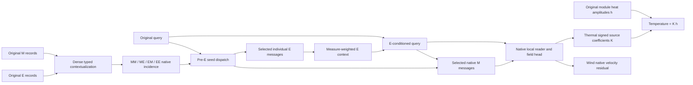

# Joint native hypergraph decoder: matched e3500 decision stop

Round9 gives the decoder a direct, query-specific environment read before it evaluates module responses. Its joint hypergraph organizes original module (M) and environment (E) records together; the selected E messages change the query used by the native module reader, local reader and physical field head. This creates a concrete route for context to change a module's response while preserving its original physical source identity. All four Thermal and four Wind arms reached literal epoch 3500, including the trained direct-sparse control S9-ME. This is the user-amended early evaluation and decision stop, **not completion of the original e5000 horizons**.

The strongest early result is improved Thermal DEV temperature prediction with an executed E-conditioning path. The main misses are incomplete field preservation on selected TRAIN and tails, no established advantage over trained S, visible hard-route spatial seams, and no selected-step or full-cycle memory benefit. Wind accuracy remains mixed. The decoder is a useful research candidate, but these results do not establish mature sparse execution or physical interaction identification.

The [evidence index](HONF_Joint_Native_Hypergraph_Round9_e3500_Evidence_Index.md) records exact checkpoints, manifests, numerical tables and historical failures. All reported endpoint results use literal e3500 checkpoints; best-field aliases were retained but not substituted. DEV is exposed development validation, not independent TEST. Further training and any full-data run await the user's decision.

## What the new decoder makes possible

This is the architectural dependency diagram; the measured graph figure below shows the actual learned incidence and executed reads. E is consumed as individual nonlinear query/record messages before reduction. It is not represented solely by a global average or an additive output correction. The bias-free E projection initially preserves the inherited field boundary, then learns to condition M responses. Thermal retains signed, full-amplitude source columns: E nodes never become heaters. Wind retains its original TRAIN-fitted height profile and residual scaling. Protected local M support, an eligible seed's own record and cross-type partner, and the nearest positive-measure E form explicit floors distinct from learned membership.

The scientific opportunity is a context-dependent response model with inspectable original-record reads and reusable prepared scenes. Dense contextualization remains upstream: a record omitted by the final reader can still influence a selected state. Thus this graph describes executed information flow, not a complete causal graph of the physical system. Geometry-derived E records also do not constitute independently varied environmental forcing.

This is the actual H9-ME graph for fixed TRAIN0231, M12, at e3500. Optional retained MM/ME/EM/EE incidences are 106/144, 2,292/2,304, 2,112/2,304 and 22,329/36,864; separate mandatory self/cross counts are 12, 12, 192 and 192. Original receiver IDs 0/8127/8191 read 9/12, 9/12 and 12/12 modules, with a unique mandatory/protected union of three records each. All three read all 192 environment records: the figure deliberately exposes the still-dense E access. Legal input shifts change 16/13 directory memberships but leave these read counts unchanged; there is no shifted physical reference for a causal claim. The eight-page [actual graph PDF](../../diagnostics/generated/joint_native_round9_20261017T210035Z/figures/graph_work_e3500_attempt2_v1/graph_selected/graph_support_layout.pdf) also shows Thermal M1 and Wind M6/M30, both H and the trained S control; S has direct query gates and no typed seed directory.

The architectural potential is visible in the separation of scene organization, query-selected original records and E-conditioned responses: a single prepared typed directory can support different native receiver reads while retaining interpretable source identity and physical source contraction. The present measurements establish that this path runs and affects outputs. They leave open whether more router training or a revised design can turn it into consistently useful grouping and lower complete cost.

## Predictor: gains, misses and measured fields

The endpoint board covers all Thermal DEV22 and selected TRAIN150 cases, plus all Wind DEV24 direction rows/eight layouts and selected TRAIN72 rows/24 layouts. Every arm uses the same saved receiver identities, native masks, targets and TRAIN normalization. Thermal includes fluid/surface/material temperature, u/v/p/curl, q-proxy and separately recomputed module peaks. Wind includes Ux/Uy/Uz/vector errors in volume, hub slab, downstream envelope, near-turbine and background roles. Its five-role Q8192 board is distinct from the inherited two-region training loss and original monitoring quotas.

Values are equal-case mean errors; parentheses give the p90 across case errors. Percentage pairs are mean changes versus **D9-M / D9-ME**, respectively; negative is better. Thermal uses native field units described below; every Wind component/vector value is m/s. All controls are matched at literal e3500.

### Exposed DEV: Thermal

| Field / role | D9-M mean (p90) | D9-ME | H9-ME | S9-ME | H mean Δ% vs M / ME | S mean Δ% vs M / ME |
|---|---:|---:|---:|---:|---:|---:|
| u | 0.020738 (0.027767) | 0.020113 (0.026385) | 0.018879 (0.024462) | 0.019024 (0.026145) | -8.96 / -6.13 | -8.27 / -5.41 |
| v | 0.0025944 (0.0032643) | 0.0025575 (0.0033059) | 0.002454 (0.0031023) | 0.0025903 (0.0035089) | -5.41 / -4.05 | -0.16 / +1.28 |
| p | 0.010732 (0.014691) | 0.010594 (0.01495) | 0.010516 (0.014812) | 0.010401 (0.014892) | -2.01 / -0.74 | -3.08 / -1.83 |
| omega | 0.048074 (0.066237) | 0.048411 (0.06047) | 0.047852 (0.064376) | 0.046397 (0.060297) | -0.46 / -1.16 | -3.49 / -4.16 |
| T fluid | 0.78274 (1.2989) | 0.86429 (1.4276) | 0.71202 (1.0813) | 0.707 (1.1907) | -9.03 / -17.62 | -9.68 / -18.20 |
| T surface | 0.86097 (1.373) | 0.93147 (1.5296) | 0.7983 (1.3828) | 0.79775 (1.416) | -7.28 / -14.30 | -7.34 / -14.36 |
| T material | 0.91657 (1.667) | 1.0047 (1.6832) | 0.86583 (1.5594) | 0.84093 (1.4768) | -5.54 / -13.82 | -8.25 / -16.30 |
| q_proxy | 3.3234 (5.4422) | 3.3648 (4.738) | 3.2142 (5.2616) | 3.2808 (4.9778) | -3.29 / -4.47 | -1.28 / -2.49 |
| module peak | 1.0227 (2.2073) | 1.0616 (1.7604) | 0.95513 (2.1319) | 0.93953 (1.9445) | -6.61 / -10.03 | -8.13 / -11.50 |

### Exposed DEV: Wind

| Field / role | D9-M mean (p90) | D9-ME | H9-ME | S9-ME | H mean Δ% vs M / ME | S mean Δ% vs M / ME |
|---|---:|---:|---:|---:|---:|---:|
| volume/Ux | 0.066925 (0.082136) | 0.067973 (0.090011) | 0.068704 (0.083438) | 0.068724 (0.08497) | +2.66 / +1.08 | +2.69 / +1.10 |
| volume/Uy | 0.010487 (0.014671) | 0.010505 (0.015247) | 0.010268 (0.014612) | 0.010545 (0.015511) | -2.09 / -2.26 | +0.55 / +0.39 |
| volume/Uz | 0.0074046 (0.011718) | 0.0072581 (0.011974) | 0.0073664 (0.011978) | 0.0073569 (0.012155) | -0.52 / +1.49 | -0.64 / +1.36 |
| volume/vector | 0.068191 (0.084243) | 0.069201 (0.091989) | 0.069927 (0.08511) | 0.069968 (0.087353) | +2.55 / +1.05 | +2.60 / +1.11 |
| hub/Ux | 0.1256 (0.17307) | 0.12645 (0.18787) | 0.12862 (0.16082) | 0.12779 (0.17598) | +2.40 / +1.72 | +1.74 / +1.07 |
| hub/Uy | 0.019735 (0.028287) | 0.019659 (0.028777) | 0.019407 (0.027791) | 0.01955 (0.029276) | -1.66 / -1.28 | -0.94 / -0.56 |
| hub/Uz | 0.011738 (0.0171) | 0.011592 (0.017124) | 0.011684 (0.017548) | 0.011608 (0.01709) | -0.46 / +0.80 | -1.11 / +0.14 |
| hub/vector | 0.12774 (0.17588) | 0.12854 (0.19043) | 0.13069 (0.16422) | 0.12986 (0.17884) | +2.31 / +1.67 | +1.66 / +1.03 |
| downstream/Ux | 0.15768 (0.19142) | 0.15861 (0.20924) | 0.15971 (0.19545) | 0.15951 (0.20076) | +1.29 / +0.69 | +1.16 / +0.57 |
| downstream/Uy | 0.024312 (0.032399) | 0.024275 (0.032282) | 0.023985 (0.031702) | 0.024184 (0.033242) | -1.34 / -1.19 | -0.53 / -0.38 |
| downstream/Uz | 0.016352 (0.023169) | 0.016204 (0.023429) | 0.016255 (0.023049) | 0.016108 (0.023409) | -0.60 / +0.31 | -1.49 / -0.59 |
| downstream/vector | 0.16045 (0.19504) | 0.16133 (0.21298) | 0.16243 (0.19887) | 0.16221 (0.2044) | +1.23 / +0.68 | +1.09 / +0.54 |
| near turbine/Ux | 0.20923 (0.26745) | 0.21045 (0.2691) | 0.20693 (0.2482) | 0.20798 (0.24897) | -1.10 / -1.67 | -0.60 / -1.17 |
| near turbine/Uy | 0.045723 (0.056142) | 0.045194 (0.057583) | 0.044548 (0.054707) | 0.044418 (0.056066) | -2.57 / -1.43 | -2.85 / -1.72 |
| near turbine/Uz | 0.029097 (0.035999) | 0.028889 (0.035776) | 0.029149 (0.036231) | 0.02884 (0.035893) | +0.18 / +0.90 | -0.89 / -0.17 |
| near turbine/vector | 0.21623 (0.27483) | 0.21727 (0.27547) | 0.2138 (0.25728) | 0.21473 (0.25526) | -1.13 / -1.60 | -0.69 / -1.17 |
| background/Ux | 0.034682 (0.041272) | 0.036213 (0.043792) | 0.03644 (0.043136) | 0.036395 (0.043873) | +5.07 / +0.63 | +4.94 / +0.50 |
| background/Uy | 0.0054864 (0.0071971) | 0.0055356 (0.0073666) | 0.005483 (0.0072488) | 0.005793 (0.0079354) | -0.06 / -0.95 | +5.59 / +4.65 |
| background/Uz | 0.0047267 (0.006804) | 0.0046248 (0.0074521) | 0.0048086 (0.006986) | 0.0048527 (0.0077037) | +1.73 / +3.97 | +2.67 / +4.93 |
| background/vector | 0.035466 (0.042062) | 0.036967 (0.044851) | 0.037205 (0.044161) | 0.037219 (0.045126) | +4.90 / +0.64 | +4.94 / +0.68 |

### Selected TRAIN endpoint: Thermal

| Field / role | D9-M mean (p90) | D9-ME | H9-ME | S9-ME | H mean Δ% vs M / ME | S mean Δ% vs M / ME |
|---|---:|---:|---:|---:|---:|---:|
| u | 0.011275 (0.014222) | 0.011549 (0.013022) | 0.0098156 (0.011408) | 0.0089703 (0.010402) | -12.94 / -15.01 | -20.44 / -22.33 |
| v | 0.0018007 (0.00208) | 0.0017625 (0.0020412) | 0.0017221 (0.0019982) | 0.0016794 (0.0019252) | -4.36 / -2.29 | -6.74 / -4.71 |
| p | 0.005954 (0.007046) | 0.0056268 (0.0065188) | 0.0058123 (0.0066288) | 0.0052154 (0.0060754) | -2.38 / +3.30 | -12.40 / -7.31 |
| omega | 0.028462 (0.033921) | 0.028236 (0.032717) | 0.029521 (0.034808) | 0.026258 (0.029854) | +3.72 / +4.55 | -7.75 / -7.00 |
| T fluid | 0.43639 (0.62819) | 0.56497 (0.88025) | 0.41904 (0.60571) | 0.35296 (0.50437) | -3.98 / -25.83 | -19.12 / -37.53 |
| T surface | 0.23705 (0.36628) | 0.46412 (0.82481) | 0.25669 (0.43056) | 0.17497 (0.25166) | +8.29 / -44.69 | -26.19 / -62.30 |
| T material | 0.2404 (0.37022) | 0.53415 (0.93783) | 0.27656 (0.44023) | 0.18468 (0.24688) | +15.04 / -48.22 | -23.18 / -65.43 |
| q_proxy | 0.92617 (1.1585) | 1.1291 (1.4434) | 0.91822 (1.1639) | 0.85601 (1.0555) | -0.86 / -18.68 | -7.57 / -24.19 |
| module peak | 0.23211 (0.37749) | 0.48996 (0.90191) | 0.19999 (0.35552) | 0.19513 (0.3192) | -13.84 / -59.18 | -15.93 / -60.18 |

### Selected TRAIN endpoint: Wind

| Field / role | D9-M mean (p90) | D9-ME | H9-ME | S9-ME | H mean Δ% vs M / ME | S mean Δ% vs M / ME |
|---|---:|---:|---:|---:|---:|---:|
| volume/Ux | 0.031302 (0.036255) | 0.033303 (0.039007) | 0.035286 (0.040064) | 0.032863 (0.038619) | +12.73 / +5.95 | +4.99 / -1.32 |
| volume/Uy | 0.0023691 (0.0028536) | 0.0026326 (0.0034073) | 0.0024577 (0.0029275) | 0.0025335 (0.0031159) | +3.74 / -6.64 | +6.94 / -3.76 |
| volume/Uz | 0.0017391 (0.0021999) | 0.0018831 (0.0023292) | 0.0019339 (0.0023419) | 0.0019742 (0.0024377) | +11.20 / +2.70 | +13.52 / +4.84 |
| volume/vector | 0.031443 (0.036414) | 0.033463 (0.039235) | 0.035428 (0.040245) | 0.033022 (0.038798) | +12.67 / +5.87 | +5.02 / -1.32 |
| hub/Ux | 0.04589 (0.053876) | 0.050676 (0.062057) | 0.055352 (0.066074) | 0.049239 (0.059737) | +20.62 / +9.23 | +7.30 / -2.84 |
| hub/Uy | 0.0036779 (0.0047089) | 0.004252 (0.0056782) | 0.004018 (0.004756) | 0.0040325 (0.0051503) | +9.25 / -5.50 | +9.64 / -5.16 |
| hub/Uz | 0.0026628 (0.0034109) | 0.0027719 (0.0035334) | 0.0029344 (0.0037374) | 0.0028879 (0.0036136) | +10.20 / +5.86 | +8.45 / +4.18 |
| hub/vector | 0.046117 (0.054166) | 0.050933 (0.062371) | 0.055583 (0.06625) | 0.04949 (0.060068) | +20.53 / +9.13 | +7.31 / -2.83 |
| downstream/Ux | 0.061885 (0.069497) | 0.067023 (0.076926) | 0.070227 (0.079704) | 0.065807 (0.073497) | +13.48 / +4.78 | +6.34 / -1.81 |
| downstream/Uy | 0.0051862 (0.0061418) | 0.0057187 (0.0072234) | 0.0055448 (0.0062326) | 0.005309 (0.0062941) | +6.91 / -3.04 | +2.37 / -7.16 |
| downstream/Uz | 0.0037924 (0.0043961) | 0.0039881 (0.004811) | 0.0041456 (0.0047425) | 0.0040809 (0.0047388) | +9.31 / +3.95 | +7.61 / +2.33 |
| downstream/vector | 0.06222 (0.069963) | 0.067389 (0.077441) | 0.070572 (0.080036) | 0.066149 (0.073955) | +13.42 / +4.72 | +6.31 / -1.84 |
| near turbine/Ux | 0.086246 (0.096712) | 0.092269 (0.10359) | 0.098527 (0.11389) | 0.092289 (0.10603) | +14.24 / +6.78 | +7.01 / +0.02 |
| near turbine/Uy | 0.0085362 (0.0095086) | 0.0094381 (0.010898) | 0.0089624 (0.010152) | 0.0090358 (0.010257) | +4.99 / -5.04 | +5.85 / -4.26 |
| near turbine/Uz | 0.0071139 (0.0079684) | 0.0072982 (0.0082046) | 0.0078084 (0.0088632) | 0.0073288 (0.0083357) | +9.76 / +6.99 | +3.02 / +0.42 |
| near turbine/vector | 0.086964 (0.097518) | 0.093044 (0.10443) | 0.099251 (0.1146) | 0.093024 (0.10676) | +14.13 / +6.67 | +6.97 / -0.02 |
| background/Ux | 0.021889 (0.024903) | 0.022594 (0.026026) | 0.023512 (0.028988) | 0.022544 (0.026122) | +7.42 / +4.07 | +2.99 / -0.22 |
| background/Uy | 0.0014583 (0.0016885) | 0.0015447 (0.0018387) | 0.0014417 (0.0016451) | 0.0015984 (0.0018485) | -1.14 / -6.67 | +9.61 / +3.48 |
| background/Uz | 0.0011514 (0.0013221) | 0.0013036 (0.0015788) | 0.0013109 (0.0014897) | 0.0014263 (0.00175) | +13.85 / +0.57 | +23.88 / +9.42 |
| background/vector | 0.021969 (0.025006) | 0.022686 (0.02619) | 0.023594 (0.029046) | 0.022648 (0.026251) | +7.40 / +4.00 | +3.09 / -0.17 |

Full-cohort summaries, worst IDs and module-count/layout strata are retained in the [native endpoint tables](../../diagnostics/generated/joint_native_round9_20261017T210035Z/arrays/report_tables_e3500_v1/per_field_full_cohort.csv) and four [comparison receipts](../../diagnostics/generated/joint_native_round9_20261017T210035Z/arrays/physical_comparisons/); original case-level errors remain in the [board JSON records](../../diagnostics/generated/joint_native_round9_20261017T210035Z/arrays/physical_boards/). The underlying boards, saved receiver hashes and literal checkpoints are linked in the evidence index.

**Thermal gains:** H lowers DEV fluid/surface/material temperature means by 9.03%/7.28%/5.54% versus D9-M and 17.62%/14.30%/13.82% versus D9-ME. Its q-proxy and peak means improve against both. **Thermal misses:** H's module-peak p90 is 2.13189 versus D9-ME's 1.76043 (+21.10%), exceeding the priority-tail band even though the mean improves. On selected TRAIN, H versus D9-M raises surface/material p90 by 17.55%/18.91% and material mean by 15.04%. No populated Thermal priority stratum exceeds the +25% mean investigation threshold; M1/M2 do not repeat Round8's multi-fold small-M failure. Their 23-case TRAIN material means are H 0.12775/0.16257 versus D9-M 0.13468/0.15861; they remain training evidence.

D9-ME itself degrades Thermal DEV fluid temperature mean by 10.42% versus D9-M. Its TRAIN surface/material/peak means are 95.79%/122.19%/111.09% higher, so matching that dense control alone would conceal a substantial miss. S improves Thermal DEV fluid/surface/material means by 9.68%/7.34%/8.25% versus D9-M and passes the listed overall field bands against both dense controls in both partitions. On TRAIN, S lowers those means by 19.12%/26.19%/23.18% versus D9-M; H's corresponding surface/material means are 46.70%/49.76% above S. The hypergraph has no established predictive advantage over the trained direct selector at this age and work mismatch prevents a clean grouping-only interpretation.

**Wind gains and misses:** H's DEV five-role vector means versus D9-ME change by +1.05%/+1.67%/+0.68%/−1.60%/+0.64%; most priority tails improve, and overall DEV field bands against both dense controls are met. This is mixed error behavior, not uniform wake recovery. On TRAIN, H's vector means versus D9-M rise 12.67%/20.53%/13.42%/14.13%/7.40%; hub p90 rises 22.31%, with additional near-turbine/background tail and secondary-component misses visible above. Populated TRAIN strata include M10 hub-vector +81.47% versus D9-M and +56.92% versus D9-ME (three directions from one geometry), so full field preservation is unqualified. These correlated direction rows do not constitute three independent layouts.

Wind S has no overall DEV band miss against either dense control. TRAIN priority vector means versus D9-M rise 5.02%/7.31%/6.31%/6.97%/3.09%, smaller than H's increases, but volume/background Uz means still miss the secondary band (+13.52%/+23.88%). S is not a uniformly improved physical predictor either. The report retains component errors, case tails and layout variation rather than inferring utility from an aggregate score.

The fixed DEV0277 M3 example uses 7,976 valid original fluid receivers and literal e3500 models. Native temperature RMSE is D9-M 0.4988, D9-ME 0.5208, H 0.4947 and S 0.4422. H preserves the main thermal pattern and improves slightly on both dense controls here; the direct sparse control is better on this representative case. Shared prediction/error scales retain the residual structure. [PDF master](../../diagnostics/generated/joint_native_round9_20261017T210035Z/figures/fields_e3500/Thermal_DEV_temperature.pdf).

The fixed selected-TRAIN0006 M1 panel has 3,096 material receivers. Native material RMSE is 0.1124/0.1259/0.1114/0.1079 for D9-M/D9-ME/H/S. It shows no large small-M collapse, but is a training example, not an independent M1 validation case. [PDF master](../../diagnostics/generated/joint_native_round9_20261017T210035Z/figures/fields_e3500/Thermal_TRAIN_M1_material.pdf).

The fixed selected-TRAIN0051 M2 panel has 6,192 material receivers. Native material RMSE is 0.1567/0.4762/0.1584/0.1670 for D9-M/D9-ME/H/S. The dense M+E miss is visible; H largely recovers the dense-M fit on this example, without implying a cohort-wide or grouping-specific gain. [PDF master](../../diagnostics/generated/joint_native_round9_20261017T210035Z/figures/fields_e3500/Thermal_TRAIN_M2_material.pdf).

This fixed DEV row69 view contains only 101 saved native hub-plane points; no target interpolation fills the unobserved plane. Ux RMSE on these plotted points is 0.1518/0.1466/0.1660/0.1237 m/s for D9-M/D9-ME/H/S. The H miss is shown explicitly. These plot-subset errors are distinct from the full five-role cohort table. [PDF master](../../diagnostics/generated/joint_native_round9_20261017T210035Z/figures/fields_e3500/Wind_DEV_hub_Ux.pdf).

The original reporting bands compare H against **both** dense controls: priority mean error within +10%, priority p90 within +15%, secondary mean within +10%, and investigation of populated module-count priority regressions exceeding +25%. They are reported per field, without averaging a miss into a passing scalar. Small or unresolved denominators retain absolute errors and frozen TRAIN scales. Thermal DEV contains no M1/M2 cases; their selected-TRAIN results remain visible and cannot be called independent validation. Full numerical tables retain p90, worst original IDs, populated module-count strata and Wind layout summaries.

### Does the E-conditioned path help prediction?

Fixed-state interventions zero the E context or its projected values while preserving the prepared scene, original support and checkpoint. They test whether the learned E path changes native outputs and whether removing it worsens the available reference error. They do not create an independent physical environmental intervention. Detailed per-field changes, TRAIN-scale and intact-error normalization, exact restoration and both intervention modes are retained in the final numerical tables.

| Fixed four-case Thermal TRAIN panel, zero E context | H9-ME | S9-ME |
|---|---:|---:|
| Fluid-temperature output change / frozen TRAIN scale | 0.00903–0.02616 | 0.01209–0.09525 |
| Fluid-temperature output change / intact RMSE | 0.242–0.542 | 0.660–1.616 |
| Fluid-temperature RMSE increase after zeroing | +2.24–30.71%, all 4 cases | +15.91–106.33%, all 4 cases |
| Surface-temperature RMSE increase after zeroing | +1.53–11.30%, all 4 cases | +94.43–425.29%, all 4 cases |
| q-proxy RMSE change after zeroing | −0.95% to +3.42%, mixed | +35.26–70.21%, all 4 cases |

The temperature changes exceed the declared numerical bands (1e−5 for primitive and 1e−4 for derived normalized quantities) and establish useful operational E conditioning on this exposed panel. H's q-proxy result is mixed; removing E is not uniformly harmful in every field. S also uses E strongly and remains an essential trained control. A successful E ablation does not establish superiority of the joint hypergraph over direct sparse gates, and the independently trained dense M+E arm's weaker Thermal fit shows that simply adding E capacity is not sufficient.

For Wind, the same four fixed TRAIN cases cover five native roles (20 vector-error entries per arm). Zeroing E worsens 19/20 H vector errors and 20/20 S errors. H's absolute RMSE changes range from −0.000283 to +0.062531 m/s; S's range is +0.002708 to +0.056168 m/s. Output changes divided by frozen TRAIN scale are 0.01122–0.06270 for H and 0.01363–0.05558 for S; divided by intact RMSE they are 0.1668–2.7313 and 0.3288–2.7256. Both models therefore make useful use of E on these inputs, while this result alone does not identify a physical environmental mechanism or favor H's grouping rule.

## Organizer: actual reads, logical support and costs

H9-ME and S9-ME each received **only 500 router-training epochs**: 200 dense-estimator epochs followed by 300 epochs of the corrected balanced cadence. Over each later four-epoch cycle, every macro position—including the partial final batch—receives one dense-router step, covering exactly 25% of primary case visits. Dense exposure across all 500 router epochs is therefore 55%. At age 500, unchanged M/E removable-row targets are approximately 0.912578/0.787735, stochastic noise is 0.625782 and relaxation temperature is 0.5. The original deterministic training phase beginning at router age 1001 was not reached. Deterministic inference support and relaxed or stochastic TRAIN support are separate measurements. Insufficient sparsity at this age is inconclusive, not proof of architectural failure.

The following deterministic endpoint counts are actual selected nonlinear rows divided by eligible native query/record pairs. Packed forward rows equal selected rows in these boards. Dense M+E reads all eligible M and E rows; dense M has no E value reader. Pair-weighted retention is shown explicitly; the separate equal-case mean is not interchangeable with it. Original IDs and protection/mandatory membership are retained in the representative typed traces.

| Dataset / partition | Arm | Actual M reads / eligible | M retention: pair / case | Actual E reads / eligible | E retention: pair / case |
|---|---|---:|---:|---:|---:|
| Thermal DEV | H9-ME | 933,859 / 1,064,960 | 87.69% / 89.33% | 33,791,139 / 34,603,008 | 97.65% / 97.65% |
| Thermal DEV | S9-ME | 1,006,209 / 1,064,960 | 94.48% / 95.45% | 30,985,399 / 34,603,008 | 89.55% / 89.55% |
| Thermal TRAIN | H9-ME | 6,148,897 / 6,971,392 | 88.20% / 91.32% | 231,444,322 / 235,929,600 | 98.10% / 98.10% |
| Thermal TRAIN | S9-ME | 6,529,146 / 6,971,392 | 93.66% / 95.81% | 205,155,446 / 235,929,600 | 86.96% / 86.96% |
| Wind DEV | H9-ME | 3,490,898 / 3,735,552 | 93.45% / 93.57% | 10,924,060 / 12,582,912 | 86.82% / 86.82% |
| Wind DEV | S9-ME | 3,307,832 / 3,735,552 | 88.55% / 90.13% | 12,346,903 / 12,582,912 | 98.12% / 98.12% |
| Wind TRAIN | H9-ME | 9,755,957 / 10,616,832 | 91.89% / 91.90% | 32,523,669 / 37,748,736 | 86.16% / 86.16% |
| Wind TRAIN | S9-ME | 9,381,892 / 10,616,832 | 88.37% / 90.46% | 36,643,948 / 37,748,736 | 97.07% / 97.07% |

H and S are not uniformly work-matched within five percentage points: Thermal DEV differs by −6.12 points in equal-case M retention and +8.11 in E; Thermal TRAIN differs by +11.14 in E; Wind DEV/TRAIN E differs by −11.31/−10.92. H’s better or worse error cannot therefore be attributed solely to grouping at an equal work budget. These full-board values also differ from the original sparse-monitor panel and stochastic training stream.

Actual four-epoch engineering forward rows are Thermal H E 331,585,573 and M 15,451,731 versus dense same-mask E 485,446,656 and M 28,288,465; Wind H E 131,294,252 and M 45,952,422 versus 150,994,944 and 65,601,536. Each has an equal number of matching checkpoint-recomputation rows. Thermal valid-selected/eligible rows are E 283,382,981/375,724,992 and M 11,552,069/12,664,124; Wind E 124,694,106/150,994,944 and M 38,897,149/42,467,328. The wider executed/dense rectangles also include estimator work and padding, so their reduction is not all learned omission. Cheap score construction and dense contextual preparation remain executed upstream.

The discarded engineering replay starts from literal e3500 weights, named Adam state and RNG, then replays policy/query epochs 3497–3500. Six complete H cycles compare packed selected execution, a dense same-mask reference and the actual all-open D9-ME function; eight low/high-M probes check same-weight stochastic native forward/backward parity. The all-open engineering control uses the H-source common physical weights with the actual dense M+E function and removes router parameters; it is distinct from the independently trained D9-ME field checkpoint. These 116 optimizer updates are engineering work, not further scientific training. Subsequent replay trajectories evolve independently, so only the initial state and prescribed case/query streams are identical throughout; later supports are not universally identical. Recomputed nonlinear row counts match their original forward counts, and all observed prepared weak references clear and post-clear allocated memory stays constant.

| Dataset | Complete-cycle H packed peak allocated | Same-mask dense peak | Actual all-open D9-ME peak | H selected steps versus aligned all-open steps |
|---|---:|---:|---:|---|
| Thermal | 9,922,950,144 B | 9,922,950,144 B | 7,180,207,616 B | 17.54–28.19% higher allocated memory across 12 selected macros |
| Wind | 6,788,213,248 B | 6,788,213,248 B | 3,711,226,880 B | 81.43–84.70% higher across 15 selected macros |

The desired 20% selected-step memory reduction was not achieved; neither complete cycle reduces peak allocated memory. Same-weight low/high probes against the dense **same-mask** reference show −2.41%/+4.16% allocated-memory change for Thermal and +1.80%/+1.88% for Wind. All native parity checks pass within their sealed numerical bands, but the small low-M Thermal saving is neither a fair all-open baseline result nor a complete-cycle capacity saving. Dense-router steps intentionally evaluate omitted values to restore router gradients; selected-only reads cannot stand in for total training cost.

Complete native calls start from host scene/receiver inputs and end at blocking native CPU outputs, including H2D and D2H. GPU1 is the RTX 6000 Ada; actual Torch threads are four, FP32 with TF32 disabled, one model per fresh process, three warmups and seven timed repetitions. Process/model/provider loading and CPU query sampling are excluded from this per-call scope and remain part of complete campaign cost. Q denotes primary receivers; unchanged native auxiliary extraction can increase total decoded rows. Medians below are milliseconds for fixed input panels, not population confidence intervals.

| Dataset / arm | Q1024 B1 | Q1024 B8 | Q4096 B1 | Q4096 B8 | Q8192 B1 | Q8192 B8 |
|---|---:|---:|---:|---:|---:|---:|
| Thermal D9-M | 22.57 | 41.55 | 23.45 | 46.43 | 22.51 | 46.50 |
| Thermal D9-ME | 32.83 | 112.78 | 45.18 | 193.50 | 45.89 | 192.97 |
| Thermal H9-ME | 49.60 | 140.71 | 63.65 | 268.41 | 64.83 | 266.96 |
| Thermal S9-ME | 40.44 | 124.95 | 54.61 | 238.74 | 54.69 | 237.15 |
| Wind D9-M | 15.63 | 17.48 | 15.13 | 26.15 | 15.17 | 39.03 |
| Wind D9-ME | 19.47 | 25.65 | 21.43 | 52.11 | 26.25 | 89.77 |
| Wind H9-ME | 30.35 | 37.34 | 35.35 | 67.97 | 40.17 | 114.58 |
| Wind S9-ME | 24.75 | 31.73 | 28.37 | 63.79 | 34.47 | 113.49 |

Alternating fresh-process high-M B8/Q8192 pairs give H 280.40–282.31 ms versus the same H-source physical weights evaluated by the actual all-open M+E function at 205.00–206.43 ms for Thermal; Wind gives 119.32–120.33 ms versus 89.06–89.86 ms. The three all-open/H latency ratios are 0.7261–0.7362 and 0.7402–0.7494, respectively: H is slower in these samples. These paired controls are distinct from the independently trained D9-ME rows above, and the high-M panels differ from those mixed-panel descriptive rows. A speedup was not required and is not claimed.

| Dataset / arm | New-query B1 setup → call (ms) | New-query B8 setup → call (ms) | Fixed-heat B1 setup → call (ms) | Fixed-heat B8 setup → call (ms) |
|---|---:|---:|---:|---:|
| Thermal D9-M | 19.85 → 10.71 | 34.53 → 29.15 | 22.47 → 2.31 | 46.43 → 2.58 |
| Thermal D9-ME | 21.73 → 19.19 | 36.34 → 101.15 | 44.44 → 2.68 | 192.03 → 3.06 |
| Thermal H9-ME | 30.15 → 28.42 | 43.80 → 122.16 | 65.93 → 3.13 | 268.68 → 3.36 |
| Thermal S9-ME | 21.81 → 27.57 | 36.40 → 114.14 | 54.93 → 2.93 | 238.66 → 3.11 |
| Wind D9-M | 12.69 → 3.58 | 12.84 → 5.52 | not applicable | not applicable |
| Wind D9-ME | 14.56 → 6.01 | 15.37 → 12.29 | not applicable | not applicable |
| Wind H9-ME | 22.45 → 10.15 | 24.16 → 16.38 | not applicable | not applicable |
| Wind S9-ME | 14.58 → 10.82 | 15.04 → 17.85 | not applicable | not applicable |

New-query reuse uses Q1024; Thermal fixed-query/new-heat reuse uses Q8192. Setup transfers/prepares the retained scene (and fixed-query factors when applicable) once. Timed new-query calls transfer the new receivers; fixed-query calls transfer only the new heat amplitudes. Both return complete native CPU outputs, and every arm passes fresh-versus-retained native numerical parity. These are different scopes from a complete scene call, with their setup charged separately. In the H Thermal B8 fixed-heat case, setup peaks at 4,775,623,168 allocated bytes; the post-setup live allocated baseline (model, prepared state and live inputs) is 77,870,592 bytes and the subsequent native call peaks at 95,407,104 bytes, while reserved memory remains 6,220,152,832 bytes. A small retained-call allocation is not a reduced setup or training capacity requirement.

The fast heat-contraction reuse preserves the inherited heat-affine physical capability and is available to all four arms; it is not a unique hypergraph speedup. Full-call/reuse allocator records, all 24 reuse measurements and the twelve alternating paired measurements are retained in the [actual inference summary](../../diagnostics/generated/joint_native_round9_20261017T210035Z/receipts/actual_inference_attempt2_summary_v1.json).

The trained S control is included in field, actual-read, E-path, native physical and full-call/reuse audits. Its observational scientific four-epoch cycle is reported separately from H's engineering replay. Relative to D9-M/D9-ME, S's whole-epoch allocated peaks were 5.369×/1.371× for Thermal and 1.047×/1.808× for Wind; native-time ratios were 4.545×/1.197× and 3.061×/1.308×. These are independently evolving scientific trajectories on GPU1, not same-weight backend comparisons. No S phase-separated selected-training-memory or 20% saving claim is available.

The e3500 Thermal engineering cycles reduce executed nonlinear rows while retaining a higher allocated-memory peak than the actual all-open M+E function; paired complete calls are slower. Allocated bars/curves and reserved allocator ticks/curves remain distinct. The historical twenty-epoch GPU2 lifetime panel is explicitly separate from the e3500 GPU1 endpoint measurements. The four-page [work and cost PDF](../../diagnostics/generated/joint_native_round9_20261017T210035Z/figures/graph_work_e3500_attempt2_v1/work_selected_v2/work_memory_latency.pdf) includes Wind, the observational S scientific cycles and all native reuse scopes; its numerical tables retain eligible/selected/padded rows, projections and recomputation counts; protected-floor masks are recorded in the actual graph tables.

## Physical responses and interaction-evidence limits

The saved reference response audit covers four original TRAIN families and retains both finite geometry changes and heat controls. Over eight geometry×geometry quartets, mixed fluid-temperature RMSE averages are D9-M 0.019085, D9-ME 0.019328, H 0.029384 and S 0.027969 native units. H is worse by 53.97%/52.03% versus the dense controls; S is worse by 46.55%/44.71%. For mixed solid temperature, H is slightly better (0.025410 versus 0.026497/0.026130), while S is worse (0.034536). The available physical response evidence is therefore mixed, with a clear fluid-response miss.

For the promoted affine heat-increment control, solid-temperature RMSE improves to 0.015025/0.012961 for H/S versus 0.020545/0.017623 for D9-M/D9-ME. Fluid-temperature values are 0.017073/0.013905 versus 0.021554/0.016775: H is mixed and S improves on both. The independent rank-two heat-null catalogue gives near-zero residuals of about 2.51e−7 fluid temperature and 4.10e−7 solid temperature for all arms, supporting the preserved affine law rather than a hypergraph-specific interaction gain. These quantities use saved physical arrays and no new solver calls.

All eight full-native invariance/value-control jobs pass their declared numerical envelopes. The worst normalized RMS discrepancies are 5.0265e−6 for Thermal q-proxy against a 1e−4 limit, and 2.2112e−6 for Wind near-turbine Uy against a 1e−5 limit. These are the planned value/invariance checks, not a spatial smoothness guarantee.

Hard-route seam discovery finds four crossings in each dataset/arm combination for H and S (16 total); all twelve cross-arm replay jobs evaluate the same four coordinates. At the smallest Thermal half-step, 1.2e−6 native xy, maximum absolute temperature jumps remain 0.268725 for H and 0.163653 for S. Both dense controls at H's points give maxima of 1.31e−6/2.86e−6; at S's points they give 1.40e−6/7.90e−7. At Wind half-steps of about 2.8e−6 rotor diameters, maximum absolute (Ux, Uy, Uz) jumps are (0.001321, 0.000952, 0.000304) m/s for H and (0.013512, 0.001844, 0.000873) m/s for S; both dense controls remain at or below 1.91e−6 m/s at the same coordinates. Thus the hard routes introduce visible seams. The Thermal continuous-core probe is distinct from literal native curl, which accepts cell centers; the separate adjacent-cell diagnostic is not a continuity limit.

Count-matched score/geometry controls preserve each query's learned final per-type counts, and independently evaluated dense same-mask native parity passes all four cases for each dataset/arm. Thermal H mean fluid-temperature RMSE is 0.42384 learned versus 0.47171 score-ranked and 1.19413 geometry-ranked; S is 0.33620 versus 0.33620/0.34191. Wind H mean volume-vector RMSE is 0.03590 m/s versus 0.03139/0.03506, so learned grouping does not win there; S is 0.03105 versus 0.03105/0.03169. H M-incidence rewiring raises the corresponding errors to 1.12123 and 0.04311, while E-only rewiring changes them little (0.42373 and 0.03590). Rewiring preserves incidence degrees but can change the protection-union work; it is distinct from the exact final-count controls.

All 32 planned legal layout shifts are available. Across Thermal H they change 454 directory memberships but no final reads or dispatches; across Wind H they change 17 directory memberships, ten final reads and one dispatch. Wind S changes five reads and Thermal S none. This demonstrates some input-sensitive organization, with limited downstream adaptation on this panel. There are no matched shifted physical references, so these effects do not establish improved physical response fidelity.

Thermal temperatures are native temperature differences relative to the prescribed zero inlet/wall reference, without an established Kelvin/Celsius calibration. Native heat controls are per-solid-cell source amplitudes, not integrated watts. Pressure has the native outlet gauge removed, without a recorded Pa conversion; q-proxy is a harmonic-conductivity-scaled sampled temperature-jump proxy, not an independent conservation solve or calibrated W/m². Adapter-exported signed K already includes the temperature scale and is not scaled again. Wind velocities are m/s, reconstructed as TRAIN height profile plus normalized residual × safe standard deviation × 9 m/s; no absolute-velocity mean is added to the residual.

The saved Thermal response catalogue offers four families with baseline, geometry perturbations and heat-only states, but lacks the complete geometry-plus-heat factorial and independent environmental excitation needed for broad physical interaction identification. The rank-deficient heat direction in the available M3 family remains a limitation. Analytic-wake/shared-grid references are not certified CFD validation, and the historical Thermal generating revision remains unresolved. Fixed-support ablations and typed rewiring establish model dependence only; legal geometry changes require their own compatible physical reference before their error can be interpreted physically.

The official Thermal fixed-TRAIN support monitor did not trigger its >0.15 drop test at e3300. A separately labelled historical diagnostic under broader work denominators was attempted once and failed exact native-loss equality. For e3275→3300, valid-pair M retention fell from 1.0 to 60,631/80,460 (−24.64454 percentage points), removable equal-case retention fell 18.28839 points, while the official equal-case total fell only 11.85803 points and did not trigger its 15-point rule. Counter/state restoration passed, but denominator/support comparisons after the assertion were not reached; the mismatching loss values were not serialized, so the discrepancy cannot be quantified or dismissed as roundoff. The failure is preserved and no looser tolerance or repeated test is substituted.

The saved original-TRAIN family0001 geometry quartet gives a physical mixed finite temperature response at 7,919 common-valid native receivers. At e3500 its RMSE is D9-M 0.02913, D9-ME 0.03315, H 0.03408 and S 0.04033 native temperature units. H's localized response residuals remain visible and this representative response does not improve on either dense control. Shared scales and native points prevent a learned read graph from substituting for response fidelity. The separate baseline-to-heat-transfer-plus delta is exposed supervised training evidence; independent environment forcing and a compatible geometry-plus-heat combined endpoint are absent. [PDF master](../../diagnostics/generated/joint_native_round9_20261017T210035Z/figures/interactions_e3500/thermal_geometry_mixed_temperature.pdf).

## Inverse: what was and was not qualified

No new solver or inverse campaign was run. The optional saved-design ranking remains conditional on field, E-effect, actual-omission and measured-memory prerequisites. The measured memory prerequisite is unqualified at e3500, so the six-candidate, single exposed M3-layout ranking is not promoted into an unconditional test or a new optimization campaign. It provides no newly validated design, inverse success or independent physical interaction evidence. The inherited 326/326 closed solver accounting remains a pinned lineage receipt; the bounded search did not find an independent global ledger, so this is not a newly audited global solver total. Round9 adds zero solver attempts and leaves TEST locked.

## Exact training identity and learning history

D9-M continues the literal D8 e2500 parent for 1,000 new development epochs. Dense M+E warms from D8 to e3000 once per dataset; D9-ME, H9-ME and S9-ME then share that boundary and each train for 500 epochs. H uses joint typed incidence; S uses independently learned query-to-M and query-to-E gates with the same value function. The D9-M source snapshot is `scientific_a13329d` (`a13329d85b0895a58f87e4883f65b8f741f71a35`); warm-up and fork fits use the recorded `scientific_96ca8be` snapshot (`96ca8bef53a44c267799e9a97e145e7a2d6732a6`). Current evaluator bytes are separately pinned. Base `6ecc1086454705dc791d9ea782dba0f68b459e55` was verified as an ancestor and later user changes were preserved.

| Executed exposure | Thermal | Wind |
|---|---:|---:|
| Selected TRAIN population | 150 cases | 72 direction rows / 24 layouts |
| D9-M updates | 4,000 | 5,000 |
| Shared M+E warm-up updates, charged once | 2,000 | 2,500 |
| Each of D9-ME/H9-ME/S9-ME post-warm updates | 2,000 | 2,500 |
| Total scientific optimizer updates | 12,000 | 15,000 |
| Primary case visits | 450,000 | 216,000 |
| Primary query/receiver rows | 460,800,000 | 1,769,472,000 |
| Native effective / microbatch | 48 / 8 | 16 / 8 |
| Updates per epoch, including final partial batch | 4 | 5 |

All eight final models and named Adam tensors were finite (6,494 checked tensors). The final 300 epochs have identical case/query and effective/micro/partial update streams across the four arms within each dataset; saved e3200 sources and earlier histories remain unchanged. The common AdamW schedule is constant 3e−4 with weight decay 1e−5. Initialization seeds are zero; sampler seeds are Thermal zero and Wind 42. Membership, TRAIN-fitted normalization, physical losses, deterministic query draws, response cadence and original checkpoint retention were preserved. The total is 27,000 scientific updates; the original 81,000-update e5000 campaign is uncompleted and unauthorized.

Strict Thermal one-step common-parameter optimizer parity failed with maximum absolute difference 2.9802322387695312e−8, despite passing the separately defined forward recovery envelope. That failed receipt is retained; exact inherited state is not a claim of bitwise-identical subsequent computation across architectures. Wind's corresponding strict audit passed. Standalone e3500 exports for all eight models passed guarded CPU native-inference comparison with ancestor/dataset reads denied during forward execution; this checks packaging, not field efficacy or GPU speed.

The actual nine-term Thermal histories retain spikes and the shared e2500–3000 ancestry; all three M+E descendants begin at the same boundary. No smoothing or selected-checkpoint substitution hides instability. The five-page [learning PDF](../../diagnostics/generated/joint_native_round9_20261017T210035Z/figures/learning_e3500_v2/learning.pdf) also contains original DEV monitors, Wind training/monitor curves, routing/dual evolution and measured dense exposure. Original monitor quotas differ from the endpoint physical boards.

Hard retention remains much higher than relaxed retention in several curves, particularly Thermal E. Dual saturation and an only partly completed sparsity schedule limit what can be concluded after 500 router epochs. These equal-case fractions must not be confused with pair-weighted valid-present counts or actual nonlinear rows.

## Execution cost, storage and preservation

The [deduplicated complete-cost receipt](../../diagnostics/generated/joint_native_round9_20261017T210035Z/receipts/complete_cost_exposure_e3500_v4.json) records 27,000 successful scientific optimizer updates (12,000 Thermal and 15,000 Wind) and 599 discarded engineering updates within the original 600-update cap. Shared warm-up is counted once. Primary exposure is Thermal 450,000 case visits and 460,800,000 query receivers; Wind 216,000 and 1,769,472,000. Additional native union, surface/material and saved-response receiver counters are retained separately because their scopes overlap and cannot be summed as independent samples.

| Measured execution scope | Seconds | Accounting meaning |
|---|---:|---|
| Complete scientific subprocesses | 22,010.150 | Cold/setup, training, monitors, saves and driver overhead included |
| Historical e3000 boards | 82.064 | Preserved earlier boundary measurements, not repeated |
| Nonterminal engineering/calibration | 764.499 | Includes 103.790 s calibration; no second addition |
| Terminal GPU-associated scope including outer overhead | 1,500.886 | All endpoint attempts, failures and recoveries; nested engineering counted once |
| Total accounted GPU-associated process time | 24,357.599 (6.766 h) | Process elapsed time, not measured GPU kernel-active time |
| Terminal CPU comparison scope | 5.802 | Separate from GPU-associated time |
| Recorded CPU rendering/export/regression intervals | 47.815 | Includes failed/superseded work where timing was recorded |
| Campaign wall at final cost extraction | 28,950.387 (8.042 h) | Includes review, CPU work and waiting; these scopes overlap |

Terminal owner charges are 380.257 s boards, 402.853 s physical audits and 694.176 s execution audits, below the unchanged 600/600/1,500 s category limits and 2,700 s shared ceiling. The slightly wider terminal subprocess scope adds measured outer wrapper overhead; it is not added a second time to the total. All 156 applicable logical outputs completed; six failed owner attempts remain visible. CPU summary/index generation, visual-review time and durations absent from receipts are explicitly unavailable, not zero or inferred GPU time. Later document validation, cleanup and Git operations are administrative closeout rather than new model execution.

Early science ran on GPU2 and later science plus all terminal endpoint comparisons on GPU1, the authorized priority device. The actual devices, process scopes, failed attempts and foreign-process observations are retained. GPU2 had external contention during part of the campaign; whole-campaign training wall time is not an uncontended architecture benchmark. The clean paired endpoint measurements use the same GPU1, FP32 settings, four Torch threads and complete host-input/native-CPU-output scopes. The 24-hour reservation and two-hour closeout reserve retained their original start, with no new authorization inferred from elapsed time. Nine thousand one hundred fourteen GPU1 training observations have no missing samples, a maximum 2.546 s gap and a minimum 15,052,308,480 free bytes.

Storage preparation verified the intended mounted `/data2` filesystem and retained the original 40 GiB payload, 15 GiB temporary, 55 GiB peak and 30 GiB minimum-free-space limits. Existing verified shared data/cache identity was reused; no datasets were copied or scientific precision/query draws changed to save space. Exact endpoint checkpoints, latest/best aliases and declared milestones, full histories, native numerical evidence, failure records and source snapshots remain retained.

Exact recursive allowlists and retained receipts document removal of **585 regular files (23,017,069 bytes) and 129 symlinks (16,520 link-payload bytes)** across 18 cleanup events; at least 406 inventoried directories were removed, with incomplete historical directory counts disclosed. Selected PDF/PNG figures and numerical arrays remain intact. The [final protection check](../../diagnostics/generated/joint_native_round9_20261017T210035Z/receipts/final_cost_cleanup_protected_closure_v1.json) verifies all eight endpoint checkpoints, nine historical protected artifacts and five unrelated user changes. Of 802 historical source pins, the one authorized public evaluator repair resolves explicitly to archived original bytes; all remaining historical sources match. No native Round9 process or GPU1 compute process remains, and unrelated GPU jobs were left untouched. Open-handle checks are limited by process visibility; kernel-protected and other-user mappings are not claimed to be globally observable.

The [final retention/capacity snapshot](../../diagnostics/generated/joint_native_round9_20261017T210035Z/receipts/final_tmp_retention_and_capacity_v1.json) records 2,659,391,170 retained bytes plus 2,406,008 bytes under the temporary namespace, totaling 2,661,797,178. The latter are required native birth/resume/fresh-fit binding proofs (2,015,250 bytes), eight source helpers (22,158 bytes) and a unique historical pre-seal manifest source (368,600 bytes), not disposable cache payloads. No unnecessary cache, dataset copy or raster remains. Actual free space at that snapshot is **3,374,263,619,584 bytes on `/data2` and 163,896,655,872 bytes on `/`**, comfortably above the unchanged floors. Summary/index construction and administrative receipts add only small metadata afterward; the timestamped capacities are observations, not an assertion that other users stop writing.

## Decision

**Recommendation: retain the current stop; do not launch a full-data run yet.** The new decoder has a real, inspectable context-to-response path and useful Thermal DEV behavior, but H does not yet beat trained S consistently, misses selected-TRAIN/tail bands, retains hard-route spatial seams, and does not deliver a memory reduction. Five hundred router epochs are too early to call the eventual sparsity schedule a failure; they are also insufficient to claim a mature sparse organizer.

If the user chooses further training, the most informative selected extension is the **matched Thermal D9-M/D9-ME/H9-ME/S9-ME comparison**, retaining both dense controls, unchanged scientific identity and explicit field/tail/work accounting under a new budget. Preserve S because it is a strong current predictor; preserve D9-M because the new dense M+E baseline degrades some fields. Wind's selected-TRAIN and stratum misses make an automatic Wind extension less compelling. A model revision addressing hard-route seams is also justified by the continuous-coordinate audit; further epochs alone are not evidence that this architectural issue will disappear. A separately labelled full-data run should be proposed only after choosing a useful predictor and stating which organizer and interaction claims remain unvalidated. Speedup is not a condition for scientific usefulness.

The current checkpoints, native numerical evidence and visualizations are retained for the user's choice between extending these comparisons and revising the models. No epoch after 3500, new solver, locked TEST evaluation or formal full-data run is started by this report.

## Figure index

All eight PDF masters (22 inspected pages) and nine embedded raster companions are retained locally. The selected views use literal e3500 models and fixed development panels; no figure is substituted for its full numerical cohort.

| Figure family | PDF master | What to inspect |
|---|---|---|
| Actual M/E organization, H and trained S | [8 pages](../../diagnostics/generated/joint_native_round9_20261017T210035Z/figures/graph_work_e3500_attempt2_v1/graph_selected/graph_support_layout.pdf) | Typed incidence, mandatory/protected floors, original receiver reads, legal input shifts and near-dense cases |
| Thermal DEV temperature | [1 page](../../diagnostics/generated/joint_native_round9_20261017T210035Z/figures/fields_e3500/Thermal_DEV_temperature.pdf) | Physical prediction and signed residuals against both dense controls and S |
| Thermal TRAIN M1 material | [1 page](../../diagnostics/generated/joint_native_round9_20261017T210035Z/figures/fields_e3500/Thermal_TRAIN_M1_material.pdf) | Explicit small-M exposed example |
| Thermal TRAIN M2 material | [1 page](../../diagnostics/generated/joint_native_round9_20261017T210035Z/figures/fields_e3500/Thermal_TRAIN_M2_material.pdf) | Dense M+E miss and its partial recovery |
| Wind DEV hub Ux | [1 page](../../diagnostics/generated/joint_native_round9_20261017T210035Z/figures/fields_e3500/Wind_DEV_hub_Ux.pdf) | Native saved points, no interpolated targets, visible H miss |
| Saved physical mixed response | [1 page](../../diagnostics/generated/joint_native_round9_20261017T210035Z/figures/interactions_e3500/thermal_geometry_mixed_temperature.pdf) | Geometry quartet and signed response residuals, distinct from learned read support |
| Actual work, memory and complete cost | [4 pages](../../diagnostics/generated/joint_native_round9_20261017T210035Z/figures/graph_work_e3500_attempt2_v1/work_selected_v2/work_memory_latency.pdf) | Thermal/Wind row counts, full-cycle capacity, S observations and charged reuse setup |
| Full learning and routing histories | [5 pages](../../diagnostics/generated/joint_native_round9_20261017T210035Z/figures/learning_e3500_v2/learning.pdf) | Spikes, native terms, original monitors, duals and router age |
