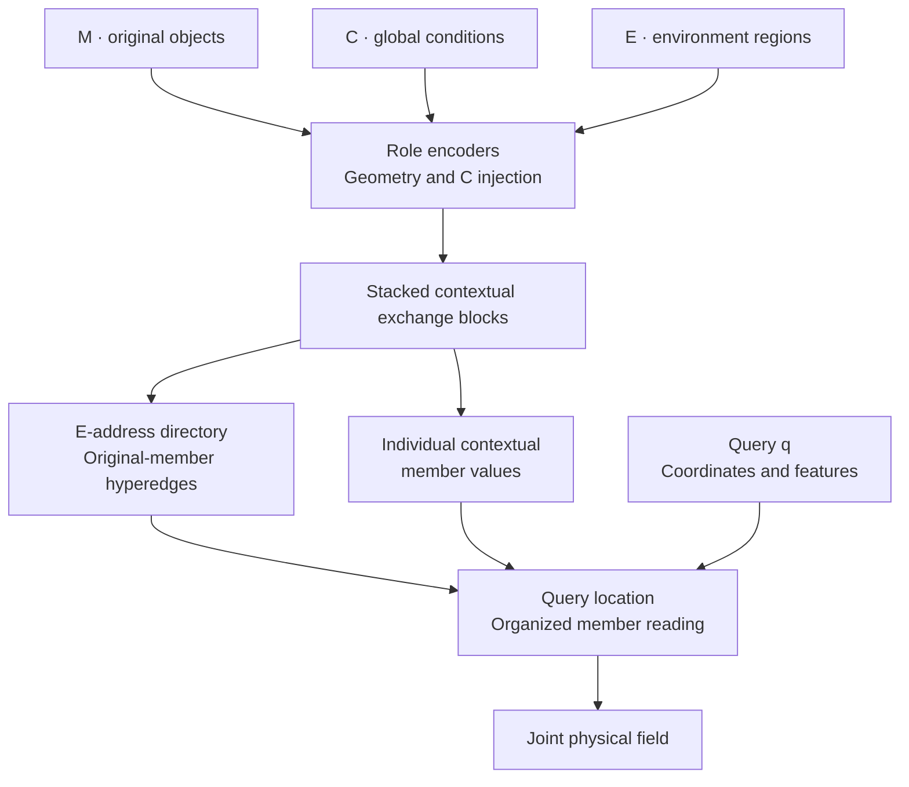
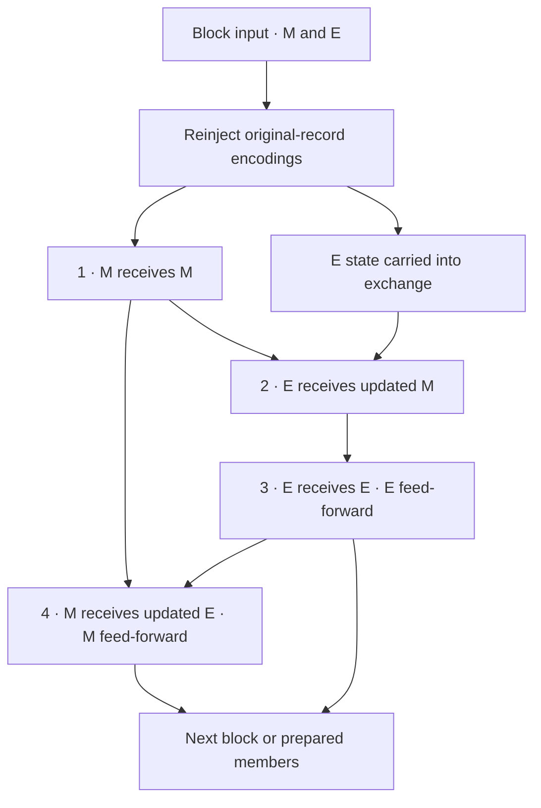
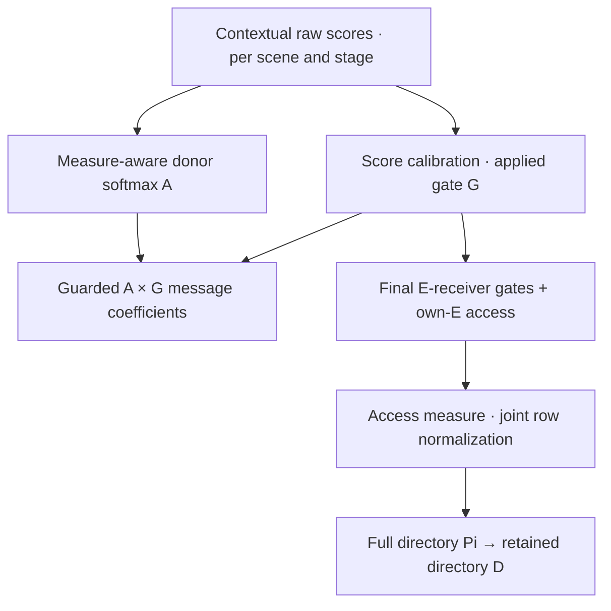
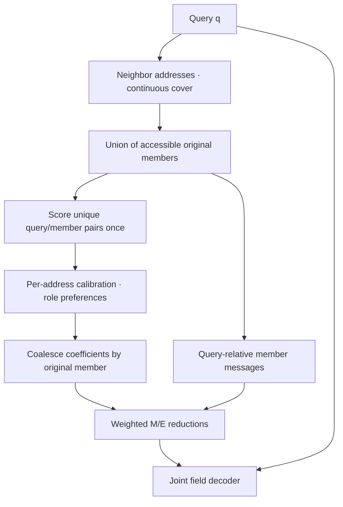

# Hypergraph Organized Neural Fields: model definition and implementation

**Implementation binding:** branch `ThermalWindUpdate`, source commit [`ea03e54204dc5424ab315b71d526f2ae0d687e45`](https://github.com/cosmos2w/ModularDT/tree/ea03e54204dc5424ab315b71d526f2ae0d687e45), 31 October 2026. **Document revision:** `HONF-Core-Explain-1`. This document describes fresh public `relation_anchored` and `relation_anchored_active` configurations at that source version. Their shared mechanism is detail-preserving relation-anchored reading. Source paths refer to repository-root `src/` and `Case_*/src/`.

HONF constructs a conditional neural field from physical object records. The same learned relationships that regulate contextual exchange are reused to organize access to original members. A query combines accessible member messages according to its location, content and learned read strength. Case adapters supply physical records, units, coordinate conventions and observation operators.

This document establishes the project's mathematical notation. Part I specifies the shared core; Part II defines the structure for ThermalChannel, WindFarm and electro-thermal case chapters. Diagram sources are collected in the [model explanation resource library](docs/assets/model_explain/README.md).

## Table of contents

- [Part I. HONF core](#core)
    - [1. Problem and information flow](#problem)
    - [2. Notation standard](#notation)
    - [3. Preparing M/E/C](#inputs)
        - [3.1 Identity, support, attributes and measure](#record-contract)
        - [3.2 Environment discretization and patch encoding](#environment-encoding)
        - [3.3 Conditions and owning records](#conditions)
    - [4. Contextual exchange](#exchange)
        - [4.1 One ordered block, stacked in depth](#exchange-block)
        - [4.2 Raw score, softmax preference and applied relation](#contextual-scores)
        - [4.3 Gate calibration and reuse](#gate-calibration)
        - [4.4 E←E and scalability](#ee-scalability)
    - [5. Forming the global organization](#organization)
        - [5.1 A scorer produces a scene's tables](#scene-tables)
        - [5.2 E-address rows and access measures](#directory-measures)
        - [5.3 Joint P95 access](#p95-access)
        - [5.4 End-to-end learning and reuse](#relation-reuse)
    - [6. Query reading and neural-field formation](#query-reading)
        - [6.1 Continuous address coverage](#address-coverage)
        - [6.2 Query preference and role strength](#query-preference)
        - [6.3 Coalescing shared original members](#member-coalescence)
        - [6.4 Detail-preserving selected-member messages](#detail-messages)
    - [7. Mapping visualization to the model](#visualization-mapping)
    - [8. Learning and computational meaning](#learning-work)
    - [9. Public interface and implementation map](#implementation)
- [Part II. Case formulations](#cases)
    - [10. Case chapter contract](#case-contract)

<a id="core"></a>

## Part I. HONF core

<a id="problem"></a>

### 1. Problem and information flow

For one scene, let $\Omega\subset\mathbb{R}^d$ be the physical domain. The input is $(\mathcal{M},\mathcal{E},\mathbf c)$: module/object records, environment records and prescribed global conditions. At a valid query $q\in\Omega$, the model predicts $\widehat{\mathbf y}(q)\in\mathbb{R}^{d_y}$. A record's role identifies its input ownership; both roles contribute to every configured output channel.

$$
\begin{aligned}
(\mathcal{M},\mathcal{E},\mathbf c)&\longmapsto
(\{z_i\}_{i\in\mathcal{V}},G,\Pi,D),\\
(q,\{z_i\},D)&\longmapsto(h_M(q),h_E(q))
\longmapsto\widehat{\mathbf y}(q),\qquad
\mathcal{V}=\mathcal{M}\sqcup\mathcal{E}.
\end{aligned}
$$



Figure 1. Scene preparation produces both access organization and individual member values. C enters the record encodings. Queries reuse these prepared quantities.

<a id="notation"></a>

### 2. Notation standard

Equations suppress batch and padding axes. Sets contain present records; positive donor measure determines information eligibility. Matrix rows are receivers and columns are donors unless stated otherwise. A route $r\leftarrow s$ means a receiver of role $r$ reads a donor of role $s$; physical arrows point donor to receiver.

| Symbol | Definition |
| --- | --- |
| $d,d_z,d_y$ | Coordinate dimension, contextual width and output-channel count. |
| $\mathcal{M},\mathcal{E},\mathcal{V}$ | M inventory, E inventory and their disjoint union. |
| $N_M,N_E,N_h,L$ | Present M/E counts, attention-head count and contextual-block count. |
| $i,j,a,q$ | Original member, donor, E address and query coordinate; $a\in\mathcal{E}$. |
| $r,s$ | Roles in $\{M,E\}$; $\mathcal{V}_M=\mathcal{M}$ and $\mathcal{V}_E=\mathcal{E}$; $r(i)$ is member $i$'s role. |
| $x_i,f_i,\boldsymbol\ell_i$ | Member coordinate, prescribed features and positive per-axis characteristic lengths. |
| $\omega_i,\mu_i,\nu_{ai}$ | Input donor measure, role-normalized inventory measure and address-specific access measure. |
| $o,\mathbf L$ | Frame origin and positive per-axis scene scale. |
| $\mathbf c,z_C$ | Global condition vector and its encoded state. C is reserved for conditions. |
| $z_i^{(t)},z_q$ | Member state at block boundary $t$ and query state. |
| $s_{ij}^h,A_{ij}^h,G_{ij},B_{ij}^h$ | Raw contextual score, donor-softmax coefficient, applied gate and actual message coefficient. |
| $\Pi_{ai},D_{ai},\mathcal{S}_a,\mathcal{H}_a$ | Full directory, retained directory, selected member set and native hyperedge. |
| $\eta,\lambda_a(q)$ | Retained mass target and continuous address-cover weight. |
| $t_{ri}(q),\xi_{ari}(q),p_{ari}(q)$ | Raw query/member score, address-calibrated score and within-role read distribution. |
| $\rho_{ar}(q),\beta_{ri}(q),h_r(q)$ | Role read strength, coalesced original-member coefficient and role context. |
| $v_{ri},m_{ri}(q)$ | Prepared member value and query-relative selected-member message. |
| $\mathbf u_\theta(q),\widehat{\mathbf y}(q)$ | Normalized joint core output and physical field after case unit conversion. |
| $\mathcal{D}_{\mathrm{case}},\mathcal{O}_{\mathrm{case}}$ | Case unit conversion and native observation operator. |

Use $\mathbf c$ for conditions, $h_r$ for read contexts and $\mathcal{H}_a$ for hyperedges. $\boldsymbol\ell_i$ is a length vector, $L$ counts blocks and $\mathbf L$ is scene scale. Route/block labels are restored when needed. Code and earlier visualization guides call $\Pi$ `R` or full access weights, and $D$ `C` or restricted access weights; these map to the same arrays, not additional model objects.

<a id="inputs"></a>

### 3. Preparing M/E/C

<a id="record-contract"></a>

#### 3.1 Identity, support, attributes and measure

An original member is $(\mathrm{id}_i,r(i),x_i,f_i,\boldsymbol\ell_i,\omega_i)$. M records usually represent physical objects. E records represent selected parts of the surrounding domain: cells, sampled regions or boundary patches. IDs preserve correspondence through padding, sorting, preparation and visualization; they are identifiers, not learned numerical embeddings.

`SceneBatch` carries coordinates, features, masks, measures, IDs, characteristic lengths and the coordinate frame. Geometry describes where and at what scale a record acts; measure controls its donor weighting. A centroid does not specify represented size, and a flattened index does not specify physical position. See [the input contracts](src/honf_forward_core/content_hypergraph/contracts.py).

| E information | Current core use | Adapter meaning |
| --- | --- | --- |
| $x_i,o,\mathbf L$ | Position encoding and relative geometry. | Native position and declared physical frame. |
| $\boldsymbol\ell_i$ | Encoded normalized size and local pair distance. | Cell widths or another declared per-axis support scale. |
| $\omega_i$ | Measure-aware exchange and E inventory normalization. | Area, volume or appropriate positive quadrature measure. |
| $f_i$ | Role encoding and repeated raw-record injection. | Prescribed material fields, boundaries, sources and case attributes. |
| ID and mask | Alignment and eligibility. | Original identity and present/padded status. |

These are the operational geometric fields of the current core. A case can additionally require orientation, boundary normals, connectivity or higher-order shape descriptors to distinguish physically different supports with the same centroid and widths. Such information belongs in adapter-defined features or a corresponding geometry contract; IDs do not encode it.

<a id="environment-encoding"></a>

#### 3.2 Environment discretization and patch encoding

The adapter chooses regions $\{\Omega_a\}$ and encodes a prescribed field $b(x)$ through a regional operator $\mathcal{P}_a$, such as a weighted average, sampled patch encoder or basis coefficients:

$$
f_a^E=\mathcal{P}_a[b,\mathrm{geometry},\mathrm{boundaries}],\qquad
x_a=\operatorname{centroid}(\Omega_a),\qquad
\omega_a=\operatorname{measure}(\Omega_a).
$$

This is the patchification analogy: each region becomes a feature-bearing record, augmented with position, support scale and measure. The adapter decides which within-region distinctions survive encoding. A mean conductivity and a resolved conductivity pattern are different input representations. The core receives the chosen features rather than reconstructing the original patch automatically.

Structured grids make centers, lengths and measures easy to define. Thermal currently uses $24\times8$ E records; Wind uses a configurable three-dimensional grid. The shared scorer consumes records and geometry. The maintained continuous locators additionally require the case's structured grid-to-original-ID map. An unstructured tessellation needs its own coverage/locator implementation.

<a id="conditions"></a>

#### 3.3 Conditions and owning records

M/E/C is the general problem definition. Examples of $\mathbf c$ include inlet Reynolds number, reference velocity, wind direction and prescribed global operating parameters. In the current implementation, C is encoded once and broadcast into both roles, rather than instantiated as a third inventory of attention vertices:

$$
z_C=\operatorname{Enc}_C(\mathbf c),\qquad
z_i^{(0)}=\operatorname{Enc}_{r(i)}
\!\left([f_i,\gamma_x((x_i-o)\oslash\mathbf L),
\boldsymbol\ell_i\oslash\mathbf L]\right)+z_C.
$$

$\oslash$ denotes componentwise division; $\gamma_x$ is the configured coordinate feature map. Encoders are role-specific. If no condition encoder is configured, $z_C=0$. Changing conditions can therefore change member states and organization at a fixed layout. Spatially varying conditions belong in their owning M/E features; C carries prescribed scene-wide quantities.

Relation-anchored preparation reinjects learned projections of the individual initial encodings at every block and uses no extra pooled scene-summary value path. The query encoder receives a zero direct operating-state argument, so controls reach predictions through conditioned records and interactions. The query still has positional and declared query features. See [`_initial_states`](src/honf_forward_core/content_hypergraph/model_v2.py), [unified preparation](src/honf_forward_core/continuous_joint/unified.py) and [`_query_states`](src/honf_forward_core/interaction_reused_member_routing/core.py).

<a id="exchange"></a>

### 4. Contextual exchange

<a id="exchange-block"></a>

#### 4.1 One ordered block, stacked in depth

One block executes M←M, E←M, E←E and M←E, reading the states produced by preceding stages. E's feed-forward update follows E←E; M's follows M←E. M←M excludes self, while E←E includes self. Updates are pre-normalized, residual and masked.



Figure 2. One reusable block with sequential state updates. Its four relation matrices belong to different stages. `context_depth` stacks separately parameterized blocks; current public recipes commonly use two.

Before block $t$, gated raw-record projections are added to the current states. Each attention update and each role's feed-forward update have the forms

$$
z_i\leftarrow z_i+\operatorname{Dropout}
\left(\operatorname{Attn}_{r\leftarrow s}
(\operatorname{LN}_r(z_i),\{\operatorname{LN}_s(z_j)\}_{j\in\mathcal{V}_s})\right),
$$

$$
z_i\leftarrow z_i+\operatorname{Dropout}
\left(W_2\operatorname{SiLU}(W_1\operatorname{LN}(z_i)+b_1)+b_2\right).
$$

The feed-forward hidden width is $4d_z$. Each route owns query/key/value/output projections and normalization. See [staged attention](src/honf_forward_core/content_hypergraph/staged_attention_v2.py) and [block construction and raw reinjection](src/honf_forward_core/content_hypergraph/model_v2.py).

<a id="contextual-scores"></a>

#### 4.2 Raw score, softmax preference and applied relation

For one route and block, the raw score in head $h$ is

$$
s_{ij}^h=\tau_h\langle\widehat Q_i^h,\widehat K_j^h\rangle+b_h(\zeta_{ij}),\qquad
\zeta_{ij}=\left[
\frac{x_i-x_j}{\mathbf L},
\left\|\frac{x_i-x_j}{\mathbf L}\right\|_2,
\operatorname{asinh}\!\left(
\frac{x_i-x_j}{\sqrt{\boldsymbol\ell_i\odot\boldsymbol\ell_j}}
\right)\right].
$$

Each $Q/K$ is projected from a separately layer-normalized state and then L2-normalized, giving $\widehat Q,\widehat K$; $b_h$ is learned geometric bias. Temperature is $\tau_h=1+31\operatorname{sigmoid}(\theta_h)$. Products, roots and fractions of vectors are componentwise. Geometry can support nearby and distant preferences.

The donor-softmax coefficient includes positive input measure:

$$
A_{ij}^h=\frac{\exp(s_{ij}^h)\omega_j}
{\sum_{k\in\mathcal{A}(i)}\exp(s_{ik}^h)\omega_k}.
$$

$\mathcal{A}(i)$ is the route's eligible donor set, including its mask/self rules. A calibration of the same raw scores produces a shared-head gate $G_{ij}$. The actual contextual coefficient is

$$
Z_i^h=\sum_jA_{ij}^hG_{ij},\qquad
B_{ij}^h=\frac{A_{ij}^hG_{ij}}
{Z_i^h+\epsilon(1-Z_i^h)^2},\qquad\epsilon=10^{-3}.
$$

Each head contracts $B$ with projected donor values. The output projection's bias is scaled by mean head message mass $Z/[Z+\epsilon(1-Z)^2]$. A zero gate row produces zero contextual message, while the residual state survives. Common measure references cancel within a softmax row; empty eligible rows contribute zero. See [contextual value reduction](src/honf_forward_core/continuous_joint/preparation.py).

<a id="gate-calibration"></a>

#### 4.3 Gate calibration and reuse

Define $\psi(u)=[u]_+^2/(1+[u]_+^2)$, where $[u]_+=\max(u,0)$. For MM, EM and ME,

$$
G_{ij}=\psi\!\left(a\sum_h\pi_h[s_{ij}^h-\max_ks_{ik}^h]+b\right),
\qquad\pi=\operatorname{softmax}(\mathbf u),\qquad
a=0.25+3.75\operatorname{sigmoid}(v).
$$

Head weights, scale and bias are learned per route; the active implementation initializes $b=1.5$. This calibration reuses the contextual scorer. Its gate first acts during exchange, then is reused by organization. Directory construction does not fit another grouping network. Gate calibration, query scoring and query-message projections still have learned parameters. The computational benefit of reuse is measured with preparation and query work included. One core-owned set of four route calibrators is shared across contextual blocks. The three non-EE routes each use $N_h+2$ scalars, and EE uses $N_h+1$, totaling $4N_h+7$: 23 for four heads. Directory compilation adds no learned parameters; block attention scorers remain separately parameterized.

The public E←E gate instead uses per-head receiver-relative gaps. Normalize positive donor measures within each eligible row and compute the score variance $v_i^h$. Then

$$
\delta_{ij}^h=\frac{\max_ks_{ik}^h-s_{ij}^h}{\sqrt{1+v_i^h}},\qquad
G_{ij}^{E\leftarrow E}=\sum_h\pi_h\,2\psi\!\left(1-\frac{\delta_{ij}^h}{\tau_E}\right),
\qquad\tau_E=\operatorname{softplus}(u_E).
$$

A head's peak gate is one; it becomes zero at $\delta_{ij}^h\geq\tau_E$. The mixture remains positive if any positively mixed head supports the donor. The unit variance term stabilizes gap scale. See [`RelativeEECalibration`, `AppliedInteractionIncidence`](src/honf_forward_core/interaction_reused_member_routing/core.py) and [`ScoreCalibration`](src/honf_forward_core/joint_native/routing.py).

<a id="ee-scalability"></a>

#### 4.4 E←E and scalability

E←M distributes object information into environmental receivers. E←E lets those records exchange their attributes and received object information before M reads the updated environment. Its dense score/geometry evaluation has quadratic dependence on $N_E$; zeroing messages alone does not avoid computing their scores.

The bound implementation executes EE in every block and requires positive `context_depth`. It has no EE-only off switch that removes this pair scoring. Removing EE is a distinct architecture/execution choice to evaluate against matched field fidelity, responses and complete work. P95 query access does not remove contextual preparation cost.

<a id="organization"></a>

### 5. Forming the global organization

<a id="scene-tables"></a>

#### 5.1 A scorer produces a scene's tables

The learned objects are projections, geometry networks and calibrations. For each scene and contextual stage they evaluate an actual receiver-by-donor score tensor with a head axis. The table is an execution result, not a persistent learned adjacency parameter. Layout, attributes and conditions determine its current values.

The final block's captured E←M and E←E gates supply E-address directory rows. Earlier blocks have already influenced final member states. MM and ME act during contextualization, but their matrices do not create M-receiver rows in this directory. The captured object retains block, route and original-ID provenance.



Figure 3. The contextual scorer supports both actual value exchange and access preparation. The directory reuses the applied gate, rather than copying one head's softmax coefficients.

<a id="directory-measures"></a>

#### 5.2 E-address rows and access measures

For final-block E receiver $a$, combine the applied gates with structural own-E access:

$$
g_{ai}=\begin{cases}
G_{ai}^{E\leftarrow M},&i\in\mathcal{M},\\
G_{ai}^{E\leftarrow E}+\mathbf1[i=\operatorname{own}(a)],&i\in\mathcal{E}.
\end{cases}
$$

Structural own E is added to the actual contextual EE diagonal. It supplies the address's original environmental record when other relations vanish, with its own recorded provenance.

The inventory access measure is normalized separately within each role:

$$
\mu_i=\begin{cases}
1/N_M,&i\in\mathcal{M},\\
\omega_i/\sum_{j\in\mathcal{E}}\omega_j,&i\in\mathcal{E}.
\end{cases}
$$

Only present M and present positive-measure E records participate; empty roles have zero mass. Uniform M weighting is this directory's access convention, distinct from contextual attention's input donor measure.

For `relation_anchored`, $\nu_{ai}=\mu_i$. For `relation_anchored_active`, define $\mathcal{A}_r(a)=\{i\in\mathcal{V}_r:g_{ai}>0,\mu_i>0\}$ and use

$$
\nu_{ai}=\begin{cases}
\displaystyle\frac{\mu_i}{\sum_{j\in\mathcal{A}_{r(i)}(a)}\mu_j},
&i\in\mathcal{A}_{r(i)}(a),\\
0,&\text{otherwise}.
\end{cases}
$$

Both variants normalize jointly across M and E:

$$
\Pi_{ai}=\frac{g_{ai}\nu_{ai}}{\sum_{j\in\mathcal{V}}g_{aj}\nu_{aj}}.
$$

A zero-total row stays zero. Active-domain normalization changes each role's available-support measure; it creates no missing relationship and leaves the contextual scorer shared. See [`compile_e_access_directory`](src/honf_forward_core/interaction_reused_member_routing/anchored.py) and [`build_joint_member_measure`](src/honf_forward_core/interaction_reused_member_routing/primitives.py).

<a id="p95-access"></a>

#### 5.3 Joint P95 access

Sort positive $\Pi_{ai}$ jointly across both roles, descending with stable role-then-original-ID ties. Let $\sigma_a$ denote this order. With $\eta=0.95$, take the shortest cumulative-mass prefix and append positive own E if absent:

$$
k_a=\min\left\{k:\sum_{j=1}^k\Pi_{a,\sigma_a(j)}\geq\eta\right\},\qquad
\mathcal{S}_a=\{\sigma_a(1),\ldots,\sigma_a(k_a)\}
\cup\{\operatorname{own}(a)\},
$$

$$
D_{ai}=\Pi_{ai}\mathbf1[i\in\mathcal{S}_a],\qquad
\mathcal{H}_a=\{i:D_{ai}>0\},\qquad\sum_iD_{ai}\geq\eta.
$$

These expressions apply to a valid normalized row; own E is appended only if its stored weight is positive. Truncation preserves original weights without renormalizing. P95 means 95% cumulative directory mass, not a member fraction or score percentile. Selected counts vary by address and scene.

| Illustrative descending row | Cumulative mass | Selection |
| --- | ---: | --- |
| $M_2:0.50$ | $0.50$ | Retained. |
| $E_7\ \text{(own)}:0.30$ | $0.80$ | Retained. |
| $M_1:0.16$ | $0.96$ | Retained; mass target reached. |
| $E_4:0.04$ | $1.00$ | Omitted from restricted access. |

This synthetic example retains three members and 96% of row mass. Appending an own-E entry outside the prefix can increase retained mass further.

There is no distance cutoff: a remote member with sufficient relation mass remains accessible, and coverage blends several address rows. The rule imposes no minimum spatial spread, minimum M count or fixed hyperedge count; a concentrated learned row can remain concentrated. Numerical behavior is controlled by gate calibration, physical measures, guarded exchange and query normalization. P95 specifies a retained-access mass target with a row- and scene-dependent member count.

<a id="relation-reuse"></a>

#### 5.4 End-to-end learning and reuse

Directory weights are computed from live applied gates and remain attached to autograd. Field loss can train the scorer and gate calibration through retained access and contextual exchange. Sorting, prefix length and selected indices are detached discrete decisions. Training is joint with piecewise-selected support, rather than differentiation through a combinatorial sort.

Preparation builds one fine-grained scene-wide library of E-address rows. Queries reuse it. Native rows can overlap extensively; a compact picture of representative rows does not replace the library with a fixed number of pooled groups.

<a id="query-reading"></a>

### 6. Query reading and neural-field formation

<a id="address-coverage"></a>

#### 6.1 Continuous address coverage

The adapter supplies E-address indices and nonnegative cover weights $\lambda_a(q)$ satisfying $\sum_a\lambda_a(q)=1$ on valid queries. Thermal uses tensor-product cubic smoothstep over at most four neighboring E centers; the maintained three-dimensional case locator supplies at most eight. The core validates a maximum of eight slots in three dimensions and four otherwise. Boundary queries clamp to edge centers. Neighbor lookup and coordinate-to-ID mapping belong to the adapter.

For normalized position $u$ between neighboring centers, $s(u)=3u^2-2u^3$ on $[0,1]$; tensor products of $s$ and $1-s$ give the multidimensional cover. The candidate set is the union of members in covered rows. Restricted mode uses $D$, full mode uses $\Pi$. The equations below use restricted $D$.



Figure 4. Access selection precedes expensive query/member scoring and messages. Shared members receive one coalesced coefficient and one reusable message for that query.

<a id="query-preference"></a>

#### 6.2 Query preference and role strength

The role-specific score $t_{ri}(q)$ is learned from the layer-normalized query state, layer-normalized prepared member key and geometry: $(q-x_i)\oslash\mathbf L$, its norm and $\operatorname{asinh}((q-x_i)\oslash\boldsymbol\ell_i)$. Each unique query/member score is evaluated once for the requested union and reused across rows.

Within role $r$ and address $a$, normalize the directory prior and compute query-dependent moments. All sums here run over $\mathcal{S}_a\cap\mathcal{V}_r$:

$$
w_{ari}=\frac{D_{ai}}{\sum_{j\in\mathcal{S}_a\cap\mathcal{V}_r}D_{aj}},\qquad
\bar t_{ar}=\sum_iw_{ari}t_{ri},\qquad
v_{ar}=\sum_iw_{ari}(t_{ri}-\bar t_{ar})^2.
$$

Inherited calibration and within-role preference are

$$
\xi_{ari}(q)=4\tanh\!\left(
\frac{t_{ri}(q)-\bar t_{ar}(q)}{4\sqrt{1+v_{ar}(q)}}\right),\qquad
p_{ari}(q)=\frac{D_{ai}\exp\xi_{ari}(q)}
{\sum_{j\in\mathcal{S}_a\cap\mathcal{V}_r}D_{aj}\exp\xi_{arj}(q)}.
$$

Set $p_{ari}=0$ outside $\mathcal{S}_a\cap\mathcal{V}_r$. This is prior-times-evidence reading. Query evidence reweights accessible members while retaining their relation prior. Tiny-prior members have small influence on calibration statistics. The unit variance floor and bounded score control raw-score amplification; shifted log weights stabilize implementation. Empty roles contribute zero.

A role-specific network consumes normalized query state, $\sum_i p_{ari}\xi_{ari}$ and entropy normalized by the logarithm of the full scene's eligible count for that role. Single-member support has zero entropy. If its two output logits have contrast $d_{ar}$, the read strength is

$$
\rho_{ar}(q)=\frac12\left(1+\frac{d_{ar}(q)}{\sqrt{1+d_{ar}(q)^2}}\right).
$$

Empty support sets $\rho_{ar}=0$. M/E strengths are not a two-role softmax; both can be strong or weak. See [packed reading](src/honf_forward_core/interaction_reused_member_routing/anchored.py) and [reader primitives](src/honf_forward_core/interaction_reused_member_routing/primitives.py).

<a id="member-coalescence"></a>

#### 6.3 Coalescing shared original members

Combine address cover, role strength and within-role preference:

$$
\beta_{ri}(q)=\sum_a\lambda_a(q)\rho_{ar}(q)p_{ari}(q).
$$

Repeated appearances refer to one original member, so their coefficients add before contraction. For two hypothetical addresses, $(\lambda_1,\rho_{1M},p_{1Mi})=(0.6,0.5,0.4)$ and $(\lambda_2,\rho_{2M},p_{2Mi})=(0.4,0.75,0.2)$ give $\beta_{Mi}=0.18$. This is one weighted contribution, not duplicate member identities. The joint coefficient sum over M and E is not constrained to one.

<a id="detail-messages"></a>

#### 6.4 Detail-preserving selected-member messages

For prepared original-member value $v_{ri}$, the current shared Detail core constructs

$$
\Delta_i(q)=q-x_i,\qquad
m_{ri}(q)=\operatorname{SiLU}\!\left[
v_{ri}+W_r^qz_q+b_r^q
+W_r^g\gamma\!\left(\Delta_i(q)\oslash\mathbf L\right)
+W_r^\ell\operatorname{asinh}\!\left(\Delta_i(q)\oslash\boldsymbol\ell_i\right)
\right],
$$

$$
\gamma(u)=\left[u,\{\sin(2\pi f u),\cos(2\pi f u)\}_{f\in\{1,2,4\}}\right],\qquad
h_r(q)=\sum_{i\in\mathcal{V}_r}\beta_{ri}(q)m_{ri}(q),
$$

$$
\mathbf u_\theta(q)=F_\theta([z_q,h_M(q),h_E(q)]),\qquad
\widehat{\mathbf y}(q)=\mathcal{D}_{\mathrm{case}}(\mathbf u_\theta(q)),\qquad
\widehat{\mathbf y}_{\mathrm{obs}}=\mathcal{O}_{\mathrm{case}}[\widehat{\mathbf y}].
$$

The core predicts a normalized joint field. The adapter converts units and observes that field on native receivers. An observation can involve several query positions, for example an interpolation or a vorticity stencil; it is not generally a pointwise decoder operation.

The message uses learned role-specific maps $W_r^q\in\mathbb{R}^{d_z\times d_z}$, $W_r^g\in\mathbb{R}^{d_z\times7d}$, $W_r^\ell\in\mathbb{R}^{d_z\times d}$ and bias $b_r^q\in\mathbb{R}^{d_z}$. The Fourier-relative feature has $7d$ components.

Detail preservation means that original members remain individually addressable, address access varies through continuous coverage, and selected values become query-relative messages rather than a single broadcast value for a region. Finite encodings and mass truncation still determine which distinctions reach the output.

The query controls member preference $p$, role strength $\rho$ and message content $m$. Near a heated object and farther downstream, it can use the same object with different weights and different relative messages. These are learned dependencies; a physical transfer interpretation requires corresponding response or conservation evidence.

Prepared keys and values are shared across queries. Paired reads reuse raw query scores; messages for positive selected pairs appearing in both paths are computed once, and missing pairs are computed when needed. Each path retains its own priors, calibrations and coefficients. See [the Detail implementation](src/honf_forward_core/interaction_reused_member_routing/detail.py) and [`_decode_requests`](src/honf_forward_core/interaction_reused_member_routing/anchored.py).

<a id="visualization-mapping"></a>

### 7. Mapping visualization to the model

The primary organization views are whole-layout access regions, original-member service maps and native overlapping hyperedges. Their source quantities remain distinct from contextual attention and final query use.

| View | Mathematical source | Meaning |
| --- | --- | --- |
| Contextual M receiver | Row of $[G^{M\leftarrow M}\ \ G^{M\leftarrow E}]$. | Incoming actual relations from both roles, with their separate stages. |
| Contextual E receiver | Row of $[G^{E\leftarrow M}\ \ G^{E\leftarrow E}]$. | Incoming actual relations; structural directory self access is separate. |
| Contextual donor | Column of captured $G^{r\leftarrow s}$. | Receivers reached by that directed relation. |
| Prepared receiver | Row $D_{a,:}$. | One E address's retained native hyperedge. |
| Prepared donor | Column $D_{:,i}$. | E addresses that can read original donor $i$. |
| Query contribution | $\beta_{ri}(q)$ and $m_{ri}(q)$. | Actual organized weighting and message at one query. |
| Native set diagram | Supports $\mathcal{H}_a$ of selected actual rows. | Exact displayed intersections of original members. |

Concatenating MM and ME receiver rows requires their sequential-stage labels. Transposing EM gives a reverse lookup, not evidence that ME ran. The E-address directory has E receiver rows only; it does not invent an M-row directory.

The region map removes own E in a display copy and assigns each address its leading positive nonself donor $g(a)$; an empty nonself row is neutral. Original M donor participation in the resulting categorical regions is

$$
W_{mg}=\frac{\sum_{a:g(a)=g}D_{am}}{\sum_aD_{am}}.
$$

Ring sectors display $W_{mg}$; cell colors display $g(a)$. These summarize incidence without changing soft membership. Donor service maps show directory columns across physical E receiver coordinates; the standard nonself display hides the E supplier's own-E entry while preserving it in the saved directory.

Native set diagrams select one to four actual rows with the common profile-coverage rule. Own E is removed only in the selection copy; nonzero profiles are L2-normalized, medoids/farthest profiles are selected, and selection stops at 90th-percentile distance at most 0.5 or four rows. Displayed membership comes from the original retained rows. Positive M and own E are preserved; other E vertices can be omitted by a declared display threshold with retained/omitted mass recorded. Ellipse area and abstract distance have no physical scale.

Set-diagram arrows use a separately declared captured contextual gate, normally MM from a named block, with donor-to-receiver direction and common strength bins. Profile coverage, displayed directory mass and arrow gate mass are recorded separately. See [the visualization specification](docs/guides/Global_Hypergraph_Organization_Visualization.md) and [plotting entry point](tools/plot_honf_organization.py).

<a id="learning-work"></a>

### 8. Learning and computational meaning

Field loss jointly trains encoders, contextual scores, gate calibration, query scores, role strengths, messages and the joint decoder. Discrete masks, neighbor indices and P95 choices select the current execution path. Coordinate derivatives flow through positional features, relative scoring/messages and cover weights on that path. Case observation operators add their declared interpolation or derivative stencils.

| Normalization | Axis and purpose |
| --- | --- |
| Contextual $A$ | Eligible donors per receiver/head: measure-aware preference. |
| Guarded $B$ | Gate-weighted message mass: permits a zero contextual message. |
| Inventory/active measure | Within role, globally or on a receiver's support: comparable access mass. |
| Directory $\Pi$ | Joint M+E row: the address's original-member prior. |
| Query score moments | Directory prior within role/address: bounded relative evidence scale. |
| Query $p$ | Accessible members within role/address: prior-times-evidence distribution. |
| Cover $\lambda$ | Neighboring addresses for one query: spatial blending. |

These operations specify numerical behavior and access semantics. They do not impose a group count or diverse learned relations. Relation structure is measured from directories, contributions and field responses.

| Work | Executed operation |
| --- | --- |
| Contextual preparation | Dense route scores/geometry, including quadratic EE scoring. |
| Directory preparation | E receiver rows, normalization, joint sorting and packed supports. |
| Query scores | Unique accessible query/member pairs for requested mode(s). |
| Address reading | Per-role/per-address calibration, distribution and strength. |
| Detail messages | Positive selected query/member pairs, coalesced across addresses and shared across paired modes. |
| Case work | Input preparation, interpolation/stencils, native losses and optional local operators. |

Restricted access can reduce query pairs while dense context preparation remains. Paired full/restricted training can score the full union while sharing work. Report score pairs, selected message pairs, preparation cost, peak memory and complete runtime separately. Query tiling changes execution chunks rather than receiver population or equations. See [query tiling](docs/guides/Query_Tiling.md).

<a id="implementation"></a>

### 9. Public interface and implementation map

```python
from honf_forward_core.models import build_model, relation_anchored_config

config = relation_anchored_config(
    "relation_anchored", base_core_config,
    input_dataset="my_case", query_tile_size=256,
)
model = build_model("relation_anchored", config)
# The case adapter supplies SceneBatch and QueryBatch, including address cover.
prepared = model.prepare(scene)
restricted = model.decode(
    prepared, queries, intervention={"read_mode": "restricted"},
)
full, restricted, shared_work = model.decode_paired(prepared, queries)
fields = restricted.joint_fields
```

The adapter supplies `base_core_config`, `scene` and `queries`. Bare `decode()` defaults to full access unless explicitly overridden. Retained-mass configuration prepares restricted access but does not itself select restricted inference. Save `get_config()`, model state and adapter transforms together. Saved schemas reconstruct their own implementation; the public name does not rewrite checkpoint semantics.

| Concept | Maintained source |
| --- | --- |
| Public construction | [`relation_anchored_config`, `build_model`](src/honf_forward_core/models.py). |
| Input contracts | [`SceneBatch`, `QueryBatch`](src/honf_forward_core/content_hypergraph/contracts.py). |
| Encoding and block stack | [`ContentHypergraphCoreV2`](src/honf_forward_core/content_hypergraph/model_v2.py). |
| Ordered scorer/exchange | [Staged attention](src/honf_forward_core/content_hypergraph/staged_attention_v2.py). |
| Applied contextual coefficients | [`contextual_value_update`](src/honf_forward_core/continuous_joint/preparation.py). |
| Applied gates/query scorer | [`RelativeEECalibration`, `AppliedInteractionIncidence`, `InteractionMemberRouter`](src/honf_forward_core/interaction_reused_member_routing/core.py). |
| Directory/P95/reader | [`compile_e_access_directory`, `AnchoredMemberRoutingCore`](src/honf_forward_core/interaction_reused_member_routing/anchored.py). |
| Access measures/calibration | [Reader primitives](src/honf_forward_core/interaction_reused_member_routing/primitives.py). |
| Detail messages | [`DetailAnchoredMemberRoutingCore`](src/honf_forward_core/interaction_reused_member_routing/detail.py). |
| Organization visualization | [Plotting tool](tools/plot_honf_organization.py) and [specification](docs/guides/Global_Hypergraph_Organization_Visualization.md). |

<a id="cases"></a>

## Part II. Case formulations

<a id="case-contract"></a>

### 10. Case chapter contract

Each case chapter will define its physical problem and units, M/E/C contents, E discretization/support, prescribed-versus-target separation, query cover, observation operators, training objective and outputs. Case-owned additions specify their exact inputs, trainable/frozen components and gradient path. Field fidelity, organized work and physical responses use their own measured quantities.

| Case | Formulation to develop | Current integration |
| --- | --- | --- |
| ThermalChannel | Heated modules, geometric E records, operating conditions, fluid/material/interface observations and optional task-trained local readout. | [Case guide](docs/guides/Case_Relation_Anchored_Training.md), [local expert](Case_ThermalChannel/src/channelthermal/training/local_expert_task.py). |
| WindFarm | Turbines, three-dimensional E support, inflow/direction conditions and velocity observation roles. | [Case guide](docs/guides/Case_Relation_Anchored_Training.md), [Wind adapter](Case_WindFarm/src/windfarm/content_hypergraph.py). |
| Electro-thermal | Material/source/boundary patches, operating conditions and coupled output/observation definitions. | [Integration walkthrough](Case_ElectroThermal/docs/COWORKER_HANDOFF.md). |

This revision establishes the core and the case chapter structure. Case-specific laws and results belong in their chapters; a Thermal-only port law or Wind-only background prescription remains case-owned.
