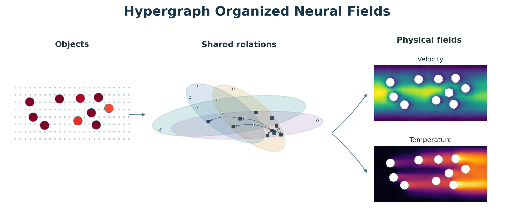
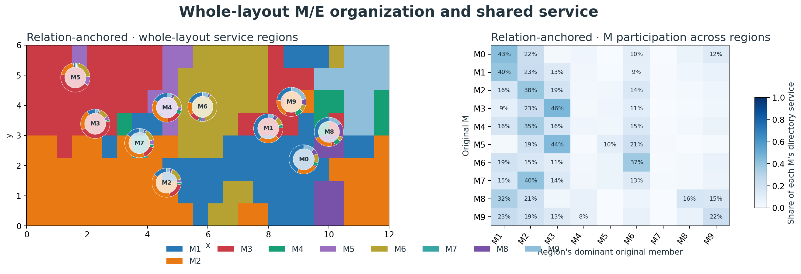
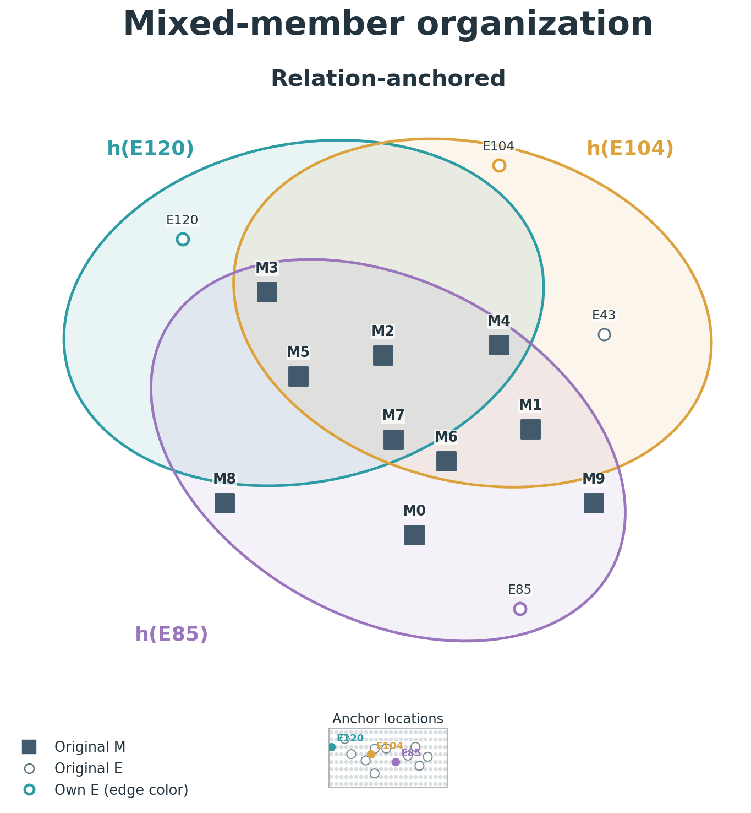
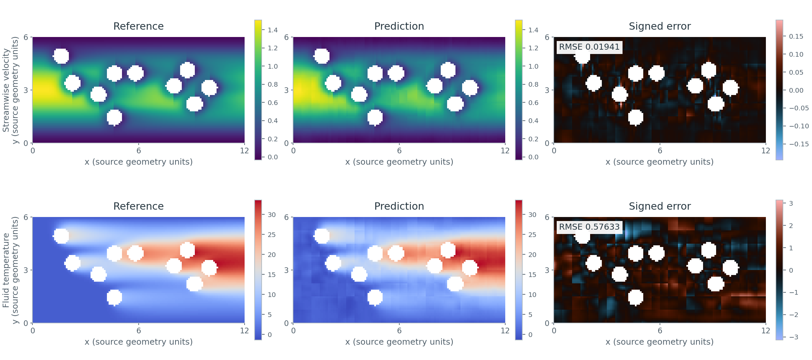

# Hypergraph Organized Neural Fields

HONF predicts continuous physical fields from interacting object records. Learned directed relations contextualize those records and organize which original members can contribute to each spatial query. Case adapters supply geometry, physical measures, prescribed conditions, native observations and train-fitted transforms.

<p align="center"></p>

Objects, overlapping relationships and joint physical fields. The field textures use a saved Thermal prediction; this opening illustration depicts the information flow. [PDF master](docs/assets/readme/honf_showcase.pdf).

## Supported capabilities

| Capability | Interface |
| --- | --- |
| Joint physical-field prediction | `relation_anchored` and `relation_anchored_active` retain contextualized original members and reuse applied relations for query access. |
| Native three-dimensional Wind fields | `WindRelationAnchoredAdapter` provides joint velocity prediction, configurable environment lattices, trilinear coverage, original turbine IDs and masked ragged batches. |
| Thermal ports and local operators | Direct native-port supervision trains the joint predictor; the historical P64 composition can additionally use a compatible frozen local operator. |
| State and finite-response training | Native field fitting with adjustable endpoint and finite-response supervision; cases provide the physical labels and observables. |
| Physical-response evaluation | Fresh baseline/edited preparations, actual relation traces, native-unit field comparisons, common-support finite changes and equal-family decision metrics. |
| Execution and visualization | Query tiling, native-decode reuse, verified native catalogues, complete histories and original-member organization figures. |

The shared core produces all configured physical channels through one joint field head. Input roles describe ownership of geometry and controls, rather than separate output physics. Physical accuracy, response accuracy and runtime are measured separately; learned relations alone do not establish a physical causal graph or a design-guidance advantage.

## Relation-anchored fields

Let $`\mathcal{V}=\mathcal{M}\sqcup\mathcal{E}`$ contain the original module and environment records. Member $`i`$ retains its ID, coordinate $`x_i`$, prescribed features, positive physical measure and contextual state $`z_i`$. Prescribed global conditions $`\mathbf{c}`$ enter the owning records before exchange. The [model definition](Model_Explain.md) gives the full notation, contextual equations and implementation map.

1. Encode original members and their geometry, support and controls.
2. Exchange information through directed $`M\leftarrow M`$, $`E\leftarrow M`$, $`E\leftarrow E`$ and $`M\leftarrow E`$ routes, retaining the actual applied relations.
3. Reuse the final E-receiver relations to form overlapping original-member address sets.
4. Read accessible member details relative to each query and decode the physical fields jointly.

### Access measures and overlapping hyperedges

For address $`a\in\mathcal{E}`$, let $`g_{ai}\geq0`$ combine its actual E-receiver gates with explicit positive own-E access. Let $`\mu_i`$ be the role-normalized inventory measure and $`r(i)\in\{M,E\}`$ the member's input role. The positive support of role $`r`$ is

$$
\mathcal{A}_r(a)=\left\lbrace i\in\mathcal{V}_r:g_{ai}>0,\ \mu_i>0\right\rbrace.
$$

The two relation-anchored models differ in their access measure:

$$
\nu_{ai}^{\mathrm{inventory}}=\mu_i,\qquad
\nu_{ai}^{\mathrm{active}}=
\begin{cases}
\displaystyle\frac{\mu_i}{\sum_{j\in\mathcal{A}_{r(i)}(a)}\mu_j},&i\in\mathcal{A}_{r(i)}(a),\\
0,&\text{otherwise}.
\end{cases}
$$

The full directory $`\Pi`$, retained directory $`D`$ and native hyperedge $`\mathcal{H}_a`$ are

$$
\Pi_{ai}=\frac{g_{ai}\nu_{ai}}{\sum_jg_{aj}\nu_{aj}},\qquad
D_{ai}=\Pi_{ai}\,\mathbf{1}\left[i\in\mathcal{S}_a\right],\qquad
\mathcal{H}_a=\left\lbrace i:D_{ai}>0\right\rbrace.
$$

A zero-total row stays zero. The retention rule selects $`\mathcal{S}_a`$ by joint M/E mass and preserves positive own-E access; the usual setting retains 95% mass. Stored weights are preserved during truncation. Hyperedges may overlap and retain individual members, coordinates and attributes. Their number and support are representation settings and learned access, respectively; neither is asserted to count physical subsystems.

<p align="center"></p>

Thermal scene 0684, TRAIN600 checkpoint at epoch 500. Colors identify each address's leading nonself directory member; ring sectors show original module service across those regions. [PDF master](docs/assets/readme/relation_anchored_regions.pdf).

<p align="center"></p>

Scene 0277, the same checkpoint. Selected native rows retain their exact displayed intersections and original identities. The [figure provenance](docs/assets/readme/README.md) records row selection, display thresholds and retained mass. [PDF master](docs/assets/readme/relation_anchored_hyperedges.pdf).

### Continuous coverage and original-member messages

The adapter supplies nonnegative address weights $`\lambda_a(q)`$ satisfying $`\sum_a\lambda_a(q)=1`$ on each valid query. Thermal uses tensor-product smoothstep coverage over up to four environment centers; Wind uses trilinear coverage over up to eight. Each adapter preserves its declared physical support and boundary handling. The core consumes those indices and weights without changing the case's coordinate convention.

For each selected address and input role, calibrated query/member evidence $`\ell_{ari}(q)`$ reweights retained directory membership:

$$
p_{ari}(q)=
\frac{D_{ai}\exp\left(\ell_{ari}(q)\right)}
{\sum_{j\in\mathcal{S}_a\cap\mathcal{V}_r}D_{aj}\exp\left(\ell_{arj}(q)\right)},\qquad
\beta_{ri}(q)=\sum_a\lambda_a(q)\,\rho_{ar}(q)\,p_{ari}(q).
$$

Here $`\rho_{ar}(q)`$ is a learned role-specific read strength; empty role support contributes zero. Repeated appearances of an original member are coalesced into $`\beta_{ri}(q)`$. Query evidence, contextual gates, directory weights and final query contributions are distinct quantities.

For displacement $`\Delta_i(q)=q-x_i`$, scene scale $`\mathbf{L}`$, member length $`\boldsymbol{\ell}_i`$, query state $`z_q`$ and contextual value $`v_{ri}`$, the selected-member message is

$$
m_{ri}(q)=\mathrm{SiLU}\left(
v_{ri}+W_r^qz_q+b_r^q
+W_r^g\gamma\left(\Delta_i(q)/\mathbf{L}\right)
+W_r^\ell\mathrm{asinh}\left(\Delta_i(q)/\boldsymbol{\ell}_i\right)
\right).
$$

Division by length vectors is elementwise. The positional feature map $`\gamma(t)`$ concatenates $`t`$ with $`\sin(2\pi ft)`$ and $`\cos(2\pi ft)`$ for $`f\in\{1,2,4\}`$. The two role reads feed one joint decoder:

$$
h_r(q)=\sum_{i\in\mathcal{V}_r}\beta_{ri}(q)m_{ri}(q),\qquad
\widehat{\mathbf{y}}(q)=\mathcal{D}_{\mathrm{case}}\left(
F_\theta\left([z_q,h_M(q),h_E(q)]\right)\right).
$$

The case conversion $`\mathcal{D}_{\mathrm{case}}`$ restores native units using saved TRAIN-fitted transforms. Physical quantities derived from the joint field use the case's native observation operators and validity masks.

## Installation and core interface

Use Python 3.10+ and a suitable PyTorch installation. Install the shared package and the case package required for your data:

```bash
python -m pip install -e ".[visualization]"
python -m pip install -e ./Case_ThermalChannel
python -m pip install -e ./Case_WindFarm
# Optional additional case: ./Case_ElectroThermal
```

The base core configuration declares coordinate and record dimensions, contextual width and joint output channels. The adapter supplies matching scene/query batches and address coverage:

```python
from honf_forward_core.models import build_model, relation_anchored_config

config = relation_anchored_config(
    "relation_anchored", base_core_config,
    input_dataset="my_case", query_tile_size=1024,
)
core = build_model("relation_anchored", config)
prepared = core.prepare(scene)
fields = core.decode(prepared, queries).joint_fields
```

For new models, start with `relation_anchored` (S) and its `inventory_unit_total` access measure. Choose `relation_anchored_active` for active-domain access. Save `core.get_config()` with weights and adapter transforms. Historical checkpoints reconstruct their saved schema, tensor names and normalization; a public model name does not replace those semantics. Native case loaders preserve that reconstruction.

### State and finite-response training

For the new state-response training profile, endpoint and finite-response supervision are enabled by default and adjustable. The case supplies paired TRAIN labels, physical scales and observations; the shared runtime provides the objective and balancing interface. Disable response supervision explicitly for a native-only baseline. Missing paired labels are an error when response training is enabled. The [state-response guide](docs/guides/State_Response_Training.md) explains the configuration, case contract and resume behavior.

In a matched fresh Thermal TRAIN600 study at epoch 3000, adding endpoint and finite-response fitting reduced J and P mean absolute response errors by 65.1% and 90.8% on 56 edits from 14 of the 144 FIT families, compared with the native baseline. The arithmetic mean of nine equal-case validation field RMSE ratios (R over baseline) was 1.317, and performance on new families was uneven. These observations motivate the configurable training profile; they do not establish general response accuracy or inverse-design reliability. They do not select a replacement for the existing P64 port/local workflow.

### Wind: native 3-D coverage

`WindRelationAnchoredAdapter` constructs original turbine records, a configurable 3-D environment lattice and native query features. It preserves the declared support, volume measures, hub geometry, conditions, turbine IDs and train-fitted velocity/background transforms. Masked ragged batches can contain different turbine counts. The native five-role workload retains volume, hub, downstream, near-turbine and background observations; training and validation query counts and physical packing are declared independently.

The [Wind interface guide](Case_WindFarm/docs/relation_anchored.md) provides the recipe template, state-payload reload interface and native catalogue requirements. Prepare and verify the geometry-only shared catalogue with [the cache tool](docs/guides/Wind_Native_Catalogue_Cache.md) before fitting. Historical callers retain their original cache policy; the native relation-anchored training path requires compatible prebuilt entries and does not silently build them during fitting.

### Thermal: angular ports and a frozen local operator

The port/local composition prepares one native query union per design. Its joint field decode supplies outside-temperature observations at 64 angles per original module. A compatible frozen local operator consumes those conditions with prescribed module inputs to predict interface and material observations. Native 16-angle training views select aligned angles from the same union, preserving decode reuse. Direct/global and local readouts remain available separately.

Port and compatibility supervision sends gradients through the frozen operator into the global predictor while using reference-conditioned local outputs as detached training targets. A compatible external local checkpoint is required and remains a separate artifact. The [port/local guide](docs/guides/Thermal_Port_Local_Integration.md) documents strict P64 loading, relocated local assets and the source-age clock. Historical asset exposure and dataset masks remain part of any evaluation's interpretation.

### Training, evaluation and continuation

The [native case entry](docs/guides/Case_Relation_Anchored_Training.md) shares training, history and checkpoint machinery across supported Wind and Thermal providers. Configure a recipe with local input, transform, source-asset and output paths before execution:

```bash
python tools/relation_anchored_train.py inspect --recipe /path/to/recipe.json --device cpu
python tools/relation_anchored_train.py fit --recipe /path/to/recipe.json \
  --output /data2/your-project/native_run --stop-after 100 --device cuda:0
python tools/relation_anchored_train.py fit --recipe /path/to/recipe.json \
  --output /data2/your-project/native_run --resume latest --stop-after 200 --device cuda:0
python tools/relation_anchored_train.py evaluate --recipe /path/to/recipe.json \
  --output /data2/your-project/native_run --checkpoint latest --device cpu
```

An epoch visits the declared training membership once. Execution stops, checkpoint cadence and optimizer horizon are explicit. Supported constant-schedule horizon extensions are opt-in and preserve the saved recipe, data, sampling and optimizer identity. Existing Thermal training commands and historical loaders remain supported through their [maintained workflow](docs/guides/Thermal_Relation_Anchored_Training.md).

## Physical responses and organization figures

A design response is a difference between complete predictions at two feasible input designs. Rebuild the scene, organization and query coverage after changing geometry or controls. The [response interface](docs/guides/Case_Response_Evaluation.md) retains native fields, original IDs, actual relation traces and executed-work counts. Its case-owned comparator measures endpoint errors on each endpoint's valid support and finite-change errors on common support, with explicit reference alignment and units. Resolved signs, ordering and equal-family reductions are separate from reconstruction error and model derivative checks.

The [organization plotting tool](tools/plot_honf_organization.py) reads saved evidence. Its primary views show whole-layout joint M/E access, original-member services and native overlapping hyperedges. Captions preserve scene/checkpoint/partition, applied-stage provenance, display thresholds and retained mass; query views supplement this organization. See the [visualization specification](docs/guides/Global_Hypergraph_Organization_Visualization.md).

## Runtime and physical-field example

`query_tile_size` limits how many query positions per scene the decoder processes together; every requested query is evaluated. Larger tiles can reduce launch/bookkeeping cost while increasing peak working memory. Native port extraction reuses already decoded field values, and ragged Wind batching preserves native draws. These changes retain the physical objective, with ordinary floating-point reduction differences possible. Compare actual fields/gradients, complete forward/backward cost, sampling, preparation, local calls, memory and artifact overhead on your workload. Smaller directories or fewer nonzero coefficients alone do not establish a speedup. The [query-tiling guide](docs/guides/Query_Tiling.md) gives a bounded measurement procedure.

<p align="center"></p>

Thermal scene 0684, exposed validation partition, TRAIN600 checkpoint at epoch 500. References and predictions share field scales; errors show signed differences. RMSE and relative L2 use the 7,474 displayed valid positive-weight fluid receivers in native units. [PDF master](docs/assets/readme/relation_anchored_fields.pdf) · [Figure provenance](docs/assets/readme/README.md).

## Models and repository map

| Public identifier | Mechanism |
| --- | --- |
| `relation_anchored` | Detail-preserving joint field with inventory-normalized relation-anchored access. |
| `relation_anchored_active` | The same reader with receiver-specific active-domain access normalization. |
| `unified_hypergraph` | Hypergraph-controlled access to contextualized original members. |
| `hypergraph_routed` | Latent hyperedges organize routing and original-member pairwise reads. |
| `dense_pairwise` | Dense contextual pairwise reads. |
| `content_attention` | Contextual exchange followed by direct content attention. |

Use each model with its matching configuration and adapter. [The registry](src/honf_forward_core/models.py) retains historical model names without rewriting checkpoint semantics.

| Location | Purpose |
| --- | --- |
| `src/honf_forward_core/` | Shared interaction, organization and field reading. |
| `src/honf_runtime/` | Training, continuation, response instrumentation and run artifacts. |
| `src/honf_inverse_core/` | Design requests and verification contracts. |
| `Case_ThermalChannel/`, `Case_WindFarm/`, `Case_ElectroThermal/` | Case inputs, physical observations, units and transforms. |
| `tools/` | Maintained command-line workflows. |
| `docs/guides/` | Integration, execution, compatibility and visualization guides. |

For a new case, preserve original IDs, physical measures, padding and data boundaries; fit transforms on training data and retain them with the checkpoint. Supply valid scene/query records and address coverage, then check native values, coordinate gradients and strict loading before fitting. Start with [case integration](docs/case_plugin.md), [checkpoint compatibility](docs/Root_Layout_and_Compatibility.md), and the [guide index](docs/guides/README.md). Data, model checkpoints, reports and generated evidence remain external to the source distribution.
