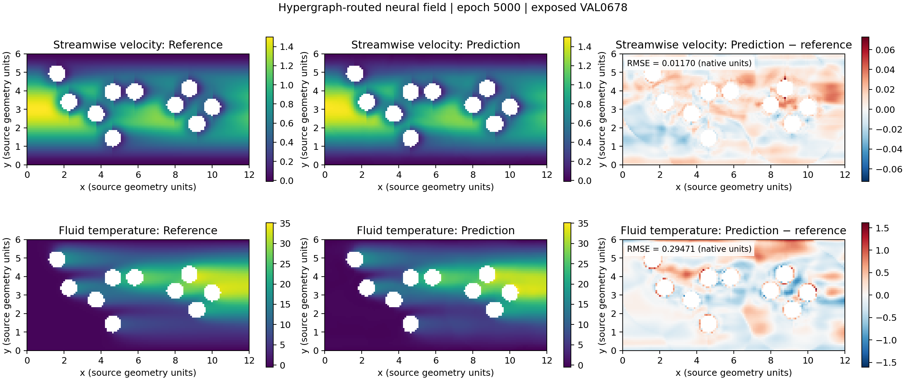
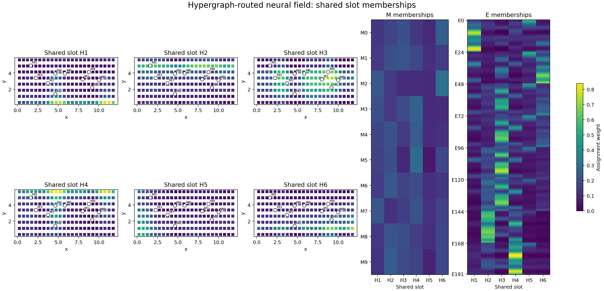
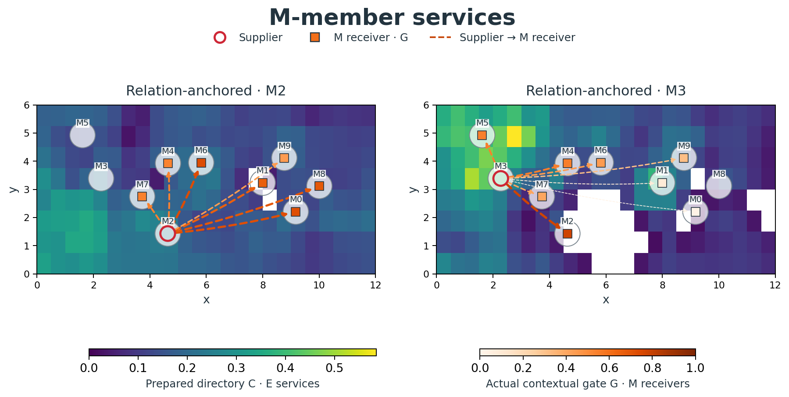
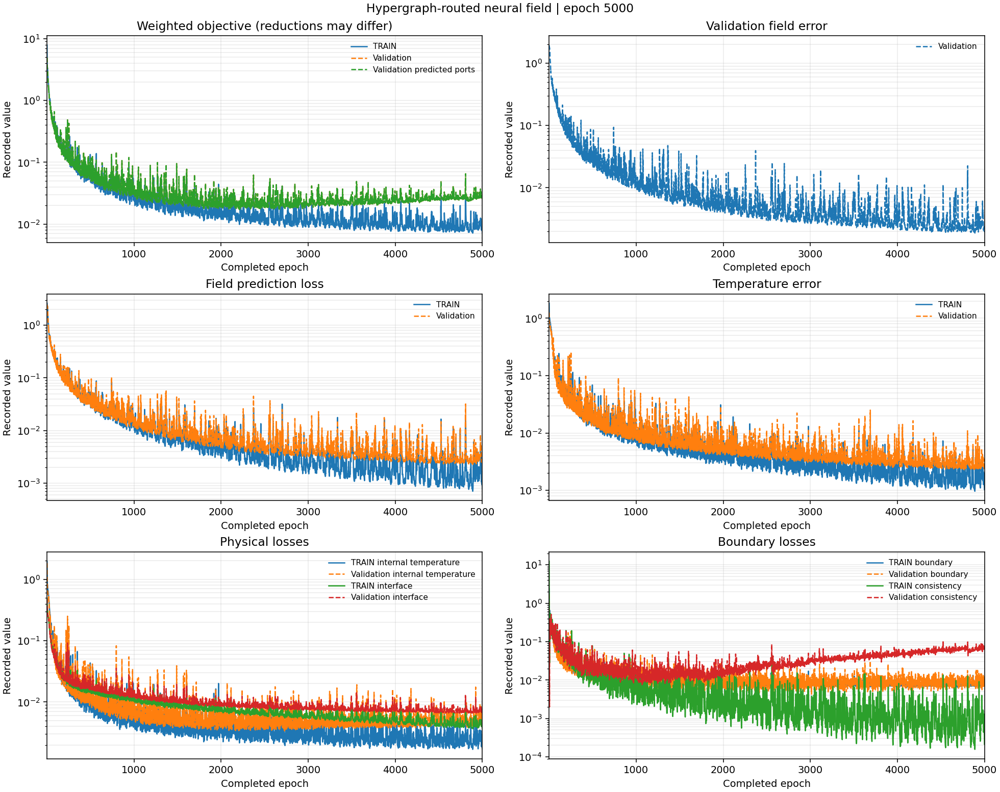
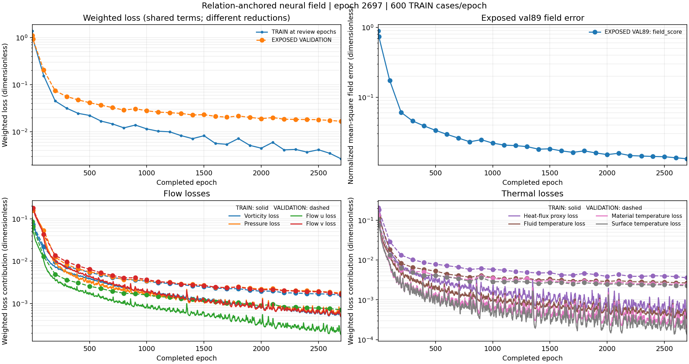

# Hypergraph Organized Neural Fields

HONF predicts physical fields for systems built from variable numbers of interacting objects. A case supplies physical records and query locations; the model exchanges information between the records, prepares an organization of their relationships where the selected architecture supports it, and predicts fields at the requested locations. Individual records, their geometry and prescribed controls remain available throughout the applicable read path.

This project contains reusable forward and inverse components, execution services, and case-owned data and physics for ThermalChannel, WindFarm and electro-thermal systems. Its research families differ in how they organize and read information; a name identifies a model family, not a claim of universal superiority or a compatible checkpoint for every case.

## Start here

From the repository root, install the core and the case you intend to use. Python 3.10 or later and an appropriate PyTorch installation are required.

```bash
python -m pip install -e . -e ./Case_ThermalChannel
# For the electro-thermal case instead:
python -m pip install -e . -e ./Case_ElectroThermal
# For the Wind case:
python -m pip install -e . -e ./Case_WindFarm
```

Datasets and trained checkpoints are external to Git. For a Thermal installation, copy `Case_ThermalChannel/Dataset/dataset_locations.example.json` to the ignored `dataset_locations.local.json` beside it and enter the actual locations. See [Thermal data and physics](Case_ThermalChannel/Dataset/PHYSICS_AND_DATA.md), [Wind data and physics](Case_WindFarm/Dataset/PHYSICS_AND_DATA.md), and the [electro-thermal handoff](Case_ElectroThermal/docs/COWORKER_HANDOFF.md) for formats and split rules. The electro-thermal case also documents a shared dataset bundle; do not assume that its machine-specific path is available on another host.

The case-specific commands below expose existing interfaces. Examine the selected configuration, resources and output location before fitting. `--dry-run` checks the configuration and integration without fitting; a useful fit requires an explicitly selected experiment and epoch budget.

```bash
# Legacy Thermal managed workflow: inspect a historical compatible profile.
python train.py --config src/config_core/forward/stage7_structured_context.json \
  --experiment-overlay src/config_core/forward/experiments/stage7_fused_query_module.json \
  --run-id 1500 --device cpu --dry-run

# Electro-thermal: inspect the shared field-training interface.
python -m hetmf train --config Case_ElectroThermal/configs/train_six_hyperedge_standard.yaml \
  --dataset /path/to/standard.h5 --output /data2/your-project/own-run \
  --device cpu --dry-run
```

The first example is a historical Thermal architecture with its own local-surrogate dependency; it is not the generic default for all cases. Use an unused run ID and a trusted local checkpoint where required. The electro-thermal command uses its own adapter and has no Thermal Stage-A checkpoint dependency.

## Model families

| Public family | Example lineage | Information flow and scope |
| --- | --- | --- |
| Hypergraph-routed neural field (`hypergraph_routed`) | Thermal Run 1404 | Six soft shared latent hyperedges organize routing and original-module pair reading; historical Thermal decoder and coupling are retained for compatibility. |
| Dense pairwise neural field (`dense_pairwise`) | Thermal Run 1804 | Dense pairwise and environmental reads provide a useful non-organized comparison; its historical Thermal head and normalization are checkpoint-specific. |
| Content-attention neural field (`content_attention`) | A2-D | Dense contextual M/E exchange prepares member states before joint field reads. Historical Thermal A2-D has its own case-specific prediction law; direct query-to-E access depends on the actual implementation. |
| Unified hypergraph neural field (`unified_hypergraph`) | U-H | A unified contextual/organization lineage with original-record access. The historical U-H Thermal instance preserves its specialized physical interface. |
| Relation-anchored neural field (`relation_anchored`) | R13-11 S | Applied contextual relations build an environment-addressed member directory used by the joint reader. |
| Active-domain relation-anchored neural field (`relation_anchored_active`) | R13-11 X | The related anchored family adds an active-domain access measure; it is a distinct policy with its own saved configuration and weights. |

These public names describe families. Existing configuration identifiers, model classes, and checkpoint keys remain part of the compatibility contract; a family name alone does not reconstruct the case, dimensions, physical law or training state. The public registry is `honf_forward_core.models.MODEL_FAMILIES`; `honf_forward_core.models.build_model(model_name, config)` constructs a bare core model from the selected family and its original constructor configuration. The registry exposes immutable family records and does not rewrite historical serialized identifiers. A case adapter supplies physical input and output semantics around the bare core. Load a checkpoint only with its matching case, model configuration, normalizer and weights; a Thermal checkpoint is not a generic checkpoint for other cases. Six is a fixed capacity in the historical 1404 configuration, not a discovered number of physical groups. Models using a generic joint predictor can be adapted to different cases, but a case adapter and a compatible trained checkpoint are still required. Historical Thermal-specific output laws must not be treated as general electro-thermal or Wind laws.

A minimal core construction uses a family-compatible original model configuration. This example reads the checked-in Thermal relation-anchored recipe and constructs the bare core; it does not read a checkpoint or run inference.

```python
import json
from pathlib import Path
from honf_forward_core.models import MODEL_FAMILIES, build_model

recipe = json.loads(Path("configs/research/thermal_r13_11s_e_anchor_train600_formal_v1.json").read_text())
core = build_model("relation_anchored", recipe["member_routing"]["model"])
print(type(core).__name__, [family.name for family in MODEL_FAMILIES])
```

A case adapter converts its records into the core's expected representation and interprets the predicted channels in the case's native units. To use trained weights, follow the matching case checkpoint loader and its saved configuration and normalization; constructing a bare core initializes a new model and does not restore a trained case adapter.

## How the information is organized

For a scene, write the input records as $V=M\cup E$, where $M$ and $E$ name input-object roles, not output-field responsibilities. Coordinates, measures, identities, masks, materials, boundary conditions and controls belong to the case and enter the appropriate records. A generic joint field predictor produces all requested channels together:

$$
Z=\operatorname{Exchange}(M,E;G),\qquad \widehat{y}(q)=\operatorname{Read}_{\theta}(q,Z,\mathcal{O}).
$$

Here $G$ denotes the relations actually applied during contextual exchange and $\mathcal{O}$ is the selected family's prepared organization, if present. The equation is a schematic interface, not a claim that all six implementations share the same exchange, readout or output law. The current anchored implementation executes directed stages in the recorded order M←M, E←M, E←E, M←E; each stage has its own provenance.

In the anchored directory, $a$ is an E address and $i$ is an original M or E member. A restricted row retains its stored weights for eligible members:

$$
C_{ai}=R_{ai}\,\mathbf{1}[i\in\operatorname{candidate}(a)],\qquad h_a=\{i:C_{ai}>0\}.
$$

The following notation summarizes the information each family exposes; $z_i$ is a contextual member, $q$ a query and $K$ an architecture setting. It is a conceptual map of access, not a common numerical decoder equation or a shared physical output head.

| Family | Organization and read in symbols |
| --- | --- |
| Hypergraph-routed, historical softmax configuration | $A^M_{ik}, A^E_{jk} > 0$, with $\sum_k A^M_{ik}=\sum_k A^E_{jk}=1$ for active members; six fixed slots in the historical example condition query and original-member reads. |
| Dense pairwise | $q$ reads dense eligible member and environmental context, without a reusable sparse member directory in the historical example. |
| Content-attention | Contextual $\{z_i\}$ are read directly by query-to-member attention; the historical A2-D instance reads M after contextual exchange rather than a direct E query path. |
| Unified hypergraph | Contextual members and the learned hypergraph jointly govern the reader; original member values remain accessible. |
| Relation-anchored | Applied E←M and E←E relations contribute to the E-addressed directory $R$; S uses inventory-normalized access measure. |
| Active-domain relation-anchored | The same anchored joint-field family uses active-domain role normalization during directory compilation while preserving relative physical E measures. |

$R$ and $C$ are prepared directory weights; query-dependent read coefficients are separate quantities. A directory row is an overlapping hyperedge of original records, rather than a pooled replacement for them. The original 1404 model instead uses six explicitly parameterized shared hyperedges. For details and the saved-evidence visualization API, see the [global organization guide](docs/guides/Global_Hypergraph_Organization_Visualization.md).

## Saved examples

The examples below use the fixed exposed Thermal VAL0678 scene with ten original modules. The 1404 latest checkpoint was at epoch 5000; one atomic hardlink of formal S latest was frozen at epoch 2813 for this illustration. These are literal selected files, not best-field checkpoints, and the different training ages and historical prediction laws prevent a controlled architecture comparison. No new fitting or solver call was performed. The selected previews and PDF masters are distributed in [`docs/assets/readme/`](docs/assets/readme/README.md). Numerical arrays, checkpoints, full histories and research reports remain local; the image index records the literal source identities and interpretation limits.

| Example | Checkpoint or history | Figure |
| --- | --- | --- |
| Hypergraph-routed neural field | Run 1404 latest, epoch 5000 | [Native fields and organization](#hypergraph-routed-native-fields-and-organization) |
| Relation-anchored neural field | Formal S frozen latest, epoch 2813 | [Native fields](#relation-anchored-native-fields), [whole-layout access](#relation-anchored-organization), original-member service, overlapping hyperedges |
| Training histories | 1404 through epoch 5000; formal S through epoch 2697 | [Loss curves](#saved-loss-histories) |

### Hypergraph-routed native fields and organization

<p align="center"></p>

The saved latest Run 1404 state uses its historical Thermal model and saved normalization. Reference, prediction and signed prediction-minus-reference are shown on the common physical-fluid mask of 7,464 native grid points; source geometry and field values use the packed dataset's native units. Streamwise velocity and fluid-temperature RMSE are 0.01170 and 0.29471, respectively, on this one scene. Prediction and reference share a scale within each row; residuals have their own scale. [PDF master](docs/assets/readme/hypergraph_routed_fields.pdf).

<p align="center"></p>

On the same exposed VAL0678 scene and latest epoch-5000 checkpoint, six panels map the actual environment-to-slot assignments $A^E_{jk}$ at the original E coordinates; white circles identify original M records. The two matrices show all ten active original M rows and 192 original E rows against the same six learned shared slots, with E row ticks labeling original IDs. All 60 M and 1,152 E assignments are positive, so memberships overlap densely; per-member softmax weights sum to one. Coordinates use source geometry units. These legacy slot assignments are not E-addressed directory rows. [PDF master](docs/assets/readme/hypergraph_routed_organization.pdf).

### Relation-anchored native fields

<p align="center"></p>

The frozen formal S latest state uses its saved TRAIN-only normalization and restricted joint95 read. On the same 7,464 physical-fluid points, streamwise velocity and fluid-temperature RMSE are 0.01941 and 0.57633 in packed native units. Each row shares its prediction/reference scale and has a separate signed-error scale; colors are scaled independently from the 1404 figure. This single exposed scene illustrates the field behavior and is not a population ranking. [PDF master](docs/assets/readme/relation_anchored_fields.pdf).

### Relation-anchored organization

<p align="center"></p>

On the same scene, restricted directory weights across 192 E addresses yield nine leading nonself display labels, all M members. Colored regions identify leading members; module rings summarize each M member's service across those regions. Own E is omitted only from this display, and coordinates use source geometry units. [PDF master](docs/assets/readme/relation_anchored_regions.pdf).

<p align="center"></p>

The same restricted directory serves 190 and 170 E addresses from M2 and M3, selected by total nonself directory service. Cell colors show directory weights; arrows show actual final-cycle M←M gates on a separate scale. These are distinct recorded operations. [PDF master](docs/assets/readme/relation_anchored_member_services.pdf).

<p align="center"></p>

Representative directory rows h(E120), h(E104), and h(E85) contain 5M+1E, 7M+2E, and 10M+1E, respectively. The E display threshold is 0.02 with all positive M and own-E memberships preserved; these rows retain 100% of their directory mass. Original memberships and intersections are exact, while ellipse geometry is illustrative and the displayed rows are not three discovered physical groups. [PDF master](docs/assets/readme/relation_anchored_hyperedges.pdf).

### Saved loss histories

<p align="center"></p>

Run 1404's history reaches epoch 5000. The sampled training and validation measurements use their recorded reductions; its selected best-field checkpoint is epoch 4890, separate from the latest example above. [PDF master](docs/assets/readme/hypergraph_routed_loss.pdf).

<p align="center"></p>

Formal S uses TRAIN600. This earlier preserved epoch-2697 redraw separates sampled weighted training terms from exposed validation measurements; their reductions differ. It does not assert current run progress or convergence. [PDF master](docs/assets/readme/relation_anchored_loss.pdf).

The [global organization guide](docs/guides/Global_Hypergraph_Organization_Visualization.md) explains the three views and saved-evidence plotter; the [image index](docs/assets/readme/README.md) records the distributed examples and limitations. Learned support describes model access and does not establish physical causality. Reduced selected records or memory alone does not establish faster complete execution.

## Bring your own data

1. Define each case's independent TRAIN, validation and test membership before fitting. Preserve related layouts or repeated physical configurations in the same split where appropriate, and fit normalization on TRAIN only.
2. Supply variable-size original M and E records with stable IDs, native coordinates, physical measures, prescribed controls, valid masks and native query locations. Padded arrays require masks; ragged storage requires explicit lengths or offsets. Keep targets, post-solve diagnostics and split labels out of model inputs.
3. Implement a case-owned reader, deterministic query sampler and adapter that produce the model's expected batch representation. The historical `BatchData` contract is defined in [`config.py`](src/honf_forward_core/config.py); newer families can use their own adapter contracts, as demonstrated by the case packages.
4. Define the joint output channels, inverse normalization, units, native geometry extraction, physical losses and fieldwise metrics in the case. Preserve the training normalizer and configuration with the checkpoint. Report residuals and physical constraints separately from field errors.
5. Exercise a small synthetic batch through the chosen model, loss and saved-checkpoint reload; add case tests for input validation, masks, reproducibility and artifacts. The [case plugin guide](docs/case_plugin.md) describes the historical managed workflow protocol and how to implement a plugin without modifying the core.

ThermalChannel supplies its own local module coupling and native observables. WindFarm owns turbine/layout geometry, native CFD arrays and layout-group splits. Electro-thermal inputs are variable contacts and 144 material-control records; the shared dataset uses five jointly predicted cell-centered targets: potential, two current components, temperature rise and total heat. Its saved target normalization is TRAIN-only, and native face quantities are required for exact reference conservation checks. See the relevant case documentation before interpreting units or physical metrics.

## Training, evaluation and inverse use

The maintained Thermal research interface provides `train-member-routing`, `resume-member-routing`, and family-specific evaluation subcommands in [`tools/honf_research.py`](tools/honf_research.py). Use `--help` on the relevant subcommand to inspect its options and select a configuration matching the exact model and dataset. The older `train.py` and `evaluate.py` dispatch historical managed case workflows; their checkpoints and profiles remain supported under their own contracts.

```bash
# Read the available options before choosing a configuration or existing run.
python tools/honf_research.py train-member-routing --help
python tools/honf_research.py resume-member-routing --help
python tools/honf_research.py evaluate-member-routing --help
python -m hetmf train --help
python -m hetmf evaluate --help
```

For a selected compatible Thermal member-routing configuration and a new output directory, the following illustrates a bounded fit, then an in-place continuation to an explicitly authorized absolute epoch and a checkpoint evaluation. These examples use placeholders; select the correct evaluator for the exact family because the member-routing evaluation command implements a particular Thermal native panel.

```bash
python tools/honf_research.py train-member-routing --config /path/to/config.json \
  --output /data2/your-project/new-run --device cuda:0 --epochs 100
python tools/honf_research.py resume-member-routing --run /data2/your-project/new-run \
  --device cuda:0 --stop-after-epoch 200
python tools/honf_research.py evaluate-member-routing --checkpoint /path/to/compatible/checkpoint.pt \
  --device cuda:0 --output /data2/your-project/evaluation
```

For electro-thermal, choose the exact original config and dataset on resume; evaluation uses a saved checkpoint and the chosen split. The examples assume the run paths have been set locally.

```bash
python -m hetmf train --config Case_ElectroThermal/configs/train_six_hyperedge_standard.yaml \
  --dataset /path/to/standard.h5 --output /data2/your-project/own-run --device cuda:0 --epochs 100 --yes
python -m hetmf train --config Case_ElectroThermal/configs/train_six_hyperedge_standard.yaml \
  --dataset /path/to/standard.h5 --output /data2/your-project/own-run --device cuda:0 \
  --resume /data2/your-project/own-run/latest.pt --epochs 200 --yes
python -m hetmf evaluate --run /data2/your-project/own-run --dataset /path/to/standard.h5 \
  --checkpoint best_field.pt --split dev --device cuda:0 --queries 1024
```

Resume stops must advance beyond the saved checkpoint. Extending a completed configured horizon is a separate decision; `--extend-horizon` on the Thermal research interface does not by itself authorize an extension.

An epoch visits the declared training membership once. Preserve run identity, sampling, normalization and optimizer state on resume; retain complete history, latest state, best-field selector and declared milestone checkpoints. A `latest` state is the most recent saved continuation state; `best_field` is selected by a validation metric and can be from a different epoch. Record the literal checkpoint, split and metric when comparing results. The [run artifacts guide](docs/guides/Run_Artifacts_and_Monitoring.md) explains monitoring and compatibility layouts.

The inverse core provides structured requests, design and verification contracts, while a case supplies physical objectives, geometry constraints and an independent verifier. A sampled or surrogate-ranked candidate is not automatically a valid physical design. Select a compatible forward model and verify candidate geometry, controls and physical behavior with the case's reference workflow. The saved S/X figures above do not establish an S/X inverse result.

## Project map

| Path | Responsibility |
| --- | --- |
| `src/honf_forward_core/` | Reusable model families, interaction, organization and readout |
| `src/honf_inverse_core/` | Inverse requests, design and verification contracts |
| `src/honf_runtime/` | Workflow dispatch, training services, artifacts and case interfaces |
| `Case_ThermalChannel/`, `Case_WindFarm/`, `Case_ElectroThermal/` | Data readers, adapters, physical models and case workflows |
| `tools/` | Maintained command-line workflows and visualization tools |
| `docs/guides/` | Current practices, case evidence and historical compatibility guides |
| `docs/assets/readme/` | Curated README image previews and PDF masters |

Start with the [guide index](docs/guides/README.md), [case plugin guide](docs/case_plugin.md), and [organization visualization guide](docs/guides/Global_Hypergraph_Organization_Visualization.md). Dataset payloads, numerical exports and checkpoints remain outside Git. The selected README previews and PDF masters are distributed in the dedicated image directory; documentation and code provide the interface and provenance needed to use the appropriate local evidence.

The [root-layout and compatibility guide](docs/Root_Layout_and_Compatibility.md) describes installation, checkpoint compatibility, image delivery and the preserved historical branches. Research reports and work plans are local archives and are excluded from this source distribution.
