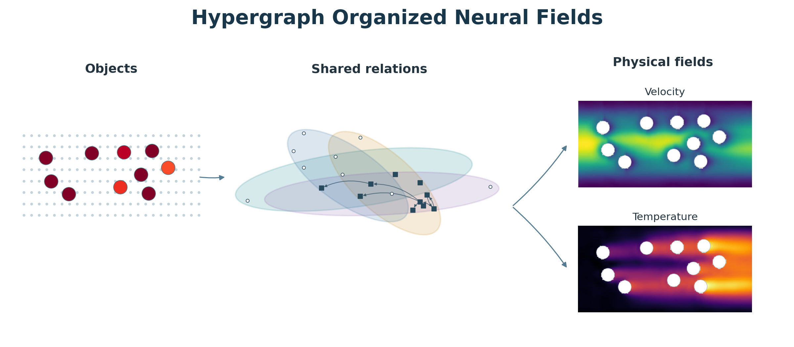
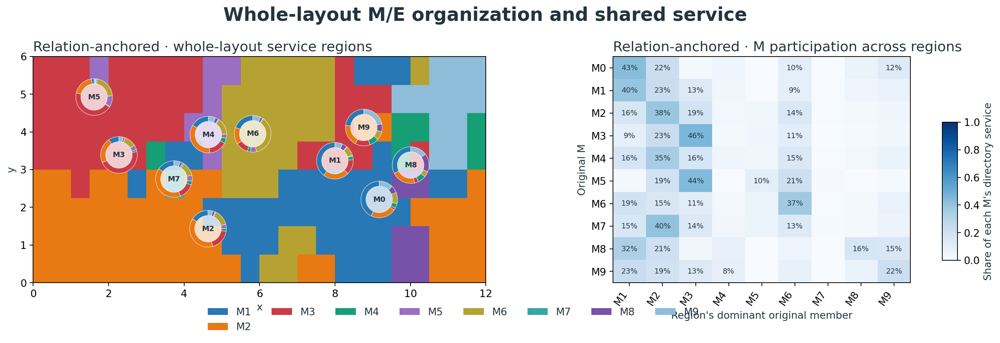
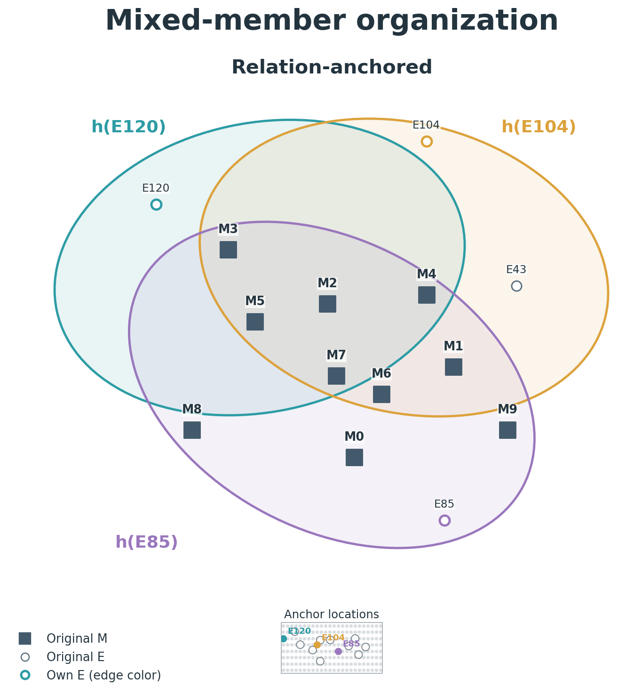
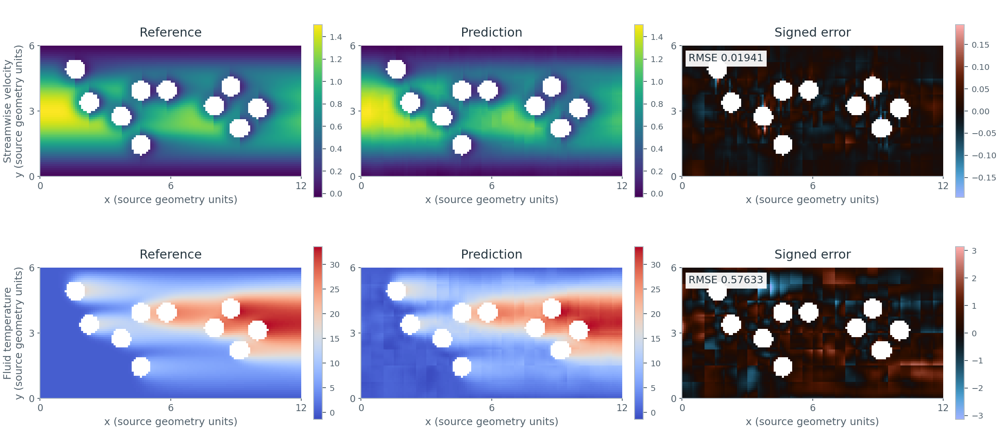

# Hypergraph Organized Neural Fields

HONF predicts physical fields from interacting object records. It prepares directed relationships between those records, organizes access to their individual information, and evaluates the resulting field at query coordinates.

<p align="center"></p>

Object records, overlapping relationships and multiple physical fields. The field textures come from a saved thermal-channel prediction; this opening illustration conveys the information flow. [PDF master](docs/assets/readme/honf_showcase.pdf).

## Relation-anchored neural fields

The public models `relation_anchored` and `relation_anchored_active` share one detail-preserving mechanism. Both retain individual contextualized records, reuse applied relations to prepare an address directory, combine nearby addresses through continuous coverage, and construct messages relative to each query. The active model changes the access measure used by the directory.

Let `M` and `E` denote input-object roles, with original records $V=M\cup E$. A member $i$ has coordinates $x_i$, prescribed features and controls, physical measure $\mu_i$, and contextual state $z_i$. These roles describe inputs; both contribute to a joint predictor of the requested physical channels. Case adapters define record features, geometry, units, normalization and observation operators.

1. **Prepare records.** Encode each member with its owning geometry, attributes and prescribed controls.
2. **Exchange information.** Contextualize the records through directed M←M, E←M, E←E and M←E exchanges, retaining their actual relations and original member identities.
3. **Organize access.** Reuse the final E-receiver relations to prepare weighted original-member hyperedges. A query's local address cover chooses the directory rows it can use.
4. **Predict jointly.** Form query-relative messages from the accessible original members, combine them with learned read coefficients, and decode all configured field channels through one joint head.

### Applied relations and access measures

An address $a\in E$ uses the recorded E←M and E←E gates, together with explicit own-E access. Write this nonnegative combined gate as $g_{ai}$. For each input role $r\in\{M,E\}$, let $V_r$ be its original member inventory and $\mathcal A_r(a)=\{i\in V_r:g_{ai}>0,\ \mu_i>0\}$ its positive-measure support.

The two public models differ in the measure $\nu_{ai}$:

$$
\nu_{ai}^{\mathrm{inventory}}=\mu_i,\qquad
\nu_{ai}^{\mathrm{active}}=
\begin{cases}
\displaystyle\frac{\mu_i}{\sum_{j\in\mathcal A_{r(i)}(a)}\mu_j},&i\in\mathcal A_{r(i)}(a),\\
0,&\text{otherwise}.
\end{cases}
$$

The prepared directory and its retained native hyperedge are

$$
R_{ai}=\frac{g_{ai}\nu_{ai}}{\sum_j g_{aj}\nu_{aj}},\qquad
C_{ai}=R_{ai}\,\mathbf 1[i\in\mathcal C(a)],\qquad
h_a=\{i:C_{ai}>0\}.
$$

A zero-total row remains zero. The configured retention rule chooses $\mathcal C(a)$ by joint M/E mass and preserves actual positive own-E access; the current recipes use 95% retained mass. Truncation preserves the stored weights. Original IDs, coordinates and individual member states remain available inside each hyperedge.

In the Thermal adapter, $\mu_i$ is uniform over present M members and proportional to positive physical cell area within E; each role has unit total inventory measure. `relation_anchored` uses that inventory measure. `relation_anchored_active` renormalizes it separately within each receiver's positive M and E support before joint row normalization. Contextual gates and query messages are shared between the two models.

<p align="center"></p>

Thermal-channel scene 0684, TRAIN600 checkpoint at epoch 500. Colors identify each address's leading nonself directory member; ring sectors show each original M member's soft service across those same regions. [PDF master](docs/assets/readme/relation_anchored_regions.pdf).

<p align="center"></p>

Scene 0277, same checkpoint. Automatically selected native rows retain exact displayed intersections, original M/E identities, actual directed MM gates and a physical-layout locator. Selected-row coverage, display thresholds and retained mass are recorded in the [figure details](docs/assets/readme/README.md). [PDF master](docs/assets/readme/relation_anchored_hyperedges.pdf).

### Continuous coverage and query-relative messages

The case adapter supplies nonnegative address weights $\lambda_a(q)$ that sum to one on each valid query. The Thermal adapter uses tensor-product cubic smoothstep coverage over up to four neighboring E centers, with boundary clamping. The shared core consumes the supplied address indices and weights.

For role $r$, the reader combines the retained directory prior with calibrated query/member scores $\ell_{ari}(q)$ within each selected address:

$$
p_{ari}(q)=
\frac{C_{ai}\exp\ell_{ari}(q)}
{\sum_{j\in\mathcal C(a)\cap V_r}C_{aj}\exp\ell_{arj}(q)},\qquad
\beta_{ri}(q)=\sum_a\lambda_a(q)\,\rho_{ar}(q)\,p_{ari}(q).
$$

Here $\rho_{ar}(q)$ is the learned role-specific read strength; empty role support contributes zero. Repeated appearances of an original member are coalesced into its final coefficient $\beta_{ri}(q)$. Raw query/member scores are shared before row-specific calibration, and selected original-member messages are reused across the covered rows and paired full/restricted reads.

For the selected member $i$, let $\Delta_i(q)=q-x_i$, $L$ be the scene coordinate scale, $h_i$ its characteristic length, $z_q$ the query state, and $v_{ri}$ its contextual member value. The detail-preserving message is

$$
m_{ri}(q)=\operatorname{SiLU}\!\left[
v_{ri}+W_r^q z_q+b_r^q
+W_r^g\gamma\!\left(\frac{\Delta_i(q)}{L}\right)
+W_r^\ell\operatorname{asinh}\!\left(\frac{\Delta_i(q)}{h_i}\right)
\right],
$$

where $\gamma(t)$ concatenates $t$ with $\sin(2\pi f t)$ and $\cos(2\pi f t)$ for $f\in\{1,2,4\}$. The reader accumulates the original-member messages and predicts jointly:

$$
c_r(q)=\sum_{i\in V_r}\beta_{ri}(q)m_{ri}(q),\qquad
\widehat{\mathbf y}(q)=D_{\mathrm{case}}\!\left(F_\theta([z_q,c_M(q),c_E(q)])\right).
$$

$F_\theta$ is the joint decoder and $D_{\mathrm{case}}$ converts its outputs to native units. Organization therefore governs which individual member details enter each prediction. Applied contextual gates, prepared directory weights and final query coefficients describe separate parts of this information flow.

## Using the models

Python 3.10+ and a suitable PyTorch installation are required. Install the shared package and the case adapter you need:

```bash
python -m pip install -e ".[visualization]"
python -m pip install -e ./Case_ThermalChannel
# Other case packages: ./Case_WindFarm or ./Case_ElectroThermal
```

### Construct a core

`relation_anchored_config` creates a fresh shared-mechanism configuration from the content encoder's base configuration. The base declares record dimensions, coordinate dimensions, contextual width and output channels. Your adapter supplies the matching scene/query batches and continuous address cover.

```python
import json
from pathlib import Path
from honf_forward_core.models import build_model, relation_anchored_config

base = json.loads(Path("base_core_config.json").read_text())
config = relation_anchored_config(
    "relation_anchored_active", base, input_dataset="my_case",
)
core = build_model("relation_anchored_active", config)
prepared = core.prepare(scene)
fields = core.decode(prepared, queries).joint_fields
```

Choose `"relation_anchored"` for inventory-normalized access. Save `core.get_config()` with the model state. For a trained case, reconstruct the saved model configuration and adapter normalization before loading its state.

### Query tiling: speed and memory

`query_tile_size` limits how many query positions per scene the decoder processes in one chunk; it evaluates all queries. Larger tiles usually reduce per-chunk launch and checkpoint bookkeeping overhead while increasing peak working memory. This execution setting preserves the model equations, query samples and physical objective; floating-point reduction order can change. Set it with `relation_anchored_config(..., query_tile_size=...)` or the model section of your recipe. Benchmark on your own dataset, GPU and batch size: compare warmed-up complete forward/backward updates, check output/gradient agreement, and include your largest expected inputs. Choose a tile near your best measured throughput with memory headroom. See the short [query-tiling guide](docs/guides/Query_Tiling.md) for a test procedure and checkpoint-resume scope.

### Thermal training and evaluation

The maintained [inventory recipe](configs/research/thermal_relation_anchored_train600.json) and [active-domain recipe](configs/research/thermal_relation_anchored_active_train600.json) use the full training population and the same mechanism. Configure dataset paths and `storage.output_root` for your installation before launching. The dry run resolves the model/provider identity without creating a training run:

```bash
python tools/honf_research.py train-member-routing \
  --model relation_anchored --device cpu \
  --output /data2/your-project/train600/RUN_NAME --dry-run
```

Use `--model relation_anchored_active` for active-domain access. The configured first training segment is 100 epochs, where an epoch visits the declared training population once. Run the selected recipe without `--dry-run` to train; continue and evaluate the same saved lineage through its maintained loaders:

```bash
python tools/honf_research.py resume-member-routing \
  --run /data2/your-project/train600/RUN_NAME \
  --stop-after-epoch 200 --device cuda:0

python tools/honf_research.py evaluate-member-routing \
  --checkpoint /data2/your-project/train600/RUN_NAME/checkpoints/best_by_field_mse_model.pt \
  --device cpu --output /data2/your-project/evaluation
```

The checkpoint carries its model, optimizer, normalization, data/sampling identity and continuation state. Loading dispatches by the saved schema and architecture; a public model name does not replace those saved semantics. See the [Thermal workflow](docs/guides/Thermal_Relation_Anchored_Training.md), [checkpoint compatibility](docs/Root_Layout_and_Compatibility.md), and [run artifact guide](docs/guides/Run_Artifacts_and_Monitoring.md).

## Physical field example

<p align="center"></p>

Scene 0684, exposed validation partition, TRAIN600 checkpoint at epoch 500. Reference and prediction share an absolute color scale within each field. Speed uses `viridis`, temperature `inferno`, and signed errors `berlin`. RMSE and relative L2 are computed from the displayed values on the 7,474 valid positive-weight fluid receivers in packed native units. [PDF master](docs/assets/readme/relation_anchored_fields.pdf) · [Figure provenance](docs/assets/readme/README.md).

## Available models

| Public identifier | Model |
| --- | --- |
| `relation_anchored` | Shared detail-preserving reader with inventory-normalized relation-anchored access. |
| `relation_anchored_active` | The same reader with receiver-specific active-domain access normalization. |
| `unified_hypergraph` | Native hypergraph organization governs access to contextualized original members. |
| `hypergraph_routed` | Shared latent hyperedges organize routing and original-member pairwise reads. |
| `dense_pairwise` | Dense contextual pairwise reads without hypergraph routing. |
| `content_attention` | Contextual record exchange followed by direct content attention. |

Use each model with its matching saved configuration and case adapter. The [model registry](src/honf_forward_core/models.py) defines these six public names; detail preservation is a shared mechanism within the two relation-anchored models.

## Adapting HONF to a physical case

The shared core owns interaction, organization and joint field reading. A case adapter defines original record roles, physical geometry and measures, prescribed features, masks, coordinate transforms, train-fitted normalization and target observation operators.

Keep training, validation and test populations separate. Supply stable original IDs, physical measures and complete padding masks; fit normalization only on training data and retain it in the checkpoint. For the relation-anchored models, provide valid local address indices and continuous cover weights in each query batch. Verify field values, coordinate/query gradients, checkpoint reconstruction and continuation on a small case before a full experiment.

See the [case integration guide](docs/case_plugin.md), [Thermal data guide](Case_ThermalChannel/Dataset/PHYSICS_AND_DATA.md), [Wind data guide](Case_WindFarm/Dataset/PHYSICS_AND_DATA.md), and [electro-thermal walkthrough](Case_ElectroThermal/docs/COWORKER_HANDOFF.md). Organization figures follow the [global visualization specification](docs/guides/Global_Hypergraph_Organization_Visualization.md).

## Repository map

| Location | Purpose |
| --- | --- |
| `src/honf_forward_core/` | Shared model mechanisms and public model selection |
| `src/honf_inverse_core/` | Inverse requests, designs and verification contracts |
| `src/honf_runtime/` | Training, evaluation, continuation and run artifacts |
| `Case_ThermalChannel/`, `Case_WindFarm/`, `Case_ElectroThermal/` | Physical data and case adapters |
| `tools/` | Maintained command-line workflows |
| `docs/` | Method, integration and visualization guides |
| `docs/assets/readme/` | Selected homepage PNG previews and PDF masters |
