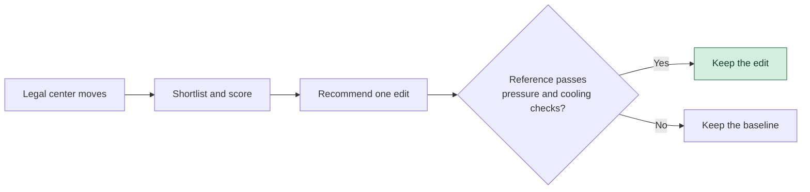
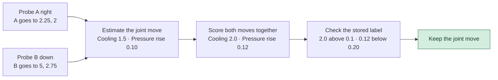

# ThermalChannel inverse design

**Where should the heated modules go?** Start from a legal channel layout and move the disk centers to cool the material under a pressure-drop limit. A frozen HONF model scores candidate layouts. The benchmark uses the reference result to decide whether to keep the proposed layout. Each module carries its prescribed heat load, radius and material properties through every move. [Thermal physics and data](../../Case_ThermalChannel/Dataset/PHYSICS_AND_DATA.md)



Each policy can recommend one edit from a supplied pool. Model policies have the same forward allowance. When a model ranks the baseline first, the replay keeps it without an edit check. Otherwise the final decision reads the selected edit's stored reference label if available. The completed result below is a scripted replay. The released B0/R comparison is pending. [Benchmark guide](../../Case_ThermalChannel/scripts/inverse/README.md#frozen-placement-benchmark)

## What counts as a better design

The objective $J$ is a smooth maximum over the valid material-temperature receivers. The pressure drop $P$ is the mean pressure in the fluid inlet band minus the mean pressure in the fluid outlet band. Each band spans 8% of the channel length. For a proposed layout $D$ and the baseline $D_0$, the replay uses changes in those quantities:

$$
\Delta J = J(D)-J(D_0), \qquad \Delta P = P(D)-P(D_0).
$$

Cooling is $-\Delta J$. A reference-feasible baseline supplies the anchor. An edit is accepted when the reference cooling exceeds the declared temperature resolution and the reference pressure rise is at or below the allowance. Check disks for wall and inlet/outlet bounds and non-overlap before scoring. A fresh forward rebuilds the scene, receivers and HONF organization for each scored layout. [Native observations](../../Case_ThermalChannel/src/channelthermal/native_functionals.py) · [Native design scoring](../../Case_ThermalChannel/src/channelthermal/native_design.py)

## A worked design decision

The controlled `synthetic` fixture uses a $12\times6$ channel with three disks of radius `0.7` in fixture coordinates. The baseline centers for A, B and C are `(2, 2)`, `(5, 3)` and `(9, 4)`. Their prescribed heat values are `3`, `1` and `2` in fixture units. The test executes the native forward path on an untrained adapter and substitutes scripted $J$ and $P$ responses for decision testing. The reference labels use the same scripted values. [Fixture geometry and adapter](../../Case_ThermalChannel/tests/test_placement_benchmark.py#L39) · [Scripted responses](../../Case_ThermalChannel/tests/test_placement_benchmark.py#L97)

```text
 y                  Inlet → outlet
 6  +------------------------------------------------+
    |                                                |
 4  |                                   (C)          |
 3  |                   (B)                          |
    |                    ↓                           |
 2  |       (A)→                                     |
    |                                                |
 0  +------------------------------------------------+ x
    0                                               12
```

**Plan view of the accepted edit.** The markers show the baseline centers. The arrows enlarge the selected displacements for readability. A moves right by `0.25` to `(2.25, 2)`, B moves down by `0.25` to `(5, 2.75)`, and C stays at `(9, 4)`. [Scripted move definitions](../../Case_ThermalChannel/tests/test_placement_benchmark.py#L104)



**Signed-response trail.** Two candidate forwards probe A-right and B-down. Adding their changes suggests `1.5` cooling for the joint move. The third forward scores the edited scene with both moves and returns `2.0` scripted cooling at `0.12` pressure rise. Its stored reference label clears the `0.1` temperature resolution and `0.20` pressure allowance. The probes and joint score use the full three-forward budget for this policy. [Budget and acceptance assertions](../../Case_ThermalChannel/tests/test_placement_benchmark.py#L130)

| Supplied edit | Center change in fixture coordinates | Cooling $-\Delta J$ | Pressure rise $\Delta P$ |
| --- | --- | ---: | ---: |
| A left | A $x$ −0.25 | −2.0 | 0.02 |
| A right | A $x$ +0.25 | +1.0 | 0.04 |
| B down | B $y$ −0.25 | +0.5 | 0.06 |
| **Joint** | **A $x$ +0.25 and B $y$ −0.25** | **+2.0** | **0.12** |

All four edits meet the fixture pressure cap. A-left uses the least pressure and warms the material. The joint move supplies the most cooling in the pool. The reference-only poll checks A-left under seed `0` and retains the baseline. A separate scripted test rejects a candidate predicted to be feasible whose reference pressure rise is `0.30` against a `0.10` allowance. [Controlled pool](../../Case_ThermalChannel/tests/test_placement_benchmark.py#L104) · [Pressure rejection test](../../Case_ThermalChannel/tests/test_placement_benchmark.py#L14)

## Policy results

One synthetic family, four candidate edits, seed `0`, CPU and restricted HONF reads. The four model policies share one baseline forward, tracked separately. Each row checks one supplied reference label for its proposed edit. Probes are included in the candidate-forward count. [Replay implementation](../../Case_ThermalChannel/src/channelthermal/inverse/placement_benchmark.py)

| Policy | Candidate forwards | Of which probes | Checked edit | Retained layout | Cooling |
| --- | ---: | ---: | --- | --- | ---: |
| Uniform sample | 3 | 0 | Joint | Joint | 2.0 |
| Hot-receiver proximity | 3 | 0 | Joint | Joint | 2.0 |
| HONF environment access | 3 | 0 | Joint | Joint | 2.0 |
| Signed finite response | 3 | 2 | Joint | Joint | 2.0 |
| Reference-only poll | 0 | 0 | A left | Baseline | 0.0 |

All four model shortlists contain the best feasible edited layout in this fixture. Their measured shortlist and decision losses are both zero. The poll's shortlist misses `2.0` scripted temperature units of cooling, and keeping the baseline is the best decision within its one-move shortlist. This example verifies accounting and acceptance. The tie among model policies leaves the benefit of HONF shortlisting on real layout families open. [Comparison test](../../Case_ThermalChannel/tests/test_placement_benchmark.py#L139)

## Evidence and open measurements

| Question | Evidence available |
| --- | --- |
| Can the predictor rank real edits? | The additional full-pool fixture run scores four edits, matches all four resolved directions and all six feasible pair orderings. The scripted predictions equal their labels by construction. The B0/R comparison on matched released families is pending. |
| What does organization contribute? | Environment access follows hot receiver weights through the environment-address cover and prepared directory to prioritize original modules. Equal-magnitude opposite moves of a module tie at shortlisting. Fresh forward scoring can distinguish their predicted responses. An advantage over proximity and signed response on real families is unmeasured. |
| Does the inverse policy return better verified layouts? | The fixture retains the `2.0` scripted cooling edit and exercises pressure rejection and the minimum improvement threshold. The prospective comparison with the case solver is pending. |
| Does it save work? | The replay counts candidate forwards and executor work. End-to-end reference solver savings and performance under full access remain unmeasured. |

Real-case execution requires the released B0/R checkpoints and matched edited endpoints. A prospective trial also needs the external analytic-wake and shared-grid thermal solver. This solver provides the benchmark reference fidelity. [Dataset binding](../../Case_ThermalChannel/Dataset/README.md) · [Reference adapter](../../Case_ThermalChannel/src/channelthermal/interaction_evidence/reference_adapter.py)

## Run the replay

From the repository root after installing the shared and ThermalChannel packages:

```bash
python tools/thermal_placement_benchmark.py \
  --panel /path/to/matched-panel.json \
  --checkpoint B0=/path/to/b0.pt --checkpoint R=/path/to/r.pt \
  --budget 4 --tau 0.4149511814117432 \
  --pressure-allowance 0.1 --j-resolution 0.01 \
  --full-pool --format markdown
```

The numeric arguments illustrate the command. Use the matched panel's smoothing scale and native pressure and temperature thresholds. Supply the same legal edits and family partitions to both checkpoints. Within each checkpoint, the same seed and forward budget control the comparison among model policies. `--format json` exposes action IDs, predicted and reference deltas, counted work, and the two sources of loss. `--full-pool` adds a predictor comparison over identical edits outside the proposal budgets. [Panel format](../../configs/examples/thermal_response_families.example.json) · [CLI guide](../../Case_ThermalChannel/scripts/inverse/README.md#frozen-placement-benchmark) · [Project README](../../README.md)
