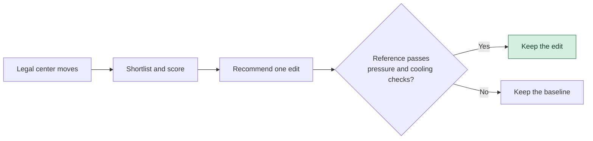
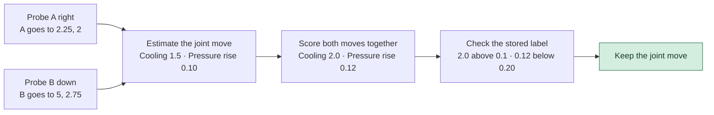
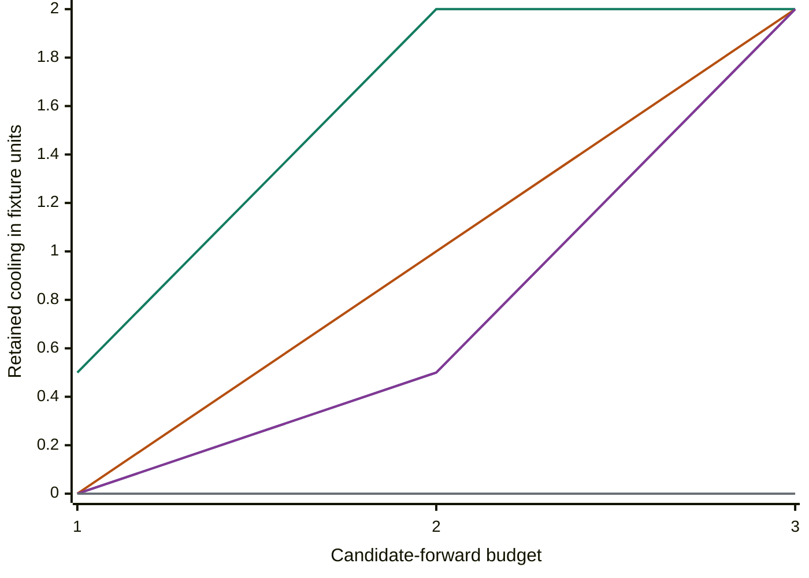
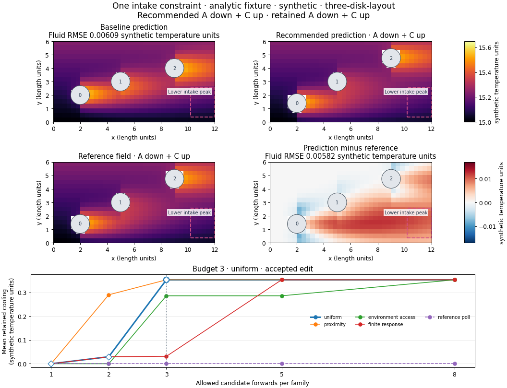
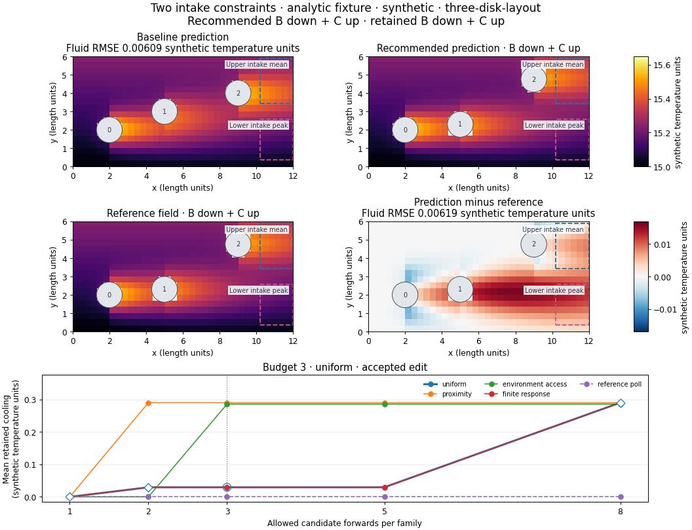
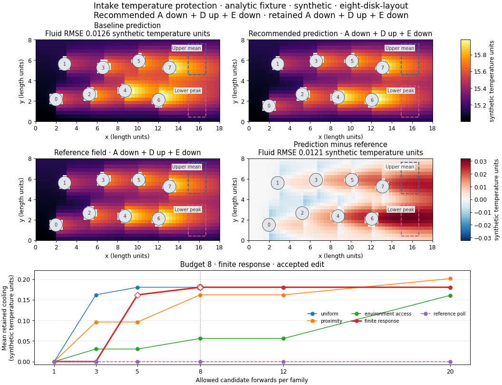
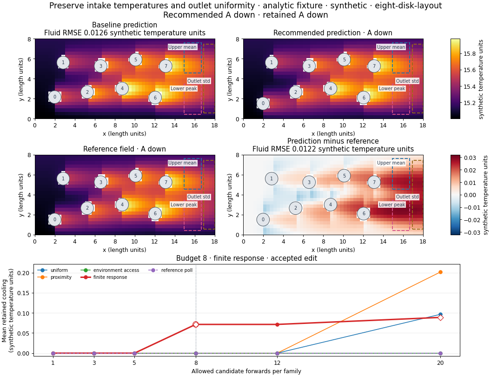

# ThermalChannel inverse design

**Where should the heated modules go?** Start from a legal channel layout and move the disk centers to cool the material under a pressure-drop limit. A frozen HONF model scores candidate layouts. The benchmark uses the reference result to decide whether to keep the proposed layout. Each module carries its prescribed heat load, radius and material properties through every move. [Thermal physics and data](../../Case_ThermalChannel/Dataset/PHYSICS_AND_DATA.md)



Each policy can recommend one edit from a supplied pool. Model policies have the same forward allowance. When a model ranks the baseline first, the replay keeps it without an edit check. Otherwise the final decision reads the selected edit's stored reference label if available. The completed result below is a scripted replay. The released B0/R comparison is pending. [Benchmark guide](../../Case_ThermalChannel/scripts/inverse/README.md#frozen-placement-benchmark)

## What counts as a better design

The objective $J$ is a smooth maximum over the valid material-temperature receivers. The pressure drop $P$ is the mean pressure in the fluid inlet band minus the mean pressure in the fluid outlet band. Each band spans 8% of the channel length. For a proposed layout $D$ and the baseline $D_0$, the replay uses changes in those quantities:

$$
\Delta J = J(D)-J(D_0), \qquad \Delta P = P(D)-P(D_0).
$$

Cooling is $-\Delta J$. A reference-feasible baseline supplies the anchor. An edit is accepted when the reference cooling exceeds the declared temperature resolution and the reference pressure rise is at or below the allowance. Check disks for wall and inlet/outlet bounds and non-overlap before scoring. A fresh forward rebuilds the scene, receivers and HONF organization for each scored layout. [Native observations](../../Case_ThermalChannel/src/channelthermal/native_functionals.py) · [Native design scoring](../../Case_ThermalChannel/src/channelthermal/native_design.py)

## A worked design decision

The controlled `synthetic` fixture uses a $12\times6$ channel with three disks of radius `0.7` in fixture coordinates. The baseline centers for A, B and C are `(2, 2)`, `(5, 3)` and `(9, 4)`. Their prescribed heat values are `3`, `1` and `2` in fixture units. The test executes the native forward path on an untrained adapter and substitutes scripted $J$ and $P$ responses for decision testing. The reference labels use the same scripted values. [Fixture geometry and adapter](../../Case_ThermalChannel/tests/test_placement_benchmark.py#L39) · [Scripted responses](../../Case_ThermalChannel/tests/test_placement_benchmark.py#L97)

```text
 y                  Inlet → outlet
 6  +------------------------------------------------+
    |                                                |
 4  |                                   (C)          |
 3  |                   (B)                          |
    |                    ↓                           |
 2  |       (A)→                                     |
    |                                                |
 0  +------------------------------------------------+ x
    0                                               12
```

**Plan view of the accepted edit.** The markers show the baseline centers. The arrows enlarge the selected displacements for readability. A moves right by `0.25` to `(2.25, 2)`, B moves down by `0.25` to `(5, 2.75)`, and C stays at `(9, 4)`. [Scripted move definitions](../../Case_ThermalChannel/tests/test_placement_benchmark.py#L104)



**Signed-response trail.** Two candidate forwards probe A-right and B-down. Adding their changes suggests `1.5` cooling for the joint move. The third forward scores the edited scene with both moves and returns `2.0` scripted cooling at `0.12` pressure rise. Its stored reference label clears the `0.1` temperature resolution and `0.20` pressure allowance. The probes and joint score use the full three-forward budget for this policy. [Budget and acceptance assertions](../../Case_ThermalChannel/tests/test_placement_benchmark.py#L130)

| Supplied edit | Center change in fixture coordinates | Cooling $-\Delta J$ | Pressure rise $\Delta P$ |
| --- | --- | ---: | ---: |
| A left | A $x$ −0.25 | −2.0 | 0.02 |
| A right | A $x$ +0.25 | +1.0 | 0.04 |
| B down | B $y$ −0.25 | +0.5 | 0.06 |
| **Joint** | **A $x$ +0.25 and B $y$ −0.25** | **+2.0** | **0.12** |

All four edits meet the fixture pressure cap. A-left uses the least pressure and warms the material. The joint move supplies the most cooling in the pool. The reference-only poll checks A-left under seed `0` and retains the baseline. A separate scripted test rejects a candidate predicted to be feasible whose reference pressure rise is `0.30` against a `0.10` allowance. [Controlled pool](../../Case_ThermalChannel/tests/test_placement_benchmark.py#L104) · [Pressure rejection test](../../Case_ThermalChannel/tests/test_placement_benchmark.py#L14)

## Policy results

One synthetic family, four candidate edits, seed `0`, CPU and restricted HONF reads. The four model policies share one baseline forward, tracked separately. Each row checks one supplied reference label for its proposed edit. Probes are included in the candidate-forward count. [Replay implementation](../../Case_ThermalChannel/src/channelthermal/inverse/placement_benchmark.py)

| Policy | Candidate forwards | Of which probes | Checked edit | Retained layout | Cooling |
| --- | ---: | ---: | --- | --- | ---: |
| Uniform sample | 3 | 0 | Joint | Joint | 2.0 |
| Hot-receiver proximity | 3 | 0 | Joint | Joint | 2.0 |
| HONF environment access | 3 | 0 | Joint | Joint | 2.0 |
| Signed finite response | 3 | 2 | Joint | Joint | 2.0 |
| Reference-only poll | 0 | 0 | A left | Baseline | 0.0 |

All four model shortlists contain the best feasible edited layout in this fixture. Their measured shortlist and decision losses are both zero. The poll's shortlist misses `2.0` scripted temperature units of cooling, and keeping the baseline is the best decision within its one-move shortlist. This example verifies accounting and acceptance. The tie among model policies leaves the benefit of HONF shortlisting on real layout families open. [Comparison test](../../Case_ThermalChannel/tests/test_placement_benchmark.py#L139)

## Cooling yield versus forward budget



**Scripted replay, one family, seed 0.** Uniform is blue, proximity is orange, HONF environment access is green, signed response is purple, and the reference-only poll is gray. Uniform and signed response overlap. Environment access finds the joint move at two forwards. The other model policies reach it at three. At the larger budget, the curves tie and the selected action alone hides the difference in when they found it. [Curve implementation](../../Case_ThermalChannel/src/channelthermal/inverse/placement_benchmark.py) · [Fixture](../../Case_ThermalChannel/tests/test_placement_benchmark.py#L97)

| Forward budget | Critical decisions | Retained cooling |
| ---: | --- | --- |
| 1 | Environment access keeps B-down. The reference-only poll checks A-left and keeps the baseline. | `0.5` for environment access and `0` for the other policies. |
| 2 | Environment access keeps the joint move. Proximity keeps A-right. Uniform and signed response keep B-down, with signed response still using its uniform fallback. | `2.0`, `1.0` and `0.5`, respectively. |
| 3 | Signed response uses two component probes and one joint score. All four model policies keep the joint move. | `2.0` for each model policy. |

Each point restarts from the same baseline with that budget. A decline is possible because a larger budget can change the recommendation. In a separate rejection check, changing the joint edit's reference pressure rise to `0.30` against a `0.20` cap sends the uniform curve from `0.5` at two forwards back to `0` at three. The benchmark records the rejected edit and retained baseline at that point. [Curve and rejection tests](../../Case_ThermalChannel/tests/test_placement_benchmark.py#L130)

## Downstream temperature protection

The extended replay can protect a downstream intake while cooling the heated modules. One task adds a cap on the peak fluid temperature in a lower intake rectangle. A second task also caps mean temperature in a separate upper intake. The two reductions use fixed Eulerian fluid receivers, while the material objective follows the disks. The geometry check excludes any layout that intersects an intake. [Regional cap and matched label format](../../Case_ThermalChannel/scripts/inverse/README.md#fixed-downstream-temperature-constraints)

The combined figure shows baseline and recommended fluid-temperature predictions, the recommended layout's reference and signed error when available, and the policy yield curves. The outlines identify the fixed intake regions. The figure marks a selected budget on the curves and shows the proposed geometry at that point, including a proposal that the reference rejected. Each plotted error uses fluid field RMSE in native temperature units. [Field and curve figure](../../Case_ThermalChannel/scripts/inverse/README.md#fixed-downstream-temperature-constraints)

An in-memory analytic fixture exercised both tasks on a common bank of nine single- and two-module edits, with budgets of 1, 2, 3, 5 and 8 forwards. It used an untrained native adapter for prepared access and separately parameterized analytic temperature and pressure responses for the predictor and fixture reference. The pressure rise allowance was `0.10`, and the lower intake peak allowance was `0.04`. The second task added an upper intake mean allowance of `0.01`, in fixture units. [Regional cap implementation](../../Case_ThermalChannel/src/channelthermal/inverse/placement_benchmark.py)

<p align="center"></p>

**One intake cap.** At three forwards, uniform retains A down and C up. The fixture reference gives `0.352` material cooling and a `0.0578` decrease in lower-intake peak temperature. The proposed fluid-field RMSE is `0.00582` in synthetic temperature units. The marker links the plotted fields to the indicated budget and policy.

<p align="center"></p>

**Two intake caps.** At the same budget, uniform retains B down and C up. The fixture reference gives `0.0295` material cooling and a `0.00931` rise in the upper intake mean, within the `0.010` allowance. The proposed fluid-field RMSE is `0.00619` in synthetic temperature units. Both figures share temperature, signed-error and cooling scales.

| Uniform policy at three forwards | One intake cap | Two intake caps |
| --- | --- | --- |
| Retained design | A down and C up | B down and C up |
| Material cooling | 0.352 | 0.0295 |
| Lower intake peak change | −0.0578 | −0.0319 |
| Upper intake mean change | +0.0124 | +0.00931 |
| Proposed fluid-field RMSE | 0.00582 | 0.00619 |

The upper intake cap screens out the original joint move. Under both caps, proximity reaches `0.290` cooling at two forwards. Uniform and signed response reach the same cooling at eight. These values characterize the analytic fixture. Physical adoption requires the matched released-panel evaluation. [Field and curve implementation](../../Case_ThermalChannel/src/channelthermal/inverse/placement_visualization.py)

## Eight heat sources and simultaneous constraints

The denser analytic fixture places eight disks on an `18 × 8` channel sampled on a `54 × 24` grid. Disk radius is `0.64` and each disk carries its prescribed heat load. One family supplies 56 legal edits, including 16 single-coordinate moves and 40 combined edits involving up to four disks. All policies see the same bank and seed `0`, with candidate-forward budgets of 1, 3, 5, 8, 12 and 20. The predictor and fixture reference use separately parameterized analytic responses, with an untrained native adapter supplying prepared access. The units are synthetic. [Replay implementation](../../Case_ThermalChannel/src/channelthermal/inverse/placement_benchmark.py)

The objective is material cooling. All three requests allow at most `0.010` pressure rise and require a resolved decrease in material `J` greater than `0.012`. The lower intake uses peak temperature, the upper intake uses mean temperature, and outlet uniformity uses population standard deviation. Their fixed normalized rectangles use `[x0, y0, x1, y1]` bounds of `[0.83, 0.05, 0.925, 0.43]`, `[0.83, 0.57, 0.925, 0.95]` and `[0.94, 0.07, 1.00, 0.93]`. [Regional reduction and label format](../../Case_ThermalChannel/scripts/inverse/README.md#fixed-downstream-temperature-constraints)

| Request | Allowed rises in lower peak, upper mean, outlet spread | Reference-feasible edits |
| --- | --- | ---: |
| Intake protection | `0.018`, `0.012`, outlet spread unrestricted | 24 / 56 |
| Intake protection plus outlet uniformity | `0.018`, `0.012`, `0` | 20 / 56 |
| Tightened combined request | `0`, `0`, `0` | 6 / 56 |

The outlet cap alone removes four feasible edits and the measured yield curves match those of intake protection. Tightening both intake caps as well changes which edits the policies retain. The figures compare these two endpoints of the request ladder. Module markers `0`–`7` correspond to A–H. The field, error and yield scales match across the pair. Diamonds mark increases in retained cooling for signed response, and the vertical line marks the eight-forward point whose fields are displayed.

<p align="center"></p>

**Intake protection.** With four probes and four follow-up scores, signed response retains A down, D up and E down. On the analytic reference this cools the material by `0.1803`, lowers the pressure drop by `0.0426` and raises lower-intake peak temperature by `0.00226`, within the allowed `0.018`. The proposed fluid-field RMSE is `0.01209` over 1,201 displayed common valid fluid cells.

<p align="center"></p>

**Tightened combined request.** At eight forwards, the same signed-response policy retains only A down. The reference records `0.0713` material cooling, `0.0173` lower pressure drop, `0.00989` lower intake peak, `0.00241` lower upper-intake mean and `0.00380` lower outlet temperature spread. The proposed fluid-field RMSE is `0.01218` over 1,201 displayed common valid fluid cells. The three-module edit's small lower-intake temperature increase exceeds this request's zero allowance.

| Policy under the tightened request | Cooling at 8 forwards | Cooling at 20 forwards |
| --- | ---: | ---: |
| Uniform sample | 0 | 0.0963 |
| Hot-receiver proximity | 0 | 0.2013 |
| HONF environment access | 0 | 0 |
| Signed finite response | 0.0713 | 0.0887 |
| Reference-only poll | 0 | 0 |

Signed response is the first policy to retain an improvement at the sampled budgets under the tightened request. At 20 forwards, proximity finds the best reference-feasible edit in this finite bank by moving A, E and G down. These results illustrate how the budget and active constraints change which policy is effective in this fixture. [Field and curve implementation](../../Case_ThermalChannel/src/channelthermal/inverse/placement_visualization.py)

## Evidence and open measurements

| Question | Evidence available |
| --- | --- |
| Can the predictor rank real edits? | The additional full-pool fixture run scores four edits, matches all four resolved directions and all six feasible pair orderings. The scripted predictions equal their labels by construction. The B0/R comparison on matched released families is pending. |
| What does organization contribute? | Environment access follows hot receiver weights through the environment-address cover and prepared directory to prioritize original modules. Equal-magnitude opposite moves of a module tie at shortlisting. Fresh forward scoring can distinguish their predicted responses. An advantage over proximity and signed response on real families is unmeasured. |
| Does the inverse policy return better verified layouts? | The fixture retains the `2.0` scripted cooling edit and exercises pressure rejection and the minimum improvement threshold. The prospective comparison with the case solver is pending. |
| Does it save work? | The replay counts candidate forwards and executor work. End-to-end reference solver savings and performance under full access remain unmeasured. |

Real-case execution requires the released B0/R checkpoints and matched edited endpoints. A prospective trial also needs the external analytic-wake and shared-grid thermal solver. This solver provides the benchmark reference fidelity. [Dataset binding](../../Case_ThermalChannel/Dataset/README.md) · [Reference adapter](../../Case_ThermalChannel/src/channelthermal/interaction_evidence/reference_adapter.py)

## Run the replay

From the repository root after installing the shared and ThermalChannel packages:

```bash
python tools/thermal_placement_benchmark.py \
  --panel /path/to/matched-panel.json \
  --checkpoint B0=/path/to/b0.pt --checkpoint R=/path/to/r.pt \
  --budgets 1 2 3 4 --tau 0.4149511814117432 \
  --pressure-allowance 0.1 --j-resolution 0.01 \
  --full-pool --format markdown
```

The numeric arguments illustrate the command. Use the matched panel's smoothing scale and native pressure and temperature thresholds. Supply the same legal edits and family partitions to both checkpoints. Within each checkpoint, the same seed and forward budget control the comparison among model policies. Expand **Critical decisions by family** for the events behind the plotted points. `--format json` exposes action IDs, predicted and reference deltas, counted work, and the two sources of loss. `--full-pool` adds a predictor comparison over identical edits at the largest budget outside the proposal budgets. Use `--budget 4` for the single-budget summary. [Panel format](../../configs/examples/thermal_response_families.example.json) · [CLI guide](../../Case_ThermalChannel/scripts/inverse/README.md#frozen-placement-benchmark) · [Project README](../../README.md)
